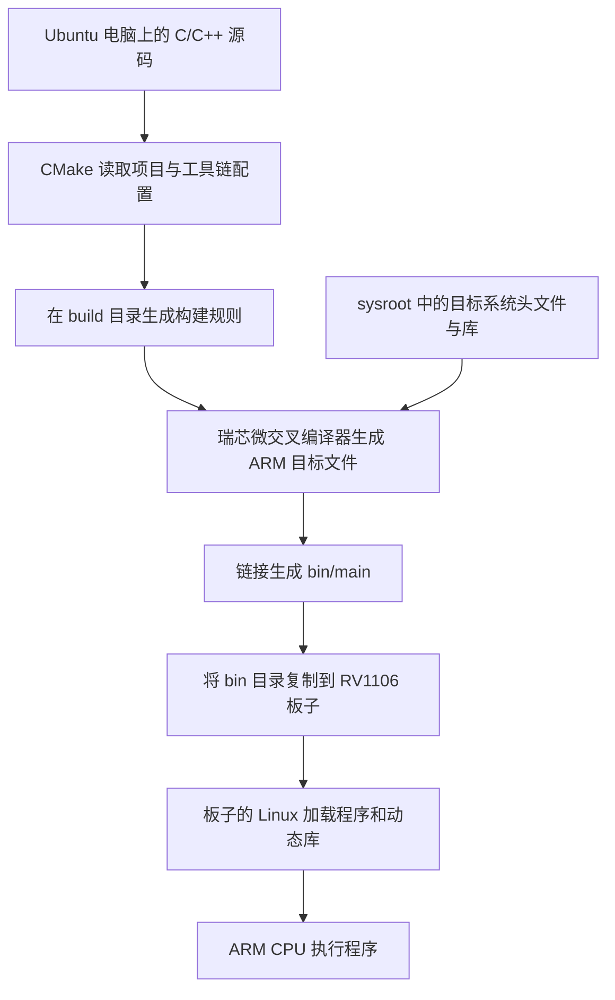

# Echo-Mate：RV1106 交叉编译、部署与原理

本文说明如何在 Ubuntu 电脑上使用瑞芯微（Rockchip）工具链，将 `Demo/DeskBot_demo` 编译为 RV1106 板子可以运行的 Linux 应用，以及这一过程的工作原理。

文中的项目路径为 `/home/mango/ai/Echo-Mate`。如果项目移动到了其他目录，需要同时修改命令中的路径和工具链文件中的 `TOOLCHAIN_ROOT`。

## 1. 交叉编译是什么

**交叉编译就是：在一种架构的电脑上运行编译器，生成另一种架构的设备能够执行的程序。**

本项目中，编译工作在 Ubuntu 电脑上完成，生成的程序在 RV1106 的 ARM Cortex-A7 处理器上运行。



交叉编译器本身是电脑能够运行的程序，但它输出的是 ARM 机器码。因此，编译过程中不需要让电脑模拟一块 ARM 板子。

## 2. 各个组件负责什么

| 组件或选项 | 作用 |
| --- | --- |
| `CMakeLists.txt` | 描述需要编译的源码、依赖库、目标和资源复制规则 |
| CMake | 根据项目配置生成构建规则；它本身不负责将 C/C++ 翻译成机器码 |
| `arm-rv1106-toolchain.cmake` | 告诉 CMake 使用哪个交叉编译器、哪个 sysroot，以及如何查找依赖 |
| `arm-rockchip830-linux-uclibcgnueabihf-gcc/g++` | 在电脑上运行，编译 C/C++ 并生成面向目标 ARM 系统的代码 |
| `sysroot` | 目标系统的开发文件目录，提供头文件和库，供编译、链接时使用 |
| `PKG_CONFIG_*` | 控制 pkg-config 查询目标系统依赖的位置，避免误用电脑上的库 |
| `TARGET_ARM=ON` | 启用项目中的 ARM 功能和依赖分支，例如 ARM 版 Snowboy、RKNN 摄像头模块 |
| `LV_USE_SIMULATOR=0` | 使用板子的显示、触摸接口；此项目对应 framebuffer 和 evdev |
| `build/` | 保存 CMake 缓存、构建规则、目标文件等构建过程文件 |
| `bin/` | 此项目指定的最终程序和运行资源输出目录 |

`CMAKE_TOOLCHAIN_FILE` 与 `TARGET_ARM` 的职责不同：前者选择编译环境，后者选择项目功能分支。本项目交叉编译时需要同时设置。

### 2.1 编译和链接

源码通常经过以下过程：

```text
C/C++ 源码 → 预处理 → 编译 → 汇编 → .o 目标文件 → 链接 → main 可执行文件
```

链接阶段会把各模块和依赖库组合起来。静态库 `.a` 中需要的代码通常会被链接进程序；动态库 `.so` 则需要在板子运行程序时能够被找到，其自身依赖的动态库也必须齐全。

### 2.2 为什么需要 sysroot

程序会调用系统接口，并使用音频、网络、JSON 等库。交叉编译时需要使用与目标 ARM 系统兼容的头文件和库。

sysroot 可以理解为电脑上准备的一份目标系统开发环境，但它不一定是一份完整、可以直接启动的根文件系统。电脑上的 x86 库不能直接与 ARM 目标文件链接。

## 3. 编译前确认

本说明中的构建目录是 **`Demo/DeskBot_demo/build`**。仓库根目录没有用于构建整个桌面机器人项目的 `CMakeLists.txt`，因此需要明确指定 `Demo/DeskBot_demo` 为源码目录。

检查 [conf/dev_conf.h](Demo/DeskBot_demo/conf/dev_conf.h)，确认板端配置为：

```c
#define LV_USE_SIMULATOR 0
```

使用现有工具链文件 [arm-rv1106-toolchain.cmake](Demo/DeskBot_demo/arm-rv1106-toolchain.cmake)。它已经配置了：

- 目标系统：Linux。
- 目标处理器架构：ARM。
- 瑞芯微 GCC/G++ 交叉编译器。
- SDK 工具链中的 sysroot。
- 在目标环境中查找头文件、库和软件包，在电脑上查找构建工具。

命令假设电脑已安装 CMake、Make、pkg-config 等构建工具，项目源码和所需 ARM 依赖已经准备好。

## 4. 在 build 目录编译

### 4.1 首次构建或切换编译架构

在 **Ubuntu 电脑终端**执行下面整段命令。命令会备份已有 `build`，然后重新配置，避免沿用之前的 x86 编译缓存。

```bash
(
set -e

cd /home/mango/ai/Echo-Mate/Demo/DeskBot_demo

if [ -d build ]; then
    mv build "build.backup.$(date +%Y%m%d-%H%M%S)"
fi

RV_TOOLCHAIN=/home/mango/ai/Echo-Mate/SDK/rv1106-sdk/tools/linux/toolchain/arm-rockchip830-linux-uclibcgnueabihf
RV_SYSROOT="$RV_TOOLCHAIN/arm-rockchip830-linux-uclibcgnueabihf/sysroot"

export PATH="$RV_TOOLCHAIN/bin:$PATH"
export PKG_CONFIG_SYSROOT_DIR="$RV_SYSROOT"
export PKG_CONFIG_LIBDIR="$RV_SYSROOT/usr/lib/pkgconfig:$RV_SYSROOT/usr/share/pkgconfig"
export PKG_CONFIG_PATH="$PKG_CONFIG_LIBDIR"

cmake -S . -B build \
    -DTARGET_ARM=ON \
    -DCMAKE_TOOLCHAIN_FILE="$PWD/arm-rv1106-toolchain.cmake" \
    -DCMAKE_BUILD_TYPE=Release

cmake --build build --target main -j4

file bin/main
)
```

参数说明：

| 参数 | 含义 |
| --- | --- |
| `-S .` | 以当前的 `Demo/DeskBot_demo` 作为源码目录 |
| `-B build` | 将构建文件放到 `build` 目录，不要求先进入该目录 |
| `-DTARGET_ARM=ON` | 启用项目的 ARM 构建分支 |
| `-DCMAKE_TOOLCHAIN_FILE=...` | 指定瑞芯微交叉编译工具链配置 |
| `-DCMAKE_BUILD_TYPE=Release` | 请求使用 Release 构建配置 |
| `--target main` | 构建桌面机器人主程序及其依赖 |
| `-j4` | 最多使用 4 个并行构建任务 |

外层括号让环境变量只作用于这次操作；`set -e` 使某一步失败时停止执行后续步骤。若编译失败，保留第一处错误及其上下文进行排查。

### 4.2 后续增量编译

如果仍使用相同的工具链，仅修改了源码，无需每次备份并重建 `build`。在电脑上执行：

```bash
(
set -e
cd /home/mango/ai/Echo-Mate/Demo/DeskBot_demo

RV_TOOLCHAIN=/home/mango/ai/Echo-Mate/SDK/rv1106-sdk/tools/linux/toolchain/arm-rockchip830-linux-uclibcgnueabihf
RV_SYSROOT="$RV_TOOLCHAIN/arm-rockchip830-linux-uclibcgnueabihf/sysroot"
export PATH="$RV_TOOLCHAIN/bin:$PATH"
export PKG_CONFIG_SYSROOT_DIR="$RV_SYSROOT"
export PKG_CONFIG_LIBDIR="$RV_SYSROOT/usr/lib/pkgconfig:$RV_SYSROOT/usr/share/pkgconfig"
export PKG_CONFIG_PATH="$PKG_CONFIG_LIBDIR"

cmake --build build --target main -j4
file bin/main
)
```

构建系统会根据文件变化更新相关目标。切换 x86/ARM 架构或更换工具链时，应重新使用干净的构建目录。

### 4.3 确认产物架构

最终程序位于：

```text
Demo/DeskBot_demo/bin/main
```

执行 `file bin/main`，应看到类似：

```text
ELF 32-bit LSB executable, ARM, EABI5 ..., dynamically linked,
interpreter /lib/ld-uClibc.so.0, ...
```

其中 `ARM` 表示机器架构，`ELF 32-bit` 表示 32 位可执行文件；这里的解释器路径表示运行时需要的动态加载器。输出中的其他字段可能随构建选项变化。

整理本文时（2026-10-15），已检查当前 `bin/main`：它确实是上述 ARM 32 位 ELF 文件，并使用 `/lib/ld-uClibc.so.0`。这证明产物架构符合预期，板端功能仍需实际运行验证。

## 5. 复制到板子并运行

### 5.1 复制整个 bin 目录

程序会读取模型、音频和配置文件，因此需要复制整个 `bin`，保留其目录结构，包括 `lib/`、`model/`、`third_party/` 等。

如果板子已联网并开启 SSH，在 **电脑终端**执行，先将示例 IP 替换为实际地址：

```bash
BOARD_IP="192.168.1.100"

ssh "root@$BOARD_IP" 'mkdir -p /root/echo-mate'
scp -r /home/mango/ai/Echo-Mate/Demo/DeskBot_demo/bin \
    "root@$BOARD_IP:/root/echo-mate/"
```

以上命令假设板子允许使用 root 登录；使用其他账号时，应同时调整账号和部署目录。也可以通过 U 盘复制。

### 5.2 启动程序

在 **板子终端**执行：

```bash
cd /root/echo-mate/bin
chmod +x main
export LD_LIBRARY_PATH="$PWD/lib${LD_LIBRARY_PATH:+:$LD_LIBRARY_PATH}"
./main
```

先进入 `bin` 很重要，因为项目包含相对于当前工作目录读取的资源。`LD_LIBRARY_PATH` 让动态加载器能够在随程序部署的 `lib` 目录中查找动态库。

根据实际环境修改 `system_para.conf` 中的服务地址、API 配置等。AI 聊天还需要启动配套服务端，并保证板子能访问它，详见 [DeskBot README](Demo/DeskBot_demo/README.md) 和 [AIChat 服务端说明](Demo/AIChat_demo/Server/README.md)。

项目会在主程序构建完成后从 `utils/system_para.conf` 复制配置到 `bin/system_para.conf`。需要长期保留的配置应注意同步，避免之后重新构建或部署时被覆盖。

## 6. 为什么不是所有 ARM 板子都能直接运行

CPU 架构相同只是条件之一，还需要匹配以下环境：

| 条件 | 本项目的要求或检查重点 |
| --- | --- |
| 指令集和位数 | 工具链面向目标 ARM 系统，当前产物为 32 位 ARM 程序 |
| ABI 与运行库 | 使用 hard-float 工具链和 uClibc 环境，需要匹配的调用约定、加载器与运行库 |
| 动态库 | 板子需要能够找到程序及其依赖库所需的 `.so` 文件 |
| 显示和触摸 | 当前板端配置使用 framebuffer、evdev；源码默认设备为 `/dev/fb0`、`/dev/input/event0` |
| 摄像头与 NPU | 项目 ARM 分支包含 RV1106 相关 RKNN/RGA 依赖，需要匹配的硬件、驱动和模型 |
| 音频与网络 | 设备、驱动、音频配置以及服务端连通性需要正常 |

因此，这套程序适用于匹配的 RV1106 Linux 板子及固件。迁移到其他 ARM 板子时，应重新核对工具链、系统库和硬件接口。

这里编译的是 Linux 应用程序。若板子已有兼容的系统和驱动，复制应用即可部署；该过程本身不要求重新编译或烧录整个系统。

## 7. 常见问题排查

| 现象 | 检查方法 |
| --- | --- |
| 编译后仍显示 `x86-64` | 检查是否使用了旧构建缓存、源码目录是否正确、是否指定了交叉工具链 |
| `Exec format error` | 检查执行文件是否适用于当前机器，例如是否把 x86 程序放到 ARM 板子，或在电脑上直接执行 ARM 程序 |
| 文件存在，但执行时提示 `not found` / `No such file or directory` | 对于该 ELF 程序，检查它要求的动态加载器是否在板子上存在，例如 `/lib/ld-uClibc.so.0` |
| 提示找不到某个 `.so` | 检查程序及库的动态依赖、板端库文件和搜索路径，补充与目标系统兼容的库 |
| `Permission denied` | 检查执行权限和文件系统挂载选项；必要时执行 `chmod +x main` |
| 程序启动但没有画面或触摸 | 检查 `LV_USE_SIMULATOR`、显示和输入设备节点、驱动及权限 |
| 找不到模型、音频或配置 | 确认复制了完整 `bin`，并从该目录启动程序 |
| 界面运行但无法聊天 | 检查服务端是否启动、配置是否正确、网络是否可达 |

可在电脑上查看 ARM 程序的动态库依赖和加载器，无需执行它：

```bash
cd /home/mango/ai/Echo-Mate/Demo/DeskBot_demo
RV_TOOLCHAIN=/home/mango/ai/Echo-Mate/SDK/rv1106-sdk/tools/linux/toolchain/arm-rockchip830-linux-uclibcgnueabihf

"$RV_TOOLCHAIN/bin/arm-rockchip830-linux-uclibcgnueabihf-readelf" -d bin/main
"$RV_TOOLCHAIN/bin/arm-rockchip830-linux-uclibcgnueabihf-readelf" -l bin/main
```

第一条输出中的 `NEEDED` 项列出直接依赖的动态库；第二条输出中的 `Requesting program interpreter` 显示程序要求的动态加载器。缺少库时，还需检查这些库自身的依赖。
