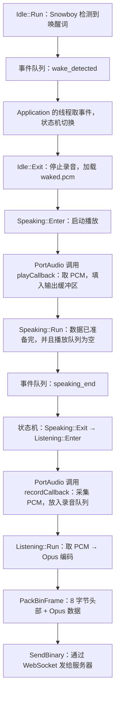

# Echo-Mate：从 Snowboy 唤醒到提示音播放、录音、Opus 编码和发送

整理日期：2026-10-02。

逐行注释补充日期：2026-10-03。本文 29 个 C++ 代码块中的每一行代码都附有中文注释，多行参数和结束括号也逐行说明。

本文根据当前项目代码和本次学习问答整理，覆盖 **Snowboy 检测到唤醒词 → 本地提示音播放 → 进入 Listening → 录音 → Opus 编码 → BinProtocol 打包 → WebSocket 发送**。

前面的“麦克风 PCM 如何进入 Snowboy”可接着阅读：[PCM 到 Snowboy 检测流程与问答](2026-10-02_PCM到Snowboy检测流程与问答.md)。

代码是用于阅读的源码节选，部分日志、错误处理和外围代码用注释省略。本文保留当前实现的关键行为，并在后面注明已确认的代码问题；没有修改业务源码。文件行号以整理时为准，后续添加代码或注释可能使行号变化。

## 1. 先看完整流程与文件



这张图表示正常唤醒流程的因果关系。不同线程各自执行，不是同一个线程从第一行一直调用到最后一行。

| 阅读顺序 | 文件及入口 | 负责什么 |
| --- | --- | --- |
| 1 | [Idle.cc：Run()](/home/mango/ai/Echo-Mate/Demo/AIChat_demo/Client/Application/UserStates/Idle.cc:23) | 从录音队列取 PCM，调用 Snowboy，发出唤醒事件 |
| 2 | [Application.cc：Run()](/home/mango/ai/Echo-Mate/Demo/AIChat_demo/Client/Application/Application.cc:32) | 创建状态切换线程，循环取出事件 |
| 3 | [StateConfig.cc](/home/mango/ai/Echo-Mate/Demo/AIChat_demo/Client/Application/StateConfig.cc:25) | 注册进入/退出回调和状态切换规则 |
| 4 | [StateMachine.cc：HandleEvent()](/home/mango/ai/Echo-Mate/Demo/AIChat_demo/Client/StateMachine/StateMachine.cc:37) | 查找规则，再通过 ChangeState 调用回调 |
| 5 | [Idle.cc：Exit()](/home/mango/ai/Echo-Mate/Demo/AIChat_demo/Client/Application/UserStates/Idle.cc:48) | 停止待机录音，把本地提示音放入播放队列 |
| 6 | [Speaking.cc：Enter / Run / Exit](/home/mango/ai/Echo-Mate/Demo/AIChat_demo/Client/Application/UserStates/Speaking.cc:9) | 启动播放、监控结束、停止并清理 |
| 7 | [AudioProcess.cc：startPlaying()](/home/mango/ai/Echo-Mate/Demo/AIChat_demo/Client/Audio/AudioProcess.cc:202) | 开启播放流，注册 playCallback |
| 8 | [Listening.cc：Enter / Run / Exit](/home/mango/ai/Echo-Mate/Demo/AIChat_demo/Client/Application/UserStates/Listening.cc:9) | 启动录音，取音频、编码、打包、发送 |
| 9 | [AudioProcess.cc：startRecording()](/home/mango/ai/Echo-Mate/Demo/AIChat_demo/Client/Audio/AudioProcess.cc:63) | 开启录音流，注册 recordCallback |
| 10 | [WebsocketClient.h：BinProtocol](/home/mango/ai/Echo-Mate/Demo/AIChat_demo/Client/WebSocket/WebsocketClient.h:14) | 定义二进制音频包的格式 |
| 11 | [AudioProcess.cc：encode()](/home/mango/ai/Echo-Mate/Demo/AIChat_demo/Client/Audio/AudioProcess.cc:420) | 把 PCM 编码为 Opus |
| 12 | [AudioProcess.cc：PackBinFrame()](/home/mango/ai/Echo-Mate/Demo/AIChat_demo/Client/Audio/AudioProcess.cc:466) | 分配数据包内存，填写头部，复制音频 |
| 13 | [WebsocketClient.cc：SendBinary()](/home/mango/ai/Echo-Mate/Demo/AIChat_demo/Client/WebSocket/WebsocketClient.cc:111) | 将连续的二进制数据交给 WebSocket 发送 |

## 2. Snowboy 检测成功：先放入事件

所在文件：[Idle.cc](/home/mango/ai/Echo-Mate/Demo/AIChat_demo/Client/Application/UserStates/Idle.cc:31)。

```cpp
while (state_running_.load() == true) { // 原子读取运行标志；为 true 时持续检测唤醒词。
    if (app->audio_processor_.recordedQueueIsEmpty() == false) { // 确认录音队列非空，才尝试取出一块 PCM 音频。
        app->audio_processor_.getRecordedAudio(data); // 取出队首录音块，写入 data 这个采样点容器。
        int result = SnowboyDetectRunDetection( // 调用 Snowboy 检测这一块音频，返回检测结果。
            detector, data.data(), data.size(), false); // 依次传入检测器、采样点首地址、采样点数量和 is_end=false（不标记音频结束）。

        if (result > 0) { // 返回正数表示检测到了某个唤醒词。
            app->eventQueue_.Enqueue( // 向应用事件队列提交事件；此处开始书写函数参数。
                static_cast<int>(AppEvent::wake_detected)); // 把强类型枚举 wake_detected 转为 int，作为入队的事件值。
            break; // 跳出 while 检测循环，结束本轮唤醒检测。
        } // 结束“检测到唤醒词”的判断。
    } // 结束“录音队列非空”的判断。
} // 结束持续检测的 while 循环。
SnowboyDetectDestructor(detector); // 释放这一轮使用的 Snowboy 检测器。
```

检测成功后的动作：

1. 把 `wake_detected` 的事件编号放进 `eventQueue_`。
2. `break` 跳出检测循环。
3. 释放检测器，`IdleState::Run()` 返回，检测线程结束。

与此同时，另一个线程会取出事件并处理。入队与随后退出检测循环之间，不要假定两个线程存在固定的逐行执行顺序；后面 `Idle::Exit()` 的 `join()` 会等待检测线程结束。

### 2.1 static_cast 的含义

```cpp
static_cast<int>(AppEvent::wake_detected) // 使用 static_cast<目标类型>(值)，将 wake_detected 枚举值显式转换为 int。
// 通用语法：static_cast<目标类型>(要转换的值)
```

`AppEvent` 是 [AppEvents.h](/home/mango/ai/Echo-Mate/Demo/AIChat_demo/Client/Events/AppEvents.h:4) 定义的 `enum class`。它的成员不能隐式转换成 `int`，而事件队列是 `EventQueue<int>`，因此这里显式转换。

`AppEvent::wake_detected` 中的 `::` 表示取 `AppEvent` 作用域中的成员。当前枚举未手动指定数值，成员从 0 依次递增，`wake_detected` 目前对应 4；以后插入成员可能改变编号，阅读代码应使用枚举名字。

### 2.2 事件队列只存事件编号

所在文件：[EventQueue.h](/home/mango/ai/Echo-Mate/Demo/AIChat_demo/Client/Events/EventQueue.h:12)。

```cpp
void Enqueue(const T& event) { // 定义入队函数；const T& 以只读引用接收事件，避免参数传递时复制。
    std::lock_guard<std::mutex> lock(mutex_); // 锁住队列的互斥锁；lock 离开作用域时会自动解锁。
    queue_.push(event); // 把事件复制到队尾，等待消费线程取出。
    cond_var_.notify_one(); // 唤醒一个等待此条件变量的线程，让它重新检查队列。
} // 函数结束，局部 lock 析构并释放互斥锁。
```

这个队列存的是 `wake_detected`、`speaking_end` 等事件编号，音频数据保存在另外的录音队列和播放队列中。

## 3. 谁处理事件？怎么决定下一状态？

### 3.1 Application 的线程循环处理事件

所在文件：[Application.cc](/home/mango/ai/Echo-Mate/Demo/AIChat_demo/Client/Application/Application.cc:35)。

```cpp
state_trans_thread_ = std::thread([this]() { // 创建状态事件处理线程；lambda 捕获 this，以访问当前 Application 对象。
    StateConfig::Configure(client_state_, this); // 为状态机注册状态回调及事件对应的转换规则。
    while (threads_stop_flag_.load() == false) { // 原子读取停止标志；未要求停止时持续处理事件。
        std::this_thread::sleep_for(std::chrono::milliseconds(100)); // 每轮先休眠 100 毫秒，再检查事件队列。
        if (eventQueue_.IsEmpty() == false) { // 发现事件队列非空后，尝试取出事件。
            if (auto event_opt = eventQueue_.Dequeue(); event_opt) { // C++17 的 if 初始化语法：取出 optional 事件，再判断它是否有值。
                client_state_.HandleEvent(event_opt.value()); // 取出 optional 中的整数事件值，交给状态机处理。
            } // 结束“确实取到了事件”的判断。
        } // 结束“事件队列非空”的判断。
    } // 结束线程的事件处理循环。
}); // 结束 lambda，并将新线程保存到 state_trans_thread_。
```

持续运行的是这个线程中的循环：约每 100ms 检查一次事件队列。`Dequeue()` 取出事件，`event_opt.value()` 取得事件编号，再交给 `HandleEvent()`。

`ChangeState()` 每次调用只执行一次切换，完成后返回；它自己没有持续运行的循环。

### 3.2 规则是预先注册的

所在文件：[StateConfig.cc](/home/mango/ai/Echo-Mate/Demo/AIChat_demo/Client/Application/StateConfig.cc:43)。

```cpp
state_machine.RegisterTransition( // 注册一条状态转换规则；三个参数依次是原状态、事件、目标状态。
    static_cast<int>(AppState::idle), // 第一个参数：原状态为 idle，显式转换成 int。
    static_cast<int>(AppEvent::wake_detected), // 第二个参数：收到 wake_detected 唤醒事件。
    static_cast<int>(AppState::speaking)); // 第三个参数：目标状态为 speaking；至此完成规则注册。

state_machine.RegisterTransition( // 注册 Speaking 播放完毕后继续听用户说话的规则。
    static_cast<int>(AppState::speaking), // 第一个参数：原状态为 speaking。
    static_cast<int>(AppEvent::speaking_end), // 第二个参数：收到 speaking_end 播放结束事件。
    static_cast<int>(AppState::listening)); // 第三个参数：目标状态为 listening。

state_machine.RegisterTransition( // 注册整个对话结束后返回待机的规则。
    static_cast<int>(AppState::speaking), // 第一个参数：原状态为 speaking。
    static_cast<int>(AppEvent::dialogue_end), // 第二个参数：收到 dialogue_end 对话结束事件。
    static_cast<int>(AppState::idle)); // 第三个参数：目标状态为 idle。
```

三个参数依次表示：**当前状态、收到的事件、目标状态**。

| 当前状态 | 事件 | 目标状态 |
| --- | --- | --- |
| Idle | wake_detected | Speaking |
| Speaking | speaking_end | Listening |
| Speaking | dialogue_end | Idle |

普通规则的存储方式是 `transitions_[from][event] = to;`。因此下一状态由“当前状态 + 事件”共同决定；事件编号本身没有携带目标状态。

### 3.3 两张表：回调表与切换规则表

所在文件：[StateMachine.h](/home/mango/ai/Echo-Mate/Demo/AIChat_demo/Client/StateMachine/StateMachine.h:8)。

```cpp
using EnterFunc_t = std::function<void()>; // 为 std::function<void()> 起别名：进入状态的回调，无参数、无返回值。
using ExitFunc_t = std::function<void()>; // 为同一种函数包装类型起别名，表示退出状态的回调。

std::unordered_map<int, std::pair<EnterFunc_t, ExitFunc_t>> stateActions_; // 哈希表以 int 状态编号为键；值是 pair，first 存 Enter，second 存 Exit。
std::unordered_map<int, std::unordered_map<int, int>> transitions_; // 外层哈希表按状态查找；内层哈希表把事件编号映射到目标状态编号。
```

- `stateActions_`：状态编号 → 一对回调，第一项是进入回调，第二项是退出回调。
- `transitions_`：当前状态编号 → 事件编号 → 目标状态编号。

`std::unordered_map<键类型, 值类型>` 是哈希表；`std::pair<A, B>` 把两个成员放在一起。`EnterFunc_t` 和 `ExitFunc_t` 是类型别名，实际都是能保存无参数、无返回值可调用对象的 `std::function<void()>`。

状态注册节选，所在文件：[StateConfig.cc](/home/mango/ai/Echo-Mate/Demo/AIChat_demo/Client/Application/StateConfig.cc:29)：

```cpp
state_machine.RegisterState( // 向状态机注册一个状态及其进入、退出回调。
    static_cast<int>(AppState::listening), // 第一个参数：Listening 状态的整数编号。
    [app]() { ListeningState::Enter(app); }, // 第二个参数：捕获 app 的无参 lambda；执行时调用 ListeningState::Enter(app)。
    [app]() { ListeningState::Exit(app); }); // 第三个参数：捕获 app 的无参 lambda；执行时调用 ListeningState::Exit(app)。
```

`[app]() { ... }` 是 lambda：捕获 `app`，被调用时执行函数体。虽然 `ListeningState::Enter()` 需要参数，但这层 lambda 本身不接收参数，所以能存进 `std::function<void()>`。

注册函数把它们保存为：

```cpp
stateActions_[state] = std::make_pair(on_enter, on_exit); // 按状态编号保存回调对；make_pair 把进入和退出回调分别放进 first、second。
```

`.first` 是进入回调，`.second` 是退出回调；加上 `()` 就调用该回调。

### 3.4 查规则，再执行 ChangeState

所在文件：[StateMachine.cc](/home/mango/ai/Echo-Mate/Demo/AIChat_demo/Client/StateMachine/StateMachine.cc:37)。

```cpp
bool StateMachine::HandleEvent(int event) { // 定义事件处理函数；参数是事件编号，bool 返回值表示是否找到并执行转换。
    auto& possibleTransitions = transitions_[currentState_]; // 通过当前状态取得它的事件转换表；auto& 表示引用，避免复制整张表。
    if (possibleTransitions.find(event) == possibleTransitions.end()) { // 查找事件；find 返回 end 表示当前状态没有此事件对应的规则。
        // 省略日志：当前状态没有对应规则。
        return false; // 没有转换规则，返回 false，不调用 ChangeState。
    } // 结束“没有转换规则”的判断。
    int nextState = possibleTransitions[event]; // 根据事件编号，从当前状态的转换表中取出目标状态编号。
    ChangeState(nextState); // 执行状态切换，依次退出旧状态并进入目标状态。
    return true; // 转换已执行，返回 true。
} // 结束 HandleEvent 函数。

void StateMachine::ChangeState(int newState) { // 定义状态切换函数；newState 是本次要进入的状态编号。
    if (stateActions_.find(currentState_) != stateActions_.end()) { // 查找旧状态的回调；结果不等于 end 表示已注册回调。
        stateActions_[currentState_].second(); // 调用 pair 的 second，即旧状态的 Exit 回调。
    } // 结束旧状态退出回调的查找与调用。
    currentState_ = newState; // 把状态机记录的当前状态改为 newState。
    if (stateActions_.find(currentState_) != stateActions_.end()) { // 按更新后的当前状态查找回调，确认新状态已注册。
        stateActions_[currentState_].first(); // 调用 pair 的 first，即新状态的 Enter 回调。
    } // 结束新状态进入回调的查找与调用。
} // 结束 ChangeState；它被事件处理调用，并不是自己持续运行的循环。
```

`find(key)` 返回查找结果的位置。没找到会返回 `end()`，因此 `find(...) != end()` 表示找到了。`end()` 是末尾之后的位置标记，不是最后一个元素。

正常唤醒时，这段代码实际触发：

```text
IdleState::Exit(app)
currentState_ 改成 Speaking
SpeakingState::Enter(app)
```

提示音播放结束后则触发：

```text
SpeakingState::Exit(app)
currentState_ 改成 Listening
ListeningState::Enter(app)
```

## 4. Idle 退出：准备本地提示音

所在文件：[Idle.cc](/home/mango/ai/Echo-Mate/Demo/AIChat_demo/Client/Application/UserStates/Idle.cc:48)。

```cpp
void IdleState::Exit(Application* app) { // 定义退出 Idle 状态时执行的函数，app 指向当前应用对象。
    app->audio_processor_.stopRecording(); // 停止 Idle 使用的麦克风录音流。
    state_running_.store(false); // 原子写入 false，通知 Idle 工作线程结束循环。
    state_running_thread_.join(); // 等待 Idle 工作线程执行完毕，之后再继续退出流程。

    std::string waked_sound_path = "third_party/audio/waked.pcm"; // 指定本地唤醒提示音文件的相对路径。
    auto audioQueue = // 声明临时音频队列，接收下一行读取和分块的结果。
        app->audio_processor_.loadAudioFromFile(waked_sound_path, 40); // 读取提示音 PCM 文件，以每块 40 毫秒切分为队列。
    while (!audioQueue.empty()) { // 临时队列还有音频块时，逐块转入播放队列。
        const auto& frame = audioQueue.front(); // 以只读引用访问队首音频块，避免在此处复制整块数据。
        app->audio_processor_.addFrameToPlaybackQueue(frame); // 把当前音频块加入 AudioProcess 的播放队列。
        audioQueue.pop(); // 移除已经加入播放队列的临时队首块。
    } // 结束音频块转入播放队列的循环。
    app->set_tts_completed(true); // 标记本次待播放音频已全部准备好；这里并不表示扬声器已播完。
    std::this_thread::sleep_for(std::chrono::milliseconds(200)); // 当前线程休眠 200 毫秒，再完成 Idle 的退出过程。
    // 省略日志。
} // 结束 IdleState::Exit；状态机接下来可进入 Speaking。
```

这里先停止待机录音并等待检测线程结束，然后读取本地 `waked.pcm`，逐块放入播放队列。`waked_sound_path` 是相对于程序运行目录的路径。

`audioQueue` 是加载文件得到的临时队列，`playbackQueue` 是实际播放使用的队列。临时队列逐块转入播放队列后被取空。

### 4.1 为什么切成 40ms？

客户端配置节选，所在文件：[main.cc](/home/mango/ai/Echo-Mate/Demo/AIChat_demo/Client/main.cc:28)：

```cpp
int sample_rate = 16000; // 采样率为每秒 16000 个音频采样帧。
int channels = 1; // 声道数为 1，即单声道。
int frame_duration = 40; // 每块音频时长为 40 毫秒；单声道 16 kHz 时每块包含 640 个采样点。
```

单声道、16 位 PCM 下：

```text
每块采样点数 = 16000 × 40 / 1000 = 640
每块 PCM 字节数 = 640 × 2 = 1280
1 秒音频 = 25 块 40ms 音频
```

文件加载函数按 `sample_rate / 1000 * frame_duration_ms` 计算每块长度；播放流也按相同配置设置每次回调的缓冲区大小。因此正常情况下，每块音频与一次播放回调需要的数据量对应。

40ms 是项目的处理长度，分块后音频仍连续播放，没有要求每块之间停顿。调整这个值需要同时考虑采集、播放和编码配置。

[loadAudioFromFile()](/home/mango/ai/Echo-Mate/Demo/AIChat_demo/Client/Audio/AudioProcess.cc:353) 的当前实现先把整个文件读入内存，再切块。因此分块主要用于组织队列和匹配处理长度，并没有避免一次性读取整个文件。

## 5. Speaking：启动播放、检查结束、退出清理

### 5.1 Enter 启动播放和监控线程

所在文件：[Speaking.cc](/home/mango/ai/Echo-Mate/Demo/AIChat_demo/Client/Application/UserStates/Speaking.cc:9)。

```cpp
void SpeakingState::Enter(Application* app) { // 定义进入 Speaking 状态时执行的函数。
    std::string json_message = // 声明要发送给服务器的状态通知字符串，下一行提供其内容。
        R"({"type": "state", "state": "speaking"})"; // 原始字符串字面量，构造 type=state、state=speaking 的 JSON 文本。
    app->ws_client_.SendText(json_message); // 通过 WebSocket 发送 Speaking 状态通知。
    app->audio_processor_.startPlaying(); // 打开并启动音频播放流，PortAudio 随后调用播放回调提供音频。
    state_running_.store(true); // 原子写入 true，允许 Speaking 工作线程运行。
    state_running_thread_ = std::thread([app]() { Run(app); }); // 创建捕获 app 的工作线程，在新线程中执行 SpeakingState::Run(app)。
    // 省略日志。
} // 结束 SpeakingState::Enter；播放流和工作线程已经启动。
```

`Enter` 是项目自己定义的函数名，表示进入状态时要执行的操作。状态机通过回调调用它；它通知服务器、启动播放，再创建线程执行 `Run()` 监控播放结束。

### 5.2 谁真正提供播放数据？

所在文件：[AudioProcess.cc：startPlaying()](/home/mango/ai/Echo-Mate/Demo/AIChat_demo/Client/Audio/AudioProcess.cc:202)。

```cpp
// 节选：前面已初始化 PortAudio，并配置输出设备。
err = Pa_OpenStream( // 打开 PortAudio 播放流；该调用配置流，后面的 Pa_StartStream 才启动它。
    &playbackStream, // 传入播放流指针的地址，让 PortAudio 写回创建的 PaStream*。
    nullptr, // 输入参数为空，表示这个流不采集麦克风音频。
    &outputParameters, // 传入输出设备、声道数、采样格式等播放参数。
    sample_rate, // 指定流的采样率，单位是每秒音频采样帧数。
    sample_rate / 1000 * frame_duration_ms, // 指定每次回调的每声道采样点数；16 kHz、40 毫秒时为 640。
    paClipOff, // 关闭 PortAudio 默认的越界样本削波处理。
    playCallback, // 注册 playCallback；PortAudio 需要播放数据时会调用它。
    this); // 把当前 AudioProcess 对象指针作为 userData 传给回调。
// 省略打开失败检查。
err = Pa_StartStream(playbackStream); // 启动已打开的播放流，并将返回的错误码保存到 err。
```

流启动后，由 PortAudio 的音频回调线程持续调用 `playCallback()`，索取音频数据。

回调节选，所在文件：[AudioProcess.cc：playCallback()](/home/mango/ai/Echo-Mate/Demo/AIChat_demo/Client/Audio/AudioProcess.cc:289)：

```cpp
AudioProcess* audioProcess = static_cast<AudioProcess*>(userData); // 把 userData 的 void* 转回 AudioProcess*，访问创建流时传入的对象。
int16_t* output = static_cast<int16_t*>(outputBuffer); // 把输出缓冲区指针转成 int16_t*，按 16 位 PCM 采样点写入数据。
std::lock_guard<std::mutex> lock(audioProcess->playbackMutex); // 锁住播放队列的互斥锁，避免并发修改队列。

if (audioProcess->playbackQueue.empty()) { // 判断播放队列是否已经没有音频块。
    std::fill(output, output + framesPerBuffer * audioProcess->channels, 0); // 将整个输出缓冲区填零，提供静音；末尾地址不参与填充。
    return paContinue; // 返回 paContinue，让音频流继续运行并等待后续回调。
} // 结束“队列为空”的判断。

std::vector<int16_t>& currentFrame = audioProcess->playbackQueue.front(); // 以引用取得队首音频块，后续可直接使用或修改它。
size_t samplesToCopy = std::min( // 计算本次能复制的采样点数，取输出容量和当前块长度的较小值。
    static_cast<size_t>(framesPerBuffer * audioProcess->channels), // 第一个候选值：输出缓冲区可容纳的采样点总数（每声道帧数乘声道数）。
    currentFrame.size()); // 第二个候选值：当前音频块包含的采样点数。
std::copy(currentFrame.begin(), currentFrame.begin() + samplesToCopy, output); // 把 [begin, begin + samplesToCopy) 的采样点复制到输出缓冲区，右端不包含。
// 省略：音频不足时把剩余输出区域填为静音。

if (samplesToCopy == currentFrame.size()) { // 检查当前块是否已全部复制到输出缓冲区。
    audioProcess->playbackQueue.pop(); // 这一块已用完，从播放队列移除队首块。
} else { // 否则当前块还有尚未复制的采样点，需要保留。
    audioProcess->playbackQueue.front().erase( // 从队首块中删除本次已复制的采样点；下一行开始给出删除区间。
        audioProcess->playbackQueue.front().begin(), // 删除区间的起点：队首块的第一个采样点。
        audioProcess->playbackQueue.front().begin() + samplesToCopy); // 删除区间的终点：已复制部分之后的位置，终点本身不删除。
} // 结束“移除整块或保留剩余采样点”的判断。
```

`std::copy()` 把 PCM 填进输出缓冲区，PortAudio 和音频设备接着播放。队列为空时回调仍填静音并继续运行，播放流还需要由 `stopPlaying()` 停止。

### 5.3 Run 怎么检查播放结束？

所在文件：[Speaking.cc：Run()](/home/mango/ai/Echo-Mate/Demo/AIChat_demo/Client/Application/UserStates/Speaking.cc:21)。

```cpp
while (state_running_.load() == true) { // 原子读取 Speaking 运行标志；为 true 时循环检查播放完成条件。
    std::this_thread::sleep_for(std::chrono::milliseconds(500)); // 每次检查前休眠 500 毫秒，避免持续忙于轮询。
    if (app->get_tts_completed() && // 检查全部待播放音频是否已准备好；&& 要求下一行的条件也成立。
        app->audio_processor_.playbackQueueIsEmpty()) { // 同时检查播放队列是否为空，两项条件成立才进入结束处理。
        std::this_thread::sleep_for(std::chrono::milliseconds(500)); // 再等待 500 毫秒，给已提交到音频设备的尾部音频留出播放时间。
        if (app->get_dialogue_completed() == false) { // 判断整个对话是否尚未结束；false 时表示播完后还要继续听。
            app->eventQueue_.Enqueue( // 向事件队列提交播放结束事件；下一行给出事件编号。
                static_cast<int>(AppEvent::speaking_end)); // 将 speaking_end 转成 int 入队，状态机按已注册规则进入 Listening。
        } else { // 否则整个对话已结束，使用另一种事件通知状态机。
            app->eventQueue_.Enqueue( // 向事件队列提交对话结束事件；下一行给出事件编号。
                static_cast<int>(AppEvent::dialogue_end)); // 将 dialogue_end 转成 int 入队，状态机按已注册规则返回 Idle。
        } // 结束“继续对话还是返回待机”的判断。
        app->set_tts_completed(false); // 清除音频准备完成标志，为后续一轮播放重置条件。
        app->set_dialogue_completed(false); // 清除对话完成标志，为后续对话重置条件。
        break; // 跳出 Speaking 的检查循环，结束本次 Run 的工作。
    } // 结束“音频准备好且播放队列为空”的判断。
} // 结束 Speaking 工作线程的检查循环。
```

两个结束条件都要满足：

- `tts_completed`：音频数据已准备/接收完，后面预计不会继续来音频。
- `playbackQueueIsEmpty()`：播放队列里的音频已经取完。

本地提示音在 `Idle::Exit()` 加载完成后已把 `tts_completed` 设为 `true`，所以主要等待播放队列被取空。服务器音频可能边生成边发送，仅凭队列暂时为空不能判断全部结束。

程序每隔 500ms 检查一次，满足条件后再等待 500ms。它依据软件队列和完成标志判断，并没有精确查询音频设备是否播放完最后一个采样点。

`speaking_end` 表示这次播放结束、继续听用户说话；`dialogue_end` 表示整个对话结束、回到 Idle。正常本地唤醒提示音完成后走 `speaking_end → Listening`。

### 5.4 Exit 有什么用？

所在文件：[Speaking.cc：Exit()](/home/mango/ai/Echo-Mate/Demo/AIChat_demo/Client/Application/UserStates/Speaking.cc:42)。

```cpp
void SpeakingState::Exit(Application* app) { // 定义退出 Speaking 状态时执行的清理函数。
    app->audio_processor_.clearPlaybackAudioQueue(); // 清空播放队列，移除仍然排队的音频块。
    app->audio_processor_.stopPlaying(); // 停止并关闭播放流，结束音频输出。
    state_running_.store(false); // 原子写入 false，通知 Speaking 工作线程停止循环。
    state_running_thread_.join(); // 等待 Speaking 工作线程结束，再继续切换状态。
    // 省略日志。
} // 结束 SpeakingState::Exit；状态机随后调用新状态的 Enter。
```

发出事件负责通知状态机，`Exit()` 负责真正停止播放并清理。队列取空不会自动关闭播放流；`stopPlaying()` 停止并关闭流，`join()` 等待监控线程结束。

运行标志定义为 `std::atomic<bool>`：`store(true)` 写入 true，`store(false)` 写入 false，`load()` 读取当前值。它允许一个线程修改开关，另一个线程安全地读取这个开关，也支持提前离开 Speaking 时通知监控线程退出。

这个开关主要用于线程控制和原子读写安全；每轮的 `sleep_for(500ms)` 才直接减少反复检查带来的 CPU 占用。普通布尔变量的跨线程无同步读写会产生数据竞争。

## 6. 提示音结束后：进入 Listening，重新录音

### 6.1 Listening::Enter 开始采集

所在文件：[Listening.cc](/home/mango/ai/Echo-Mate/Demo/AIChat_demo/Client/Application/UserStates/Listening.cc:9)。

```cpp
void ListeningState::Enter(Application* app) { // 定义进入 Listening 状态时执行的函数。
    std::string json_message = // 声明要发送的状态通知字符串，下一行提供 JSON 内容。
        R"({"type": "state", "state": "listening"})"; // 原始字符串字面量，构造 type=state、state=listening 的状态通知。
    app->ws_client_.SendText(json_message); // 通过 WebSocket 通知服务器当前处于 Listening。
    app->set_first_audio_msg_received(true); // 把 first_audio_msg_received 标志设为 true，供后续音频消息处理使用。
    app->audio_processor_.startRecording(); // 打开并启动麦克风录音流，让录音回调开始采集 PCM。
    std::this_thread::sleep_for(std::chrono::milliseconds(500)); // 等待 500 毫秒；录音流在这段时间内已开始采集。
    app->audio_processor_.clearRecordedAudioQueue(); // 清空刚启动阶段已积累的录音块，之后从新采集的块开始发送。
    state_running_.store(true); // 原子写入 true，允许 Listening 工作线程运行。
    state_running_thread_ = std::thread([app]() { Run(app); }); // 创建捕获 app 的线程，在新线程中执行 ListeningState::Run(app)。
    // 省略日志。
} // 结束 ListeningState::Enter；录音流和编码发送线程已启动。
```

`set_first_audio_msg_received(true)` 是为后面接收服务器的第一块回答音频做准备，和麦克风采集数据不是同一个标志。

`startRecording()` 启动采集后，录音回调就开始向录音队列放 PCM。`Enter()` 等待 500ms 再清空队列，丢弃这期间积累的数据，然后启动发送处理线程。

### 6.2 从哪个文件继续看录音？

从 `Listening.cc` 中的 `startRecording()` 跳到 [AudioProcess.cc](/home/mango/ai/Echo-Mate/Demo/AIChat_demo/Client/Audio/AudioProcess.cc:63)。

```cpp
// startRecording() 节选，省略初始化和错误检查。
inputParameters.device = Pa_GetDefaultInputDevice(); // 使用 PortAudio 返回的默认音频输入设备。
inputParameters.channelCount = channels; // 指定录音声道数；本项目默认是 1，即单声道。
inputParameters.sampleFormat = paInt16; // 指定每个 PCM 采样点使用有符号 16 位整数。

err = Pa_OpenStream( // 打开 PortAudio 录音流；下一组参数描述输入配置和录音回调。
    &recordStream, // 传入录音流指针的地址，让 PortAudio 写回创建的 PaStream*。
    &inputParameters, // 传入刚配置的输入设备、声道数及 PCM 格式。
    nullptr, // 输出参数为空，表示这个流只录音、不播放。
    sample_rate, // 指定采样率；本项目默认每秒 16000 个音频采样帧。
    sample_rate / 1000 * frame_duration_ms, // 指定每次回调的每声道采样点数；16 kHz、40 毫秒时为 640。
    paClipOff, // 关闭 PortAudio 默认的越界样本削波处理。
    recordCallback, // 注册 recordCallback；有输入音频时由 PortAudio 调用。
    this); // 将当前 AudioProcess 对象指针作为回调的 userData。
err = Pa_StartStream(recordStream); // 启动已打开的录音流，并将返回的错误码保存到 err。
```

PortAudio 随后持续调用同文件的 [recordCallback()](/home/mango/ai/Echo-Mate/Demo/AIChat_demo/Client/Audio/AudioProcess.cc:171)：

```cpp
AudioProcess* audioProcess = static_cast<AudioProcess*>(userData); // 把回调的用户数据转回 AudioProcess*，以访问录音队列。
const int16_t* input = static_cast<const int16_t*>(inputBuffer); // 把输入缓冲区转成只读 int16_t*，按 16 位 PCM 采样点读取。

std::vector<int16_t> frame(framesPerBuffer * audioProcess->channels); // 创建一块 PCM 容器，其元素数等于每声道采样点数乘声道数。
std::copy(input, input + framesPerBuffer * audioProcess->channels, // 复制输入采样点；范围从 input 开始，到指定末尾之前结束。
          frame.begin()); // 指定复制目标为 frame 的第一个元素，完成这次 std::copy 调用。
{ // 开始一个局部作用域，限制下面互斥锁的持有时间。
    std::lock_guard<std::mutex> lock(audioProcess->recordedAudioMutex); // 锁住录音队列，保护下面的检查、弹出及入队操作。
    if (audioProcess->recordedAudioQueue.size() >= 750) { // 若队列已有至少 750 块音频，则先移除一块，限制积压数量。
        audioProcess->recordedAudioQueue.pop(); // 移除最旧的队首音频块，给新采集的音频腾出位置。
    } // 结束“队列达到上限”的判断。
    audioProcess->recordedAudioQueue.push(frame); // 将本次采集的 PCM 块复制到录音队列末尾。
} // 结束局部作用域，lock 析构并释放录音队列互斥锁。
audioProcess->recordedAudioCV.notify_one(); // 通知一个等待录音数据的线程，让它重新检查队列。
```

采集数据从 PortAudio 的输入缓冲区复制到项目持有的 `vector<int16_t>`，再放入录音队列。

### 6.3 Listening::Run 取音频并发送

所在文件：[Listening.cc](/home/mango/ai/Echo-Mate/Demo/AIChat_demo/Client/Application/UserStates/Listening.cc:25)。

```cpp
while (state_running_.load() == true) { // 原子读取 Listening 运行标志；为 true 时持续取录音、编码并发送。
    std::vector<int16_t> audio_frame; // 创建 PCM 容器，用于接收本轮取出的录音块。
    if (app->audio_processor_.recordedQueueIsEmpty() == false) { // 确认录音队列非空，才尝试读取音频。
        if (app->audio_processor_.getRecordedAudio(audio_frame)) { // 将一块 PCM 写入 audio_frame；成功时执行后续编码。
            uint8_t opus_data[1536]; // 在当前作用域创建 1536 字节缓冲区，用来接收 Opus 编码结果。
            size_t opus_data_size; // 声明实际编码字节数；encode 成功后会通过引用写入它。
            if (app->audio_processor_.encode( // 调用 Opus 编码函数，并根据 bool 返回值决定是否继续打包。
                    audio_frame, opus_data, opus_data_size)) { // 依次传入 PCM 容器、输出缓冲区首地址、实际输出长度的引用。
                BinProtocol* packed_frame = // 声明二进制包指针，接收下一行打包函数返回的内存地址。
                    app->audio_processor_.PackBinFrame( // 调用打包函数，创建“固定协议头 + Opus 数据”的连续内存。
                        opus_data, opus_data_size, // 前两个参数：Opus 数据首地址和实际字节数。
                        app->get_ws_protocolVersion()); // 第三个参数：当前 WebSocket 音频格式版本。
                if (packed_frame) { // 检查打包返回的指针非空，确认内存分配成功。
                    app->ws_client_.SendBinary( // 调用 WebSocket 二进制发送函数，下一行开始给出发送参数。
                        reinterpret_cast<uint8_t*>(packed_frame), // 把结构体指针解释为字节指针，从包的首字节开始发送。
                        sizeof(BinProtocol) + opus_data_size); // 发送字节数是固定头大小加实际 Opus 长度；不是缓冲区容量。
                } // 结束“打包成功”的判断。
                // 省略原代码的打包失败日志。
            } // 结束“编码成功”的判断。
            // 省略原代码的编码失败日志。
        } // 结束“成功取得录音块”的判断。
    } // 结束“录音队列非空”的判断。
} // 结束本次 Listening 工作线程的循环。
```

这段代码保留了当前实现的数组容量和发送后的行为，并非已经修复问题的推荐实现；容量不匹配和包内存释放问题见第 10 节。

`getRecordedAudio()` 的输出参数是引用，函数会取出最早的一块 PCM。所在文件：[AudioProcess.cc](/home/mango/ai/Echo-Mate/Demo/AIChat_demo/Client/Audio/AudioProcess.cc:152)：

```cpp
// 已在录音队列互斥锁保护下，并等待队列有数据。
recordedData.swap(recordedAudioQueue.front()); // 将队首 PCM 容器与输出参数交换，让调用者拿到音频，避免逐元素复制。
recordedAudioQueue.pop(); // 移除交换后的队首容器，完成这一块录音的出队。
```

采集和发送分别由不同线程负责，录音队列连接两者：

```text
PortAudio 回调线程：麦克风 → PCM → 录音队列
Listening 的线程：录音队列 → PCM → Opus → 打包 → WebSocket
```

离开 Listening 时，[Listening::Exit()](/home/mango/ai/Echo-Mate/Demo/AIChat_demo/Client/Application/UserStates/Listening.cc:60) 停止录音、写入 `state_running_ = false` 并通过 `join()` 等待处理线程结束。

## 7. encode：数据怎样写回 opus_data？

接口定义见 [AudioProcess.h](/home/mango/ai/Echo-Mate/Demo/AIChat_demo/Client/Audio/AudioProcess.h:96)，实现见 [AudioProcess.cc](/home/mango/ai/Echo-Mate/Demo/AIChat_demo/Client/Audio/AudioProcess.cc:420)。

```cpp
bool AudioProcess::encode( // 定义编码函数；bool 返回值表示这次 PCM 到 Opus 的编码是否成功。
    const std::vector<int16_t>& pcm_frame, // 第一个参数：只读引用接收 PCM 容器，避免复制并禁止通过此引用修改。
    uint8_t* opus_data, // 第二个参数：指向可写输出缓冲区；按值传递指针仍可写入其指向的内存。
    size_t& opus_data_size) // 第三个参数：引用调用者的长度变量，用于写回编码后的实际字节数。
{ // 开始 encode 函数体。
    // 省略 encoder 和 PCM 长度检查。
    int frame_size = pcm_frame.size(); // 取得 PCM 元素数；当前单声道下也等于本帧的每声道采样点数。
    int encoded_bytes_size = opus_encode( // 调用 Opus 库编码，返回写入的字节数或负数错误码。
        encoder, pcm_frame.data(), frame_size, opus_data, 2048); // 传入编码器、PCM 首地址、每声道样本数、输出地址及上限 2048；与调用处 1536 容量不一致。
    if (encoded_bytes_size < 0) { // 检查返回值是否为负数，负数表示编码失败。
        // 省略错误日志。
        return false; // 编码失败，返回 false，不写回有效长度。
    } // 结束编码失败的判断。
    opus_data_size = static_cast<size_t>(encoded_bytes_size); // 将非负编码长度转为 size_t，通过引用写回调用者的变量。
    return true; // 编码成功，返回 true，调用者可使用输出缓冲区及实际长度。
} // 结束 encode 函数。
```

| 参数 | 类型与方式 | 作用 |
| --- | --- | --- |
| `pcm_frame` | `const vector<int16_t>&`，常量引用 | 读取原始 PCM |
| `opus_data` | `uint8_t*`，指针按值传递 | 写入调用者提供的数组 |
| `opus_data_size` | `size_t&`，引用 | 写回编码后的实际字节数 |

调用时，数组名 `opus_data` 会转换成指向首元素的指针，即 `&opus_data[0]`。函数得到的是地址的副本，两者仍指向同一块数组内存，所以能修改原数组中的元素：

```cpp
void writeData(uint8_t* p) { // 定义示例函数；按值接收一个指向可写字节的指针。
    p[0] = 42; // 通过指针把所指内存的第一个字节改成 42。
} // 结束示例函数；对所指内存的修改保留在调用者的数组中。
uint8_t data[10]; // 在调用位置创建 10 字节数组，此处尚未初始化数组内容。
writeData(data); // 数组作为参数时转换为首元素指针；函数可通过它修改 data[0]。
// data[0] 此时为 42。
```

只有指针变量本身按值传递，整个数组不会被复制。`encode()` 返回的 `bool` 表示成功或失败；音频结果通过指针写入数组，长度通过引用写回。

## 8. PackBinFrame：头部、音频、复制与发送长度

### 8.1 BinProtocol 是什么？

定义见 [WebsocketClient.h](/home/mango/ai/Echo-Mate/Demo/AIChat_demo/Client/WebSocket/WebsocketClient.h:14)。

```cpp
struct BinProtocol { // 定义项目自定音频包的数据布局：固定头字段和可变长尾部。
    uint16_t version; // 协议版本字段，uint16_t 占 2 字节；打包时写成网络字节序。
    uint16_t type; // 数据类型字段，uint16_t 占 2 字节；当前打包代码填入 0。
    uint32_t payload_size; // 音频实际字节数字段，uint32_t 占 4 字节；保存长度数值而非音频本身。
    uint8_t payload[]; // 柔性尾数组，表示头之后的音频起点；不占固定 sizeof，需要额外分配空间。
} __attribute__((packed)); // GNU packed 属性取消字段间填充，使固定头为 8 字节；它不分配音频内存。
```

这是项目约定的二进制音频数据格式。前三项组成固定 8 字节头部，后面跟随实际 Opus 数据。`type = 0` 表示音频。

| 名称 | 职责 |
| --- | --- |
| Opus | 编码、压缩音频 |
| BinProtocol | 规定数据包内的字段顺序、含义和音频位置 |
| WebSocket | 将这个数据包作为二进制消息传输 |

头部告诉接收方协议版本、数据类型和负载长度。称为“协议”，还包含双方如何解释和处理这些字段的约定；从这个结构体本身看，也可以称为“数据包格式”，头部叫“包头”。

自定义包头是本项目的选择。WebSocket 已有消息边界和长度；如果双方另行约定每条二进制消息都是一个 Opus 包，可以只传音频。当前服务器按 `BinProtocol` 解析，因此客户端需要遵守当前格式。

### 8.2 指针变量接收打包函数返回的地址

调用见 [Listening.cc](/home/mango/ai/Echo-Mate/Demo/AIChat_demo/Client/Application/UserStates/Listening.cc:38)：

```cpp
BinProtocol* packed_frame = // 声明指向 BinProtocol 的指针，用于接收打包函数返回的包地址。
    app->audio_processor_.PackBinFrame( // 调用 AudioProcess 的 PackBinFrame，创建完整的音频二进制包。
        opus_data, // 第一个参数：已经编码好的 Opus 数据首地址。
        opus_data_size, // 第二个参数：这块 Opus 数据的实际字节数。
        app->get_ws_protocolVersion()); // 第三个参数：当前格式版本；函数返回值赋给 packed_frame。
```

`BinProtocol* packed_frame` 声明指向数据包的指针变量。`=` 把函数返回的内存地址保存到这个变量。`if (packed_frame)` 检查返回值是否为空指针，以便打包成功后再发送。

实现见 [AudioProcess.cc](/home/mango/ai/Echo-Mate/Demo/AIChat_demo/Client/Audio/AudioProcess.cc:466)：

```cpp
BinProtocol* AudioProcess::PackBinFrame( // 定义打包函数；成功返回新包的地址，失败返回 nullptr。
    const uint8_t* payload, size_t payload_size, int ws_protocol_version) // 参数依次为只读音频地址、音频字节数、格式版本号。
{ // 开始 PackBinFrame 函数体。
    auto pack = (BinProtocol*)malloc(sizeof(BinProtocol) + payload_size); // 分配固定头加音频长度的连续内存，并将地址转成 BinProtocol*。
    if (!pack) { // 检查 malloc 是否失败；空指针表示分配失败。
        // 省略错误日志。
        return nullptr; // 分配失败时返回 nullptr，让调用者跳过发送。
    } // 结束内存分配失败的判断。
    pack->version = htons(ws_protocol_version); // 把版本号转换成 16 位网络字节序，写入固定头。
    pack->type = htons(0); // 把类型值 0 转换成 16 位网络字节序，写入固定头。
    pack->payload_size = htonl(payload_size); // 把音频字节数转换成 32 位网络字节序，写入固定头。
    assert(sizeof(BinProtocol) == 8); // 断言固定头大小为 8 字节；启用断言时，不成立会终止程序。
    memcpy(pack->payload, payload, payload_size); // 将 payload_size 字节 Opus 数据复制到包头之后的音频区域。
    return pack; // 返回整包首地址；malloc 内存需要后续释放，返回不会自动释放它。
} // 结束 PackBinFrame 函数。
```

`htons()`、`htonl()` 把头部的 16 位、32 位整数转换成网络字节序，让发送方与接收方使用一致的字节排列。

### 8.3 memcpy 为什么复制？pack->payload 是什么？

```cpp
memcpy(pack->payload, payload, payload_size); // 从 payload 源地址复制 payload_size 字节到 pack->payload 目标地址。
// memcpy(目标地址, 来源地址, 复制的字节数)
```

- `pack`：指向整个新数据包。
- `pack->payload`：访问数据包的音频数组成员；传给 `memcpy` 时转换成音频区域的起始地址。
- `payload`：函数参数，指向原来的 `opus_data`。
- `payload_size`：此次实际音频字节数，即传入的 `opus_data_size`。

编码数组和 `malloc()` 分配的新包是两块不同的内存。申请新空间不会自动把音频放进去；复制之后，头部和音频才连续排列，便于当前 `SendBinary()` 从一个地址发送整段数据。

```text
复制前：
opus_data：[Opus 音频]
pack：     [8 字节头部][尚未填入音频的区域]

复制后：
pack：     [8 字节头部][Opus 音频副本]
           ↑           ↑
           pack        pack->payload
```

`pack->payload_size` 记录长度数值；`pack->payload` 存放真实音频。即使长度字段的值是 100，长度字段本身仍只占 4 字节，不会变成 100 字节。

### 8.4 为什么 sizeof(BinProtocol) 不包括 payload[]？

`sizeof(BinProtocol)` 由类型的固定布局决定。`payload[]` 没有固定元素数量，在当前编译器支持的柔性尾数组布局中，不增加固定头部的大小：

```text
sizeof(BinProtocol) = 2 + 2 + 4 = 8 字节
实际分配大小       = 8 + payload_size
实际发送大小       = 8 + opus_data_size
```

`malloc()` 多分配的空间不会改变类型的 `sizeof`。

| 编码出的音频长度 | sizeof(BinProtocol) | 整包大小 |
| --- | --- | --- |
| 80 字节 | 8 字节 | 88 字节 |
| 100 字节 | 8 字节 | 108 字节 |
| 120 字节 | 8 字节 | 128 字节 |

如果把成员改为 `uint8_t payload[100];`，固定 100 个元素就会计入 `sizeof`，在当前紧凑布局下变成 108 字节。每次都发送整个固定包时，可以只用该大小；但它不能随每次实际音频长度自动变化。

当前选择变长数据，因为压缩后每块 Opus 的实际长度可以不同。`opus_data[1536]` 是可用缓冲区容量，`opus_data_size` 是这次真正写入的字节数，发送的是实际数据长度。

`payload[]` 这种写法在 C++ 中依赖编译器扩展，`__attribute__((packed))` 也是编译器扩展；它们不是所有标准 C++ 编译器都保证支持的通用写法。

### 8.5 SendBinary 的两个参数

调用见 [Listening.cc](/home/mango/ai/Echo-Mate/Demo/AIChat_demo/Client/Application/UserStates/Listening.cc:48)，声明见 [WebsocketClient.h](/home/mango/ai/Echo-Mate/Demo/AIChat_demo/Client/WebSocket/WebsocketClient.h:67)。

```cpp
void SendBinary(const uint8_t* data, size_t size); // 声明发送接口；接收只读字节指针和字节数，无返回值。

app->ws_client_.SendBinary( // 调用二进制发送接口，发送下一组参数指定的音频包。
    reinterpret_cast<uint8_t*>(packed_frame), // 重新解释指针类型，以 uint8_t 字节视角访问整个包，不复制或重新编码数据。
    sizeof(BinProtocol) + opus_data_size); // 总长度等于 8 字节固定头加实际音频字节数，包含完整 payload。
```

- 第一个参数：把 `BinProtocol*` 重新解释为字节指针，让发送函数按字节读取数据包。转换不复制数据，不重新编码，也不改变原有字节。
- 第二个参数：头部大小加上实际音频长度，表示从该地址开始读取并发送多少字节。

`reinterpret_cast<目标类型>(值)` 是显式转换语法。`sizeof` 是取得类型或对象所占字节数的运算符。

发送实现节选，所在文件：[WebsocketClient.cc](/home/mango/ai/Echo-Mate/Demo/AIChat_demo/Client/WebSocket/WebsocketClient.cc:111)：

```cpp
// 原代码会先检查连接状态，并捕获发送异常。
ws_client_.send( // 调用 WebSocket 库的发送接口，把以下数据交给连接发送。
    connection_hdl_, // 第一个参数：目标 WebSocket 连接句柄。
    data, // 第二个参数：待发送数据的起始地址。
    size, // 第三个参数：从该地址开始发送的字节数。
    websocketpp::frame::opcode::binary); // 第四个参数：使用 WebSocket binary 操作码，发送二进制消息。
```

客户端的主线至此完成：正在采集的 PCM 已编码成 Opus，组装为二进制包，交给 WebSocket 发送。

## 9. 队列和线程分别负责什么？

### 9.1 三种队列不能混为一谈

| 队列 | 元素 | 当前容量策略 |
| --- | --- | --- |
| `eventQueue_` | `int` 事件编号 | EventQueue 实现未配置固定容量上限 |
| `recordedAudioQueue` | `vector<int16_t>` PCM 音频块 | 达到 750 块时先丢最旧块，再加入新块 |
| `playbackQueue` | `vector<int16_t>` PCM 音频块 | 播放入队代码没有容量上限检查，实际受可用内存限制 |

录音和播放队列定义见 [AudioProcess.h](/home/mango/ai/Echo-Mate/Demo/AIChat_demo/Client/Audio/AudioProcess.h:155)，录音限制见 [recordCallback()](/home/mango/ai/Echo-Mate/Demo/AIChat_demo/Client/Audio/AudioProcess.cc:189)，播放入队见 [addFrameToPlaybackQueue()](/home/mango/ai/Echo-Mate/Demo/AIChat_demo/Client/Audio/AudioProcess.cc:337)。

按当前 40ms 块长计算，750 块约对应 30 秒录音。40ms 是单块时长，不是队列总容量。播放队列中放一秒提示音时，通常有 25 块，随后回调逐块取出。

### 9.2 各线程的职责

| 执行者 | 做什么 |
| --- | --- |
| Application 状态切换线程 | 取事件、查转换规则、调用各状态的 Exit/Enter |
| Idle 的 Run 线程 | 消费录音队列，调用 Snowboy 检测 |
| Speaking 的 Run 线程 | 监控完成标志与播放队列，发结束事件 |
| Listening 的 Run 线程 | 消费录音队列，编码、打包、发送 |
| PortAudio 音频回调线程 | 在对应流运行期间调用采集或播放回调，提供或消费 PCM |

`state_running_` 是各状态类自己的运行开关，不是决定下一状态的变量。`currentState_` 才是状态机记录当前状态的变量。

## 10. 阅读当前实现时要保留的几个事实

这些问题是整理时从源码确认的，文档未修复业务代码：

1. **Opus 输出容量不一致。** [Listening.cc:32](/home/mango/ai/Echo-Mate/Demo/AIChat_demo/Client/Application/UserStates/Listening.cc:32) 的数组只有 1536 字节，但 [AudioProcess.cc:434](/home/mango/ai/Echo-Mate/Demo/AIChat_demo/Client/Audio/AudioProcess.cc:434) 给 `opus_encode()` 的最大可写长度是 2048。最大可写长度超过真实容量，有越界风险，需要使容量约定一致。
2. **打包分配的内存没有在这条路径释放。** `PackBinFrame()` 使用 `malloc()`，当前 `Listening::Run()` 发送后没有 `free()`，`SendBinary()` 也没有替调用者释放包内存。这条链路会逐块积累未释放的内存，需要明确释放时机或使用 RAII 管理。
3. **音频队列的 empty 快捷查询未加锁。** [AudioProcess.h:25](/home/mango/ai/Echo-Mate/Demo/AIChat_demo/Client/Audio/AudioProcess.h:25) 和第 27 行直接调用队列 `empty()`，不能因为入队/出队内部加锁，就认为所有音频队列访问都已安全同步。原子运行标志也不会自动保护队列。
4. **播放完成是软件判断。** 当前使用“数据已收完 + 队列为空 + 延时”，并没有精确读取硬件播放完成状态。

## 11. 我的问题与回答：去重整理

以下保留本次提问的主要表述，重复提问只收录一次，同义问题放在一起；明显的大小写和拼写差异统一为代码中的名称。答案可对照前面各节的源码节选。

### 11.1 “speaking 从哪里开始看？”“先看看 speaking 具体怎么做的？”

先读 `Speaking.cc` 的 `Enter()`、`Run()`、`Exit()`：启动播放、检查结束、停止清理。然后追到 `AudioProcess.cc` 的 `startPlaying()` 和 `playCallback()`。如果顺着 Snowboy 学，先看 `Idle::Exit()` 如何准备提示音，再看 `Speaking::Enter()` 如何启动播放。见第 4、5 节。

### 11.2 “Snowboy 检测到唤醒词之后呢？”“Enqueue(wake_detected) 这一步之后呢？”

检测线程将事件入队，然后跳出循环、释放检测器。Application 的状态切换线程取出事件，调用 `HandleEvent()`，查到 Idle → Speaking，调用 `ChangeState()`；它先执行 `Idle::Exit()`，再执行 `Speaking::Enter()`。见第 2、3 节。

### 11.3 “static_cast<int>(AppEvent::wake_detected) 是什么语法？”

显式类型转换，把强类型枚举值转换为事件队列接收的 `int`。通用写法是 `static_cast<目标类型>(值)`。见第 2.1 节。

### 11.4 “改变声音这个状态是谁调用的？”“Speaking 主要由谁调用？”

Application 的状态切换线程通过 `HandleEvent()` 调用 `ChangeState()`。后者通过已注册的回调调用 Speaking 的 `Enter()` 和 `Exit()`。Speaking 的 `Run()` 则由 `Enter()` 创建的新线程调用。见第 3、5.1、9.2 节。

### 11.5 “ChangeState 这段代码是什么意思？”

函数名表示切换状态。`ChangeState(nextState)` 是调用函数，把目标状态编号传入参数 `newState`。函数体按“旧状态 Exit → 更新 currentState_ → 新状态 Enter”执行。见第 3.4 节。

### 11.6 “.end、.first 是什么？”

`end()` 是容器的成员函数，返回末尾之后的位置标记。`first` 是 `std::pair` 的第一个成员，不是容器的函数。这里它保存进入回调，`.first()` 是调用保存的回调；`.second()` 调用退出回调。见第 3.3、3.4 节。

### 11.7 “stateActions_.find(currentState_) != stateActions_.end() 是什么？”

检查回调表中有没有当前状态的记录。`find()` 没找到时返回 `end()`；不等于 `end()` 就表示找到了，随后才能调用注册的回调。见第 3.4 节。

### 11.8 “unordered_map<int, pair<EnterFunc_t, ExitFunc_t>> stateActions_ 是什么语法？”

这是使用嵌套模板的变量声明：一个叫 `stateActions_` 的哈希表，键是整数状态编号，值是一对进入/退出回调。`EnterFunc_t` 和 `ExitFunc_t` 是 `std::function<void()>` 的类型别名。见第 3.3 节。

### 11.9 “这段操作就是切换到 Speaking，然后播放预存声音？”

正常唤醒流程是这样。更精确的顺序是：`Idle::Exit()` 先读取 `waked.pcm` 并入播放队列，状态改为 Speaking，`Speaking::Enter()` 再启动播放。见第 3.4、4、5.1 节。

### 11.10 “Speaking 哪里负责播放声音？”“播放声音这个操作是谁调用的？”

`Speaking::Enter()` 直接调用 `startPlaying()`。它注册并启动 PortAudio 音频流，PortAudio 持续调用 `playCallback()` 从队列取 PCM、填输出缓冲区。Speaking 的 `Run()` 负责结束监控。见第 5.1、5.2 节。

### 11.11 “要播放的声音来自哪里？”

两种来源都最后进入播放队列：

- 本地唤醒提示音：`Idle::Exit()` 读取 `third_party/audio/waked.pcm`。
- AI 回答：服务器发送 Opus，客户端在 [WS_Handler.cc](/home/mango/ai/Echo-Mate/Demo/AIChat_demo/Client/Application/WS_Handler.cc:42) 解包、解码为 PCM，再入播放队列。

本次主线追的是第一种，见第 4 节。

### 11.12 “为什么切成每块 40ms？”

对应项目当前配置的处理长度和播放回调缓冲区。16kHz、单声道、16 位 PCM 时，一块是 640 个采样点、1280 字节。分块仍连续播放。加载函数先读取整份文件再分块，因此不能把它解释为避免一次读入文件。见第 4.1 节。

### 11.13 “这个有说明队列多大吗？”

播放队列没有固定容量检查；录音队列有最多保留 750 块的策略；事件队列也没设置固定容量。单块 40ms 与队列最大容量是两个概念。见第 9.1 节。

### 11.14 “TTS 是什么？”

TTS 是 Text-to-Speech，文字转语音。服务器可将 AI 回答文字合成为声音。这里的 `tts_completed` 表示音频数据已准备/接收完，而非音频设备已播完；本地提示音加载完成后也设置这个标志，复用 Speaking 的结束检查。见第 4、5.3 节。

### 11.15 “Speaking Enter 是什么？”

是 `SpeakingState` 类中的进入函数，`Enter` 是程序自定义的名字。进入 Speaking 时，它通知服务器、调用 `startPlaying()`，并创建线程执行 `Run()`。见第 5.1 节。

### 11.16 “播放完毕之后会如何？”“本地唤醒提示语说完了下一步呢？”“在哪里调用进入 Listening？”

你的问题后来明确指本地提示音播放完。正常情况下 `Speaking::Run()` 发出 `speaking_end`；状态切换线程处理它，调用 `Speaking::Exit()`，再调用 `Listening::Enter()` 开启录音。

调用进入函数的具体位置是 [ChangeState()](/home/mango/ai/Echo-Mate/Demo/AIChat_demo/Client/StateMachine/StateMachine.cc:66) 中的 `stateActions_[currentState_].first();`。此时当前状态已经改为 Listening，回调对应 `ListeningState::Enter(app)`。

这也对应你曾问的“唤醒之后说话，检查说完了下一步怎么办？”的澄清：本地提示音说完后先录音；用户的问题说完后的服务器 VAD/ASR 流程是后面的另一阶段。见第 3.4、5.3、6 节。

### 11.17 “如何检查播放结束？”

`Speaking::Run()` 每隔 500ms 检查 `tts_completed && playbackQueueIsEmpty()`。两者都满足后再等 500ms，发结束事件并重置标志。队列为空表示软件队列的数据已取完，额外延时不等于精确读取硬件播放完成状态。见第 5.3 节。

### 11.18 “state_running_.store(true)，store 是什么？”

`store()` 是原子变量的写入函数。`store(true)` 设置运行开关，`store(false)` 关闭开关，`load()` 读取值。`std::atomic<bool>` 使这个标志的跨线程读写得到同步保证。它也支持赋值语法，项目用 `store/load` 清楚表达读写操作。见第 5.4 节。

### 11.19 “为什么要设计这个？”

为了控制监控线程继续或退出。进入状态设为 true，`Run()` 循环读取；离开状态设为 false，再 `join()` 等待线程结束。即使需要提前退出，也能通过开关通知线程停止。正常完成时，`Run()` 还会通过 `break` 自己退出。见第 5.3、5.4 节。

### 11.20 “是因为硬件资源有限这样设计的吗？”

原子开关主要解决线程控制和并发读写安全，即使在性能强的电脑上也需要。循环里的休眠直接减少 CPU 忙等；硬件资源有限时，这种减少反复检查的做法更重要。见第 5.4 节。

### 11.21 “dialogue_end 是发出话说完了？Speaking 中 Exit 有什么用？”

先检查播放完成，再按 `dialogue_completed` 选择事件。`speaking_end` 让程序继续进入 Listening；`dialogue_end` 表示整个对话结束，回到 Idle。发事件是通知切换，`Exit()` 则停止并关闭播放流、清队列、结束监控线程。见第 3.2、5.3、5.4 节。

### 11.22 “ChangeState 是一直保持运行吗？”

它每次执行一次切换然后返回。一直循环的是 Application 创建的事件处理线程，该线程取到有转换规则的事件才调用 `HandleEvent → ChangeState`。见第 3.1、3.4 节。

### 11.23 “本地语音说完了会往事件队列输入事件，调用状态机来工作？”

是的。Speaking 监控线程入队 `speaking_end`，Application 的线程随后取出事件并调用状态机。入队的代码本身没有直接调用 `ChangeState()`。见第 3.1、5.3 节。

### 11.24 “它怎么知道我要改的状态一定是听？”

因为预先注册了 `Speaking + speaking_end → Listening`，不是程序自己猜下一状态。当前是 Speaking，收到的是 `speaking_end`，查表得到 Listening；若收到 `dialogue_end`，另一条规则得到 Idle。见第 3.2、3.4 节。

### 11.25 “Listening 做的什么？”

`Enter()` 开启录音并启动处理线程；`Run()` 从录音队列取 PCM，编码成 Opus、打包、发送；`Exit()` 停止采集和处理线程。实际采集由 PortAudio 回调提供数据，语音识别由服务器负责。见第 6 节。

### 11.26 “接下来录取声音又跳转到哪个文件？”

阅读路径：`Listening.cc::Enter → AudioProcess.cc::startRecording → recordCallback`。采集回调把 PCM 放进录音队列，再回到 `Listening.cc::Run` 看数据如何被取出、编码、发送。见第 6.1、6.2、6.3 节。

### 11.27 “encode 的编码结果为什么能放进 opus_data？这个参数不是引用？”

第二个参数是 `uint8_t*`。调用时数组名转换成首元素指针，函数通过该地址写入原数组；复制的是地址，不是数组。第三个参数 `size_t&` 才通过引用写回实际长度，第一项 PCM 也是常量引用。见第 7 节。

### 11.28 “BinProtocol* packed_frame = PackBinFrame(...) 这个是？”

声明包指针，调用打包函数，把返回的内存地址赋给 `packed_frame`。传入的是 Opus 地址、实际字节数和版本；函数分配头部加音频所需空间，填写数据后返回地址，失败则返回 `nullptr`。见第 8.2 节。

### 11.29 “reinterpret_cast<uint8_t*>(packed_frame), sizeof(BinProtocol) + opus_data_size 是什么语法？”

这是发送函数的两个参数：第一个把结构体指针转成字节指针，第二个计算总字节数。指针转换保持已有数据不变；`sizeof` 取得固定头部大小。见第 8.5 节。

### 11.30 “memcpy(pack->payload, payload, payload_size) 是？”

按“目标地址、来源地址、字节数”复制：从原 Opus 缓冲区，复制指定数量的字节到新包的音频区域。`pack->payload` 是结构体成员，`payload` 是函数参数。见第 8.3 节。

### 11.31 “为什么要有复制这一步？”

原 Opus 数组和新分配的包处于不同内存。只申请空间并填写头部，不会自动带上音频。复制把音频放在头部后面，形成当前发送函数要求的连续数据。见第 8.3 节。

### 11.32 “为什么打包协议头？”“这个协议是什么？”“应该叫数据格式，为什么加协议头？”

`BinProtocol` 描述项目的二进制消息格式，头部用于版本检查、类型识别、长度校验；这些字段也是格式的一部分。协议还包括双方解释字段的规则。它与 Opus 编码、WebSocket 传输分别负责不同的事。

自定义头不是所有音频传输都必需；当前项目双方约定了这个格式，所以当前客户端和服务器要匹配。见第 8.1 节。

### 11.33 “发送大小为什么是 sizeof(BinProtocol) + opus_data_size？音频不是已经包含在包里？”

实际分配的数据包确实包含音频，但类型的 `sizeof` 只算 8 字节固定头。运行时追加的音频空间不改变 `sizeof`，所以还要加实际音频长度。记录长度的 4 字节字段也不等于真实音频占用的空间。见第 8.3、8.4、8.5 节。

### 11.34 “pack->payload 是做什么的？”

它是包里存放实际音频的数组成员，从 8 字节头部后开始。传给 `memcpy()` 时提供目标起始地址。`pack->payload_size` 记录长度，`pack->payload` 存放音频。见第 8.3 节。

### 11.35 “uint8_t payload[] 为什么不计入长度？计入不就不用加 opus_data_size？”

没有固定元素数量，所以它不增加类型的固定大小。运行时可以分配不同长度的包，但 `sizeof(BinProtocol)` 一直是 8。若改成固定 `payload[100]`，这 100 字节会计入 `sizeof`，整个固定包可直接按固定大小发送；当前选择按实际 Opus 长度组包。见第 8.4 节。

## 附录 A：本次提问中的 Codex 工具问题

这两组问题与音频主线分别整理，避免遗漏。

### A.1 “这几个是什么设置？”

截图是 VS Code 中 Codex 扩展的设置，按截图顺序：

| 设置 | 含义 |
| --- | --- |
| Comment Code Lens Enabled | 在 TODO 注释上方提供快捷入口，点击后交给 Codex 实现 |
| Composer Enter Behavior | 设置输入框发送按键；enter 表示 Enter 发送 |
| Follow Up Queue Mode | 工作进行中收到新消息时，queue 等下一轮，steer 引导当前轮 |
| Locale Override | 设置界面语言，留空自动检测 |
| Open On Startup | 扩展启动后打开并聚焦 Codex 侧栏 |
| Review Delivery | inline 尽可能在当前聊天进行代码审查，detached 新开审查聊天 |

发送按键的另外两个选项：`cmdIfMultiline` 在多行输入时使用 Ctrl/Cmd+Enter，`cmdAlways` 始终使用 Ctrl/Cmd+Enter。Ctrl/Cmd+Shift+Enter 可临时反转一条进行中追加消息的 queue/steer 行为。参见 [OpenAI 官方扩展设置说明](https://learn.chatgpt.com/docs/developer-settings?surface=ide)。

### A.2 “为什么我发的东西被吞？”“回车后输入消失，但没有思考或回复”

需要区分追加消息引导当前任务，与输入清空但没有显示正常提交/回复的异常。输入框清空本身不能证明后台已成功接收。

会话中的本地日志排查发现了发送队列解锁异常和会话状态错配，但不同报错可能属于不同会话，未能证明某次输入具体在哪一步丢失。因此不能把问题直接归因为 steer，也不能保证改成 queue 会修复。

当时建议的恢复顺序：先复制输入内容，执行 VS Code 的 `Developer: Reload Window`，再点击发送按钮测试；仍无响应时用新聊天测试。官方也建议用较小的新聊天排查卡住的会话，见 [OpenAI 官方排查说明](https://learn.chatgpt.com/docs/reference/troubleshooting#stuck-states-and-recovery-patterns)。

## 附录 B：后续服务器处理的边界

本次“本地提示音说完”的下一步是 **Listening 开启录音**。用户开始提问后，客户端持续编码和发送音频；服务器 VAD 判断用户语音结束、ASR 转文字、生成回答、TTS 合成语音，属于后续阶段。

如需继续阅读，服务器入口可看 [audio_handler.py](/home/mango/ai/Echo-Mate/Demo/AIChat_demo/Server/handle/audio_handler.py:28)，客户端处理 ASR 结果可看 [WS_Handler.cc](/home/mango/ai/Echo-Mate/Demo/AIChat_demo/Client/Application/WS_Handler.cc:84)。它们不应与本地提示音播放结束的检查混为同一步。
