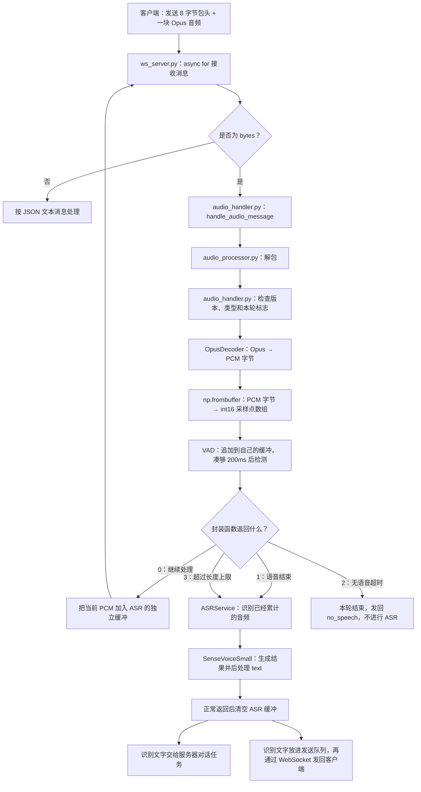

# Echo-Mate：从服务端接收音频到 VAD 检测、ASR 转文字

整理日期：2026-10-04。

本文接续 [Snowboy 唤醒到录音编码发送流程与问答](2026-10-02_Snowboy唤醒到录音编码发送流程与问答.md)，覆盖 **服务端接收 WebSocket 音频消息 → 解析 BinProtocol → Opus 解码为 PCM → VAD 检测 → 累计 ASR 音频 → SenseVoiceSmall 识别成文字**。末尾补充识别文字的去向，并整理这部分学习中提出的问题，重复问题已合并。

内容以整理时的项目源码为准。必要代码采用源码节选，省略部分文档字符串、日志和外围代码；每一行实际代码都有中文注释。节选用于对照阅读，需要结合所在类和函数理解。文件行号以后可能随源码变化。本文只整理文档，没有修改业务代码。

## 1. 完整流程与阅读顺序



这张图表示数据流和调用关系。VAD、ASR 和接收循环不是每次收包都重新创建：它们所在的对象保留缓冲和状态，供下一次调用继续使用。

| 阅读顺序 | 所在文件与入口 | 负责什么 |
| --- | --- | --- |
| 1 | [ws_server.py：handle_client()](/home/mango/ai/Echo-Mate/Demo/AIChat_demo/Server/ws_server.py:78) | 逐条接收 WebSocket 消息，区分二进制音频与 JSON 文本 |
| 2 | [audio_handler.py：handle_audio_message()](/home/mango/ai/Echo-Mate/Demo/AIChat_demo/Server/handle/audio_handler.py:13) | 解包、解码、调用 VAD，再决定是否调用 ASR |
| 3 | [audio_processor.py：unpack_bin_frame()](/home/mango/ai/Echo-Mate/Demo/AIChat_demo/Server/tools/audio_processor.py:47) | 读取包头，按声明长度取出 Opus 数据 |
| 4 | [audio_processor.py：decode_audio()](/home/mango/ai/Echo-Mate/Demo/AIChat_demo/Server/tools/audio_processor.py:96) | 使用 OpusDecoder 解码出 PCM 字节 |
| 5 | [vad_service.py：process_audio_frame()](/home/mango/ai/Echo-Mate/Demo/AIChat_demo/Server/services/vad_service.py:12) | 将采样点数组交给 VADModel 封装 |
| 6 | [vad_model.py：process_audio_frame()](/home/mango/ai/Echo-Mate/Demo/AIChat_demo/Server/models/vad_model.py:50) | 累计音频、按 200ms 检测、判断语音结束或超时 |
| 7 | [asr_service.py：asr_add_audio_buffer()](/home/mango/ai/Echo-Mate/Demo/AIChat_demo/Server/services/asr_service.py:15) | 将当前 PCM 加入 ASR 的音频缓冲 |
| 8 | [asr_model.py：add_audio_buffer()](/home/mango/ai/Echo-Mate/Demo/AIChat_demo/Server/models/asr_model.py:27) | 把 PCM 字节解释为 int16 数组，再追加保存 |
| 9 | [asr_service.py：asr_generate_text()](/home/mango/ai/Echo-Mate/Demo/AIChat_demo/Server/services/asr_service.py:22) | 调用 ASR 模型，正常返回后清空 ASR 缓冲 |
| 10 | [asr_model.py：ASR_generate_text()](/home/mango/ai/Echo-Mate/Demo/AIChat_demo/Server/models/asr_model.py:45) | 调用 SenseVoiceSmall，取出并后处理文字 |

## 2. 服务端在哪里接收音频？

所在文件：[ws_server.py，第 78 行](/home/mango/ai/Echo-Mate/Demo/AIChat_demo/Server/ws_server.py:78)。

```python
async for message in websocket:  # 持续等待当前连接的消息，每收到一条就执行一次循环体
    if isinstance(message, bytes):  # 二进制消息在这里表示为 bytes，客户端音频走这个分支
        await self.audio_handler.handle_audio_message(message)  # 把这一条二进制消息交给音频处理函数
    else:  # 当前消息为文本时，按项目的 JSON 消息格式处理
        text = json.loads(message)  # 将 JSON 字符串解析为 Python 对象
        await self.text_handler.handle_text_message(text)  # 交给文本消息处理器，例如处理客户端状态通知
```

客户端默认每次编码一块 **40ms 音频**并发送一条 WebSocket 二进制消息。因此正常情况下，每次调用 `handle_audio_message()` 处理一小块音频，而不是整句话。40ms 是客户端默认音频时长；实际能否对应一块，要看发送端采用的参数和消息组织方式。

这里的 `async for` 就是“不断收到下一块音频”的外层循环。服务器在当前连接上逐条等待并处理消息，不会为每一块音频重新建立连接。

## 3. 收到的二进制数据长什么样？

客户端发送的不是裸 PCM，而是 **BinProtocol 包头 + Opus 编码数据**。格式对应客户端 [WebsocketClient.h：BinProtocol](/home/mango/ai/Echo-Mate/Demo/AIChat_demo/Client/WebSocket/WebsocketClient.h:14)。

| 字节位置，从 0 开始 | 字段 | 大小 | 含义 |
| --- | --- | --- | --- |
| 0～1 | version | 2 字节 | 自定义协议版本 |
| 2～3 | type | 2 字节 | 自定义数据类型；当前音频处理分支要求为 0 |
| 4～7 | payload_size | 4 字节 | 后面 Opus 数据的实际字节数 |
| 从 8 开始 | payload | payload_size 字节 | 本次发送的 Opus 编码音频 |

例如，Opus 数据实际有 100 字节，那么这条消息的应用层数据长度就是 `8 + 100 = 108` 字节。这里还没有计算 WebSocket 自身的帧头。

包头是双方约定的数据格式。即使都使用 WebSocket，接收端也需要知道二进制消息应该怎样解释。它支持版本、类型和长度信息；不同客户端连接的区分由 WebSocket 连接完成。

### 3.1 HEADER_FORMAT 和网络字节序

所在文件：[audio_processor.py，第 13 行](/home/mango/ai/Echo-Mate/Demo/AIChat_demo/Server/tools/audio_processor.py:13)。

```python
HEADER_FORMAT = "!HHI"  # 按网络大端顺序读取：2 字节无符号整数、2 字节无符号整数、4 字节无符号整数
HEADER_SIZE = struct.calcsize(HEADER_FORMAT)  # 计算这个格式的总大小，结果是 8 字节
```

`!HHI` 是 Python 标准库 `struct` 的格式字符串：

| 字符 | 含义 |
| --- | --- |
| ! | 网络字节序，即大端；使用标准字段宽度，不插入对齐填充 |
| 第一个 H | 无符号整数，占 2 字节，对应 version |
| 第二个 H | 无符号整数，占 2 字节，对应 type |
| I | 无符号整数，占 4 字节，对应 payload_size |

这些字符的含义由 [Python struct 文档](https://docs.python.org/3/library/struct.html#byte-order-size-and-alignment)规定；把它们依次对应到“版本、类型、长度”，则是本项目的约定。

“大端”指多字节整数的高位字节放在前面。例如整数 256 的两字节大端表示是 `01 00`。客户端填写包头时使用 `htons()`、`htonl()`，服务端通过 `!HHI` 按同样的顺序读取。

这个网络字节序约定用于包头整数。后面解码出的 PCM 字节如何解释，是另一个音频格式问题。

### 3.2 unpack_bin_frame() 如何取出音频？

所在文件：[audio_processor.py，第 47 行](/home/mango/ai/Echo-Mate/Demo/AIChat_demo/Server/tools/audio_processor.py:47)。以下省略错误日志。

```python
def unpack_bin_frame(self, data):  # 接收完整的“包头 + 音频”字节串
    if len(data) < self.HEADER_SIZE:  # 总数据不足 8 字节时，连完整包头都无法读取
        return None  # 解包失败，返回 None
    version, type, payload_size = struct.unpack(self.HEADER_FORMAT, data[:self.HEADER_SIZE])  # 从前 8 字节依次读出版本、类型、负载长度
    if len(data) < self.HEADER_SIZE + payload_size:  # 检查收到的数据是否至少包含包头声明的音频字节数
        return None  # 音频数据不足时，解包失败
    payload = data[self.HEADER_SIZE:self.HEADER_SIZE + payload_size]  # 跳过包头，只取声明长度内的 Opus 数据
    if len(payload) != payload_size:  # 再检查取出的负载长度是否与包头一致
        return None  # 检查失败时，不返回音频
    return (version, type, payload)  # 按固定顺序返回三个值，payload_size 已用于检查和切片
```

`data[:self.HEADER_SIZE]` 等价于 `data[0:8]`：从下标 0 开始取，到下标 8 之前结束，得到前 8 字节。Python 切片遵循“包含起点，不包含终点”。

`struct.unpack()` 返回三个值组成的元组。左边的三个变量按位置接收它们：

- 第一个结果放入 `version`。
- 第二个结果放入 `type`。
- 第三个结果放入 `payload_size`。

变量名称不会自动匹配字段含义，依靠的是双方的格式约定和返回顺序。随后 `unpack_bin_frame()` 返回的第三项已经变为 `payload`，所以音频处理器收到的是“版本、类型、音频数据”。

当前代码检查的是“数据不能短于声明长度”。如果包尾还有额外字节，这里不会严格拒绝它们，而是只切出包头声明的那一段负载。

## 4. Opus 如何变成 PCM 和采样点数组？

### 4.1 音频处理函数先检查什么？

所在文件：[audio_handler.py，第 20 行](/home/mango/ai/Echo-Mate/Demo/AIChat_demo/Server/handle/audio_handler.py:20)。

```python
bin_protocol = self.service_manager.audio_processor.unpack_bin_frame(msg)  # 解包当前收到的二进制消息
if bin_protocol:  # 解包成功才继续；返回 None 时跳过后面的处理
    protocol_version, type, payload = bin_protocol  # 按返回顺序接收版本、类型和 Opus 数据
    if type == 0 and protocol_version == global_settings.protocol_version and self.service_manager.is_vad == False:  # 只处理类型和版本匹配、且本轮尚未结束的音频
        pcm_data = self.service_manager.audio_processor.decode_audio(payload)  # 把 Opus 数据解码为 PCM 字节串
        audio_data_np_array = np.frombuffer(pcm_data, dtype=np.int16)  # 将连续字节按每 2 字节一个有符号采样值解释
        vad_result = self.service_manager.vad_service.process_audio_frame(audio_data_np_array)  # 把采样点数组交给 VAD，取得本项目封装的处理状态
```

`is_vad` 是服务端的本轮处理标志。为 `True` 时，后续音频消息仍然可能到达，甚至仍会先被解包，但不会通过上述条件进入解码、VAD 和 ASR 处理。这个变量不会直接关闭 WebSocket，也不会直接停止客户端麦克风。

`handle_audio_message()` 的原文档字符串提到 PCM，但从解包后的 `decode_audio(payload)` 可以确认：当前实际收到的负载是 Opus，PCM 是服务端解码后的结果。

### 4.2 decode_audio() 的必要代码

所在文件：[audio_processor.py，第 32 行](/home/mango/ai/Echo-Mate/Demo/AIChat_demo/Server/tools/audio_processor.py:32)。解码器在初始化时设置音频参数：

```python
self.decoder = OpusDecoder()  # 创建 Opus 解码器
self.decoder.set_sampling_frequency(sample_rate)  # 设置解码后的采样率，默认 16000Hz
self.decoder.set_channels(channels)  # 设置声道数，默认单声道
```

解码过程在 [decode_audio()，第 96 行](/home/mango/ai/Echo-Mate/Demo/AIChat_demo/Server/tools/audio_processor.py:96)：

```python
def decode_audio(self, opus_data):  # 接收解包后的 Opus 字节数据
    pcm_data = b''  # 准备一个空字节串，累计解码后的 PCM
    start = 0  # 当前读取位置从第 0 字节开始
    while start < len(opus_data):  # 本次负载还有未读取字节时继续处理
        encoded_frame_size = min(len(opus_data) - start, 1536)  # 本次最多取 1536 字节，实际取值不超过剩余长度
        encoded_frame = bytearray(opus_data[start:start + encoded_frame_size])  # 取出这一段编码字节，并转成 bytearray
        decoded_frame = self.decoder.decode(encoded_frame)  # 调用 Opus 解码器，得到 PCM 字节
        pcm_data += decoded_frame  # 将解码结果追加到本次 PCM 输出
        start += encoded_frame_size  # 移动读取位置，跳过刚处理的编码字节
    return pcm_data  # 返回本次消息解码得到的 PCM 字节串
```

这里的 `1536` 是当前实现使用的取字节上限，**不表示 Opus 每一帧固定为 1536 字节**。Opus 编码后的字节数会变化。客户端当前按一块音频对应一条消息发送；不能据这个循环推断“多个任意长度 Opus 包拼起来，也能按 1536 字节正确分帧”。

### 4.3 为什么用 np.int16？

解码后的 PCM 是字节串，例如每两个连续字节共同表示一个采样值。模型需要能够进行计算的数值数组，所以这里用 `np.frombuffer(..., dtype=np.int16)` 指定解释规则。

- `int16` 是 16 位有符号整数，占 2 字节，取值范围为 -32768～32767。
- 有符号数可以表达波形相对基准的正、负幅度。
- `frombuffer` 按原有字节顺序解释数据，没有重新采样，也没有重新做模拟转数字的量化。
- 默认 `np.int16` 使用本机字节序；这是 PCM 格式与解码输出要匹配的问题，和包头的 `!HHI` 分开理解。

默认 16000Hz、单声道、16 位 PCM 下：

| 音频时长 | 采样点数 | PCM 字节数 |
| --- | --- | --- |
| 40ms | 16000 × 40 ÷ 1000 = 640 | 640 × 2 = 1280 |
| 200ms | 16000 × 200 ÷ 1000 = 3200 | 3200 × 2 = 6400 |
| 15s | 16000 × 15 = 240000 | 240000 × 2 = 480000 |

这里是解码后的 PCM 大小，不能拿它当成 Opus 压缩数据大小。

麦克风对应的模拟声音经过采样和量化，得到离散数值，再用二进制编码保存。PCM 数字音频就是数字信号的一种表示；不是任何二进制数据都表示声音。

## 5. VAD 与 ASR 使用两个独立缓冲

创建服务的代码在 [service_manager.py，第 18 行](/home/mango/ai/Echo-Mate/Demo/AIChat_demo/Server/service_manager.py:18)：

```python
self.vad_service = VADService()  # 创建 VAD 服务及其模型对象，维护自己的音频和检测状态
self.asr_service = ASRService()  # 创建 ASR 服务及其模型对象，维护另一份累计音频
```

VADModel 和 ASRModel 都有一个叫 `self.audio_buffer` 的成员，但它们属于不同对象，所以不是同一个缓冲。

| 对象 | 接收的数据 | 缓冲用途 |
| --- | --- | --- |
| VADModel | 当前 PCM 的 int16 采样点数组 | 保存累计音频，使用处理位置取出 200ms 片段进行检测 |
| ASRModel | 当前 PCM 字节串，内部再解释为 int16 数组 | 保存准备进行语音识别的累计音频，触发时交给 ASR |

同一块 PCM 数据承担两种任务：VAD 判断语音活动，ASR 识别内容。它们分别管理缓冲，可以按不同节奏工作：VAD 经常检测，ASR 在结束条件满足后进行识别。

**当前代码只有在 VAD 封装返回 0 时，才把这一块 PCM 追加到 ASR。** 这不等于“只有有声的块才存入 ASR”，因为 0 也包括暂时没说话、片段不足 200ms、尚未满足结束条件等情况。具体分支见第 7 节。

## 6. VAD 怎样逐段检测并判断结束？

### 6.1 模型来源、封装与默认参数

VAD 是 Voice Activity Detection，意思是“语音活动检测”。项目使用 **FSMN-Monophone VAD** 预训练模型。模型来自阿里达摩院语音团队，项目指向 [ModelScope 模型页](https://www.modelscope.cn/models/iic/speech_fsmn_vad_zh-cn-16k-common-pytorch)。来源也写在本地 [模型 README](/home/mango/ai/Echo-Mate/Demo/AIChat_demo/Server/models/FunAudioLLM/iic/speech_fsmn_vad_zh-cn-16k-common-pytorch/README.md:83)。

项目中的 `vad_model.py` 是调用现成模型的封装，负责保存音频、安排每次输入片段、解释端点结果和处理超时。这里没有训练 VAD 模型。

本地模型路径在 [vad_model.py，第 6 行](/home/mango/ai/Echo-Mate/Demo/AIChat_demo/Server/models/vad_model.py:6)：

```python
current_dir = os.path.dirname(os.path.abspath(__file__))  # 取得 vad_model.py 所在目录的绝对路径
_vad_path = os.path.join(current_dir, "./FunAudioLLM/iic/speech_fsmn_vad_zh-cn-16k-common-pytorch")  # 拼出预训练 VAD 模型的本地目录
```

加载模型的代码在 [第 31 行](/home/mango/ai/Echo-Mate/Demo/AIChat_demo/Server/models/vad_model.py:31)：

```python
self.vad_model = AutoModel(  # 通过 FunASR 创建并加载实际的 VAD 模型
    model=vad_model_path,  # 指定模型文件目录
    disable_pbar=True,  # 关闭进度条输出
    max_end_silence_time=self.frame_duration_ms,  # 将模型的结束静音参数设为封装的帧时长，默认 200ms
    disable_update=True,  # 禁止启动时进行更新检查
    device=device  # 指定运行设备，当前封装默认使用 CPU
)  # 完成模型加载调用
```

构造函数的默认参数在 [第 10 行](/home/mango/ai/Echo-Mate/Demo/AIChat_demo/Server/models/vad_model.py:10)：

| 参数 | 默认值 | 实际用途 |
| --- | --- | --- |
| sample_rate | 16000 | 每秒 16000 个采样点，用于样本数与毫秒之间换算 |
| frame_duration_ms | 200ms | 每次送进 VAD 模型的音频片段时长 |
| max_buffer_length_ms | 15000ms | VAD 累计音频长度的上限检查条件 |
| no_speech_timeout_ms | 3000ms | 不在说话且距最后语音位置过久时，返回无语音超时 |
| post_speech_buffer_ms | 200ms | 语音结束判断所用的额外等待时间 |

模型的结束静音参数与封装的结束后等待参数是不同层次的设置。不能仅看到 200ms，就断言人一停止说话，服务器必定在正好 200ms 后触发 ASR。

### 6.2 对象保存哪些状态？

所在文件：[vad_model.py：reset()](/home/mango/ai/Echo-Mate/Demo/AIChat_demo/Server/models/vad_model.py:42)。

```python
def reset(self):  # 为下一轮音频重新初始化 VAD 状态
    self.audio_buffer = np.array([], dtype=np.int16)  # 清空累计 PCM 采样点数组
    self.processed_audio_length = 0  # 已送入 VAD 检测的时长归零，单位为毫秒
    self.last_speech_pos = -1  # 尚无语音活动位置时，用 -1 作为初始标记
    self.is_speaking = False  # 初始状态为没有正在说话
    self.vad_cache = {}  # 清空流式模型缓存，让新一轮重新开始
```

`self` 表示当前 VADModel 对象。一次函数调用结束，并不会使这些成员消失。下一条消息继续调用同一个对象时，可以沿用缓冲、处理位置和模型缓存。

`vad_service.py` 只是把调用继续转给它，必要代码在 [第 23 行](/home/mango/ai/Echo-Mate/Demo/AIChat_demo/Server/services/vad_service.py:23)：

```python
res = self.vad_model.process_audio_frame(audio_frame)  # 将当前采样点数组交给 VADModel 的封装方法
return res  # 把封装返回的 0、1、2、3 继续返回给音频处理器
```

### 6.3 先追加音频，再凑够 200ms

以下代码位于 [vad_model.py，第 63 行](/home/mango/ai/Echo-Mate/Demo/AIChat_demo/Server/models/vad_model.py:63)，属于 `process_audio_frame()` 的开头，省略日志：

```python
audio_length = len(self.audio_buffer) * 1000 // self.sample_rate  # 把当前缓冲中的采样点数换算为毫秒，此时尚未追加当前音频块
if audio_length > self.max_buffer_length_ms:  # 如果追加前的累计时长已经超过默认 15000ms
    return 3  # 返回“超过长度上限”，当前块不会再加入 VAD 缓冲
self.audio_buffer = np.concatenate((self.audio_buffer, audio_frame))  # 将这次收到的采样点数组追加到累计缓冲
chunk_stride = self.sample_rate * self.frame_duration_ms // 1000  # 计算一次检测的采样点数，默认 16000 × 200 ÷ 1000 = 3200
if len(self.audio_buffer) - self.processed_audio_length * self.sample_rate // 1000 < chunk_stride:  # 判断尚未检测的音频是否不足 3200 个采样点
    return 0  # 数据不够 200ms，保留缓冲并等待后续音频
beg_frame = self.processed_audio_length * self.sample_rate // 1000  # 将已处理毫秒数换算成下一段的起始采样点下标
end_frame = beg_frame + chunk_stride  # 得到这一段的结束下标，切片时不包含该下标
speech_chunk = self.audio_buffer[beg_frame:end_frame]  # 从累计音频中取出下一段 200ms 采样点
res = self.vad_model.generate(input=speech_chunk, cache=self.vad_cache, is_final=False, chunk_size=self.frame_duration_ms)  # 送入流式 VAD，共用本轮缓存，不标记为最后一段
self.processed_audio_length += self.frame_duration_ms  # 将已检测位置向后推进 200ms
```

`//` 表示整数除法。`chunk_stride` 是样本数量，不是字节数。默认得到 3200 个采样点，对应 200ms、6400 字节的单声道 int16 PCM。

例如，在每条消息都有 40ms 音频、且本轮尚未结束的情况下：

| 收到第几块 | VAD 累计时长 | 本次是否已经够一段 200ms？ | 累计已检测时长 |
| --- | --- | --- | --- |
| 1 | 40ms | 不够，返回 0 | 0ms |
| 2 | 80ms | 不够，返回 0 | 0ms |
| 3 | 120ms | 不够，返回 0 | 0ms |
| 4 | 160ms | 不够，返回 0 | 0ms |
| 5 | 200ms | 够，检测 0～200ms 这一段 | 200ms |
| 6～9 | 240～360ms | 下一段仍未凑够 200ms | 200ms |
| 10 | 400ms | 够，检测 200～400ms 这一段 | 400ms |

这里没有 `while` 来一次取完缓冲里的所有片段。当前实现 **每次调用最多检测一个 200ms 片段**，再由外层接收循环触发下一次调用。若某次传入的音频特别长，积压片段也不会在这一调用里全部处理。

缓冲不会在每次检测后删去前面已经处理的采样点，只推进 `processed_audio_length`，所以累计长度会继续增长。

### 6.4 实际模型如何判断有没有说话？

调用 `self.vad_model.generate()` 时，FunASR 的 FSMN VAD 根据音频特征、上下文和端点检测规则判断语音活动。它会提取用于计算的声学特征，利用训练好的神经网络及阈值、时间窗口等规则输出语音起止位置。

详细特征与模型配置可对照本地 [config.yaml](/home/mango/ai/Echo-Mate/Demo/AIChat_demo/Server/models/FunAudioLLM/iic/speech_fsmn_vad_zh-cn-16k-common-pytorch/config.yaml)。调用者不用自行逐个采样值编写“是不是人声”的判断。

模型返回的端点结果与封装返回的 0、1、2、3 是两回事。流式端点常见形式如下，时间单位为毫秒：

| 模型端点结果形式 | 含义 |
| --- | --- |
| [[start, -1]] | 检测到语音开始，结束点还没出现 |
| [[-1, end]] | 检测到语音结束，本次只提供结束点 |
| [[start, end]] | 本次提供一段语音的开始和结束点 |
| [] | 本次没有新的端点结果，封装保留已有说话状态 |

这些端点的时间位置是本轮流式音频中的位置，不能把每次结果都当成“这个 200ms 片段内从 0 开始计时”。

### 6.5 last_speech_pos 是什么？

解析代码在 [vad_model.py，第 90 行](/home/mango/ai/Echo-Mate/Demo/AIChat_demo/Server/models/vad_model.py:90)：

```python
if len(res[0]["value"]):  # 模型本次返回了新的端点结果时才更新端点状态
    for start, end in res[0]["value"]:  # 依次取得每个结果的开始和结束位置
        if end != -1:  # 优先判断是否有有效结束点
            self.last_speech_pos = end  # 把最后语音位置设为模型给出的结束时间
            self.is_speaking = False  # 标记当前已不在说话
        elif start != -1:  # 没有有效结束点，但存在开始点时
            self.is_speaking = True  # 标记当前正在说话
            self.last_speech_pos = start  # 暂时记录开始位置
if self.is_speaking:  # 如果仍处于说话状态
    self.last_speech_pos = audio_length  # 用追加当前块之前的累计音频时长刷新最后语音位置
```

`last_speech_pos` 记录 **最近语音活动在本轮音频中的时间位置**，单位为毫秒，从本轮缓冲起点计算。它不是“人一共说了多久”。

例如，从 1000ms 开始说话，在 2000ms 结束：检测到结束端点后，`last_speech_pos` 是 2000，而这段说话持续了 1000ms。

随后总音频累计到 2300ms，`audio_length - last_speech_pos = 300ms`，表示结束位置之后又累计了 300ms 的音频。代码用这个差值判断等待时间是否超过阈值。

模型若同时给出 start 和 end，这段代码先执行 end 分支。模型没有新端点时，不会立即把 `is_speaking` 改为 False。

### 6.6 怎样返回“无语音超时”或“说话结束”？

判断代码在 [vad_model.py，第 105 行](/home/mango/ai/Echo-Mate/Demo/AIChat_demo/Server/models/vad_model.py:105)，省略日志：

```python
if not self.is_speaking and (audio_length - self.last_speech_pos) > self.no_speech_timeout_ms:  # 不在说话且距最后语音位置超过默认 3000ms
    return 2  # 返回无语音超时，由上层结束本轮处理
if self.last_speech_pos > 0 and (audio_length - self.last_speech_pos) > self.post_speech_buffer_ms:  # 已有语音位置且之后又累计了超过默认 200ms 的音频
    if self.last_speech_pos > 800:  # 当前代码比较的是语音时间位置是否大于 800ms
        return 1  # 满足条件，返回“语音结束”，上层进行 ASR
    else:  # 最后语音时间位置没有超过 800ms 时
        self.reset()  # 这里只重置 VAD 自己的缓冲和状态
return 0  # 其他情况继续处理，等待后续音频
```

人停止说话后，客户端仍然持续录音和发送，后面的静音或背景声音也会进来。VAD 处理这些后续片段，检测到结束端点；封装再根据累计位置和等待时间决定是否返回 1。

这里有几个影响理解的细节：

- `audio_length` 在追加当前块之前计算，所以不是追加后的最新时长；模型也按 200ms 片段更新。阈值不代表精确的实时触发时刻。
- 无语音超时判断在语音结束判断之前，而且片段不足 200ms 时已经提前返回 0，并不会执行这里的超时判断。
- 原代码的注释说“说话时长小于 800ms”，但实际 `last_speech_pos > 800` 比较的是时间位置，没有计算 `end - start`；前面的静音也影响这个位置。
- 当上述 else 分支重置 VAD 后仍返回 0，ASR 的旧缓冲并没有同步清空；上层还会将当前 PCM 加入 ASR。

## 7. VAD 返回结果后，音频处理器做什么？

### 7.1 四种返回值

这些 0、1、2、3 是项目的 VAD 封装定义的处理状态：

| 返回值 | 含义 | 当前块进入 VAD 缓冲？ | 当前块进入 ASR 缓冲？ | 是否调用 ASR？ |
| --- | --- | --- | --- | --- |
| 0 | 继续处理，包含片段不足、静音或等待等情况 | 是；内部短位置重置分支可能随后清空它 | 是 | 否 |
| 1 | 封装认定语音结束 | 是 | 否 | 是，识别 ASR 已有缓冲 |
| 2 | 不在说话且无语音等待超时 | 是 | 否 | 否 |
| 3 | 追加前累计长度已经超过上限 | 否 | 否 | 是，识别 ASR 已有缓冲 |

因此不能把 0 解读为“确认有人声”。也不能说“返回 1 时，当前 PCM 会先补进 ASR 再识别”：目前代码没有这一步。

### 7.2 audio_handler.py 的实际分支

所在文件：[audio_handler.py，第 31 行](/home/mango/ai/Echo-Mate/Demo/AIChat_demo/Server/handle/audio_handler.py:31)。以下省略日志，保留返回值对应的操作。

```python
if vad_result == 0:  # 继续处理：当前音频还没有触发本轮结束
    self.service_manager.asr_service.asr_add_audio_buffer(pcm_data)  # 将当前块追加到 ASR 自己的缓冲
elif vad_result == 1:  # VAD 封装认定说话结束
    self.service_manager.is_vad = True  # 关闭本轮后续音频的解码、VAD 和 ASR 处理
    asr_res = self.service_manager.asr_service.asr_generate_text()  # 识别 ASR 先前累计的音频，这里不追加当前块
    self.service_manager.task_manager.submit_task(self.service_manager.chat_start_task, asr_res)  # 将识别结果交给服务器对话任务
    res = {  # 准备给客户端的 ASR 结果消息
        "type": "asr",  # 表明这是一条语音识别结果
        "text": asr_res  # 保存识别出的文字，模型没有文字时可能为 None
    }  # 完成结果字典
    self.service_manager.ws_send_queue.put(json.dumps(res))  # 转成 JSON 字符串，加入 WebSocket 发送队列
elif vad_result == 2:  # 无语音等待超时，本轮不做语音识别
    self.service_manager.is_vad = True  # 标记本轮结束，暂不继续处理后续音频
    res = {  # 准备无语音通知
        "type": "vad",  # 标明消息属于 VAD 结果
        "state": "no_speech"  # 通知客户端本轮无语音超时
    }  # 完成通知字典
    self.service_manager.ws_send_queue.put(json.dumps(res))  # 将通知加入发送队列
elif vad_result == 3:  # VAD 的累计音频超过长度上限
    self.service_manager.is_vad = True  # 标记本轮结束
    asr_res = self.service_manager.asr_service.asr_generate_text()  # 对 ASR 已有音频进行识别，这里不追加当前块
    self.service_manager.task_manager.submit_task(self.service_manager.chat_start_task, asr_res)  # 将识别结果提交给服务器对话任务
    res = {  # 准备给客户端的 ASR 结果消息
        "type": "asr",  # 标明消息是语音识别结果
        "text": asr_res  # 放入识别出的文字
    }  # 完成结果字典
    self.service_manager.ws_send_queue.put(json.dumps(res))  # 转成 JSON 并加入发送队列
```

### 7.3 缓冲“满了”指什么？为什么设置 15 秒？

当前 VAD 的 `audio_buffer` 是不断拼接的 NumPy 数组，没有预先创建“固定只能装 15 秒”的容器。代码计算它已经累计的时长，超过阈值就返回 3。因此这里的“满了”是 **达到软件设置的长度条件**。

默认单声道、16kHz、int16 下，15 秒约对应 480000 字节 PCM，不包括数组对象、拼接临时数据和模型缓存。源码使用追加前的时长，并且条件是 `>` 而不是 `>=`，所以不是恰好 15 秒就截断。

这项限制直接约束 VAD 累计音频的增长。在没有中途单独重置 VAD 的情况下，超过上限会返回 3，结束本轮并触发 ASR，避免持续说话或结束端点迟迟没有出现时一直积累，减少等待和内存压力。

ASR 自己的缓冲没有独立的 15 秒长度检查。由于第 6.6 节的短位置分支可能只重置 VAD、保留 ASR 音频，ASR 的累计时长仍有可能超过 15 秒，不能把这个 VAD 上限当成 ASR 的硬上限。

返回 3 的处理与正常说话结束相近，都会调用 ASR；但它表示“长度上限到了”，不保证这一句话已经说完，识别的可能是截至当时的部分内容。

## 8. ASR 音频从哪里来，怎样转成文字？

### 8.1 当前 PCM 如何加入 ASR？

服务入口在 [asr_service.py，第 15 行](/home/mango/ai/Echo-Mate/Demo/AIChat_demo/Server/services/asr_service.py:15)：

```python
def asr_add_audio_buffer(self, audio_data):  # 接收音频处理器传来的当前 PCM 字节串
    self.asr_model.add_audio_buffer(audio_data)  # 委托 ASRModel 转成采样点数组并追加保存
```

实际追加代码在 [asr_model.py，第 27 行](/home/mango/ai/Echo-Mate/Demo/AIChat_demo/Server/models/asr_model.py:27)：

```python
def add_audio_buffer(self, pcm_data):  # 接收一块 PCM 音频字节
    audio_data_array = np.frombuffer(pcm_data, dtype=np.int16)  # 每两个字节解释为一个有符号 16 位采样值
    self.audio_buffer = np.append(self.audio_buffer, audio_data_array)  # 将当前块接到 ASR 先前保存的音频后面
```

所以调用 `asr_generate_text()` 时不需要传音频参数：音频已经保存在 `self.asr_model.audio_buffer` 中。

这份缓冲可能包含开始说话前的静音、说话中间的停顿和背景声音。当前封装没有用 VAD 的 `start/end` 给 ASR 裁剪“只保留人声”的片段，也没有每 200ms 调用一次 ASR。

VAD 自己确实按 200ms 切片检测；ASR 使用自己的累计音频。二者接收的是同一音频流，但不共用同一个缓冲或完全相同的处理单位。

### 8.2 具体使用哪个 ASR 模型？

ASR 是 Automatic Speech Recognition，意思是“自动语音识别”，它是任务名称。项目的具体模型是 **SenseVoiceSmall**，通过 FunASR 的 `AutoModel` 加载。

加载代码在 [asr_model.py，第 5 行](/home/mango/ai/Echo-Mate/Demo/AIChat_demo/Server/models/asr_model.py:5)：

```python
_asr_model_path = "./models/FunAudioLLM/iic/SenseVoiceSmall"  # 指定 SenseVoiceSmall 预训练模型的本地目录
_remote_code = "./models/FunAudioLLM/SenseVoice/model.py"  # 指定加载这个模型所需的实现文件
self.asr_model = AutoModel(  # 通过 FunASR 加载语音识别模型，此调用原本位于构造函数内
    model=_asr_model_path,  # 传入模型目录
    remote_code=_remote_code,  # 传入模型实现文件的位置
    trust_remote_code=True,  # 允许执行所指定的模型实现代码
    device=device,  # 使用构造函数传入的运行设备，默认 CPU
    disable_update=True  # 禁止启动时进行更新检查
)  # 完成模型加载
```

这两个 ASR 路径是相对当前工作目录的路径；VAD 前面使用 `__file__` 所在目录拼接，路径写法不同。模型介绍可参阅 [SenseVoice 官方仓库](https://github.com/QwenAudio/SenseVoice)。

### 8.3 从累计数组调用模型

所在文件：[asr_service.py，第 22 行](/home/mango/ai/Echo-Mate/Demo/AIChat_demo/Server/services/asr_service.py:22)：

```python
def asr_generate_text(self):  # 识别当前 ASR 对象已经累计的音频
    res = self.asr_model.ASR_generate_text(self.asr_model.audio_buffer.astype(np.float32))  # 将采样值转为 float32 数组，再传入模型封装
    self.asr_model.clear_audio_buffer()  # 识别函数正常返回后，清空 ASR 自己的音频缓冲
    return res  # 将识别出的文字或 None 返回给音频处理器
```

`astype(np.float32)` 只进行数值类型转换。比如 int16 的 1000 变成 float32 的 1000.0；这里没有除以 32768，不能把这一行描述为“已经归一化到 -1～1”。需要判断模型内部怎样处理幅值时，应继续检查所安装的 FunASR 及模型前端实现。

### 8.4 模型输出怎样变成 text？

所在文件：[asr_model.py，第 45 行](/home/mango/ai/Echo-Mate/Demo/AIChat_demo/Server/models/asr_model.py:45)：

```python
def ASR_generate_text(self, audio_buffer):  # 接收 ASRService 传来的累计音频数组
    res = self.asr_model.generate(input=audio_buffer, cache={}, language='auto', use_itn=True)  # 调用 SenseVoiceSmall 自动识别语言，并启用逆文本规范化
    if(res[0]['text']):  # 检查第一个识别结果是否有非空 text
        return rich_transcription_postprocess(res[0]['text'])  # 对模型输出做文本后处理，再返回结果
    return None  # text 为空时返回 None
```

这里 `input=audio_buffer` 才是真正把累计音频交给模型的地方。`res` 是模型返回的结果结构，`res[0]['text']` 取出第一个结果中的 text 字段。

`language='auto'` 表示自动判断语言；`use_itn=True` 启用逆文本规范化，例如让部分读出来的数字表达转换成适合书面显示的形式。`rich_transcription_postprocess()` 负责后处理模型的文字及附加标记，输出可能仍包含情绪或声音事件对应的符号，不能一概当成无附加信息的纯文字。

清空函数在 [asr_model.py，第 21 行](/home/mango/ai/Echo-Mate/Demo/AIChat_demo/Server/models/asr_model.py:21)：

```python
def clear_audio_buffer(self):  # 清空 ASR 为本轮保存的音频
    self.audio_buffer = np.array([], dtype=np.int16)  # 用新的空 int16 数组替换原缓冲
```

这一步清的是 ASR 缓冲，没有同时清 VAD 缓冲。模型调用若抛出异常，没有正常返回，当前代码也没有 finally 保证执行清空。

## 9. 识别完之后，文字去哪里？下一轮怎么开始？

### 9.1 识别文字的两个去向

`audio_handler.py` 中的 `asr_res` 是识别文字的接收变量。识别结果同时进入两个后续路径：

1. **服务器对话任务**：`submit_task(chat_start_task, asr_res)` 将文字作为参数提交给对话处理。
2. **客户端结果通知**：把 `{"type": "asr", "text": asr_res}` 转成 JSON 字符串，加入 `ws_send_queue`。

对话任务的入口在 [service_manager.py：chat_start_task()](/home/mango/ai/Echo-Mate/Demo/AIChat_demo/Server/service_manager.py:72)，后续进行意图识别、调用聊天服务生成回复，并交给 TTS 合成声音。这个对话处理由服务器发起。

ASR 返回 None 时，当前分支没有额外的非空检查，仍然会提交对话任务和 ASR 通知，JSON 里的 text 会成为 null。本文描述当前行为，不把“每次都会识别成功”作为前提。

### 9.2 放进队列不等于已经发出

发送任务在建立连接后创建，所在文件：[ws_server.py，第 55 行](/home/mango/ai/Echo-Mate/Demo/AIChat_demo/Server/ws_server.py:55)。

```python
process_task = asyncio.create_task(self.process_send_queue(websocket))  # 为当前连接启动异步发送队列处理任务
```

实际发送代码位于 [process_send_queue()，第 27 行](/home/mango/ai/Echo-Mate/Demo/AIChat_demo/Server/ws_server.py:27)。以下省略异常处理和日志：

```python
async def process_send_queue(self, websocket):  # 使用当前客户端的 WebSocket 连接处理发送队列
    while True:  # 持续检查是否有待发送的数据
        if not self.service_manager.ws_send_queue.empty():  # 队列非空时进入发送分支
            data = self.service_manager.ws_send_queue.get_nowait()  # 不阻塞地取出一条待发送数据
            await websocket.send(data)  # 将数据通过当前连接发回客户端
        else:  # 队列暂时没有消息
            await asyncio.sleep(0.1)  # 等待 0.1 秒，让出执行机会后再检查
```

ASR 通知经 `json.dumps()` 生成的是字符串，所以通过 WebSocket 文本消息发出。服务端的 `logger.info()` 只记录日志；真正把结果发到客户端的是发送队列和 `websocket.send()`。

### 9.3 客户端怎样处理 ASR 通知？

客户端收到文本消息后解析 JSON，遇到 `type == "asr"` 时调用 [WS_Handler.cc：handle_asr_message()](/home/mango/ai/Echo-Mate/Demo/AIChat_demo/Client/Application/WS_Handler.cc:84)：

```cpp
void WSHandler::handle_asr_message(const Json::Value& root, Application* app) { // 处理服务端发回的 ASR 结果消息
    const Json::Value text = root["text"]; // 读取 JSON 中的识别文字字段
    if (text.isString()) { // 字段确实为字符串时，才按文字处理
        std::string asr_text_ = text.asString(); // 转成局部的 C++ 字符串
        USER_LOG_INFO("Received ASR text: %s", asr_text_.c_str()); // 将识别文字打印到客户端日志
    } else { // 字段不是字符串，例如服务端发送了 null
        USER_LOG_WARN("Invalid ASR text value."); // 记录 ASR 文字无效的警告
    } // 结束文字字段的类型检查
    app->eventQueue_.Enqueue(static_cast<int>(AppEvent::asr_received)); // 将枚举转为 int，提交收到 ASR 结果的事件
} // 结束 ASR 消息处理函数
```

[StateConfig.cc，第 45 行](/home/mango/ai/Echo-Mate/Demo/AIChat_demo/Client/Application/StateConfig.cc:45) 注册了 `Listening + asr_received → Thinking` 的转换。

这段函数会打印文字并提交事件，没有在这里更新屏幕界面。即使 text 无效，当前代码仍会提交 `asr_received`。

### 9.4 无语音超时的缓存何时清空？

返回 2 的处理分支只设置 `is_vad = True` 和发送 `no_speech`，没有马上清空 VAD、ASR 两个缓冲。它们会在后续状态通知触发重置时被清空。

服务端收到客户端 `type="state"`、`state="listening"` 的通知时，在 [text_handler.py，第 54 行](/home/mango/ai/Echo-Mate/Demo/AIChat_demo/Server/handle/text_handler.py:54) 执行：

```python
self.service_manager.is_vad = False  # 重新允许下一轮音频进入解码、VAD 和 ASR 处理
self.service_manager.vad_service.reset()  # 清空 VAD 音频、处理位置、说话状态和模型缓存
self.service_manager.asr_service.reset()  # 清空 ASR 累计音频
```

收到 idle 状态时，也会调用 [service_manager.py：reset_services()](/home/mango/ai/Echo-Mate/Demo/AIChat_demo/Server/service_manager.py:43)，重置这些标志和缓冲。连接断开时同样有重置调用。

## 10. 本部分问题与回答，重复问题已合并

### 10.1 接收、包头与 Python 语法

**1. “服务器接收 Opus 编码音频在哪个文件中？”**

接收入口在 `ws_server.py` 的 `handle_client()`；二进制消息交给 `audio_handler.py` 的 `handle_audio_message()`。解包和解码具体在 `tools/audio_processor.py`。见第 2～4 节。

**2. “加包头是不是因为其他程序也可能通过这个端口发数据，没包头就区分不了？”**

不同客户端由各自连接区分。这个包头约定版本、类型和负载长度，帮助解释同一连接收到的二进制数据。双方约定只传 Opus 时，也可以直接传裸 Opus；本项目选用了带包头的格式。

**3. “那就是为了方便向客户端发送打印信息？”**

音频包头用于描述二进制音频。ASR 文字、状态通知等通过 JSON 文本消息返回；日志输出则由 logger 完成。它们有各自的发送或输出路径。

**4. “handle_audio_message 有使用包头中的数据大小吗？”**

有间接使用：它先调用 `unpack_bin_frame()`，后者用 `payload_size` 检查长度并切出 Opus 数据。处理器接到的第三项已经是 payload，不需要再次读取 payload_size。见第 3.2 节。

**5. “unpack_bin_frame 的代码是什么意思？”**

先检查 8 字节包头是否完整，按 `!HHI` 读出三个整数，再检查负载是否够长，最后切出 Opus 数据并返回。错误时返回 None。见第 3.2 节的逐行注释。

**6. “version、type、payload_size 怎么知道返回的数据一一对应？”**

`struct.unpack()` 按格式顺序返回元组，左边变量按位置接收。第一个 H 对应第一个变量，第二个 H 对应第二个变量，I 对应第三个变量；变量名字不会自动匹配。

**7. “HEADER_FORMAT 是什么？怎么知道前两项是 2 字节，后面是 4 字节？!HHI 按顺序读取吗？这是哪里的规定？”**

`HEADER_FORMAT` 保存 Python struct 格式字符串。`!` 指定网络大端和标准宽度；两个 H 各占 2 字节，I 占 4 字节，按写出的顺序解析。这些字符由 Python struct 规定，字段含义由项目约定。见第 3.1 节。

**8. “什么叫网络字节序？”**

网络字节序采用大端表示：多字节整数的高位字节放在前面。客户端与服务器遵守相同字节序，才能把相同字节恢复成相同整数。

**9. “data[:self.HEADER_SIZE] 是什么？”**

是 Python 切片，取开头到 HEADER_SIZE 之前的字节。这里 HEADER_SIZE 为 8，所以取得下标 0～7 的包头。

### 10.2 PCM、采样点与 int16

**10. “解码成 PCM 数字信号之后干嘛？”**

把 PCM 字节解释成 int16 数组交给 VAD；在继续处理的分支中，也把当前 PCM 放进 ASR 的独立缓冲，等待语音结束或长度超限后转成文字。

**11. “为什么转成有符号 16 位整数？字节串有顺序，按 16 位、16 位取不行吗？”**

按每 16 位取就是这里的做法。`dtype=np.int16` 还明确告诉 NumPy：每组 2 字节要按有符号数解释，得到模型可以计算的采样值。单纯知道字节有顺序，还需要知道宽度、符号和字节序。见第 4.3 节。

**12. “chunk_stride = sample_rate * frame_duration_ms // 1000 是什么？”**

把毫秒换算为样本数量：16000 个样本/秒 × 200ms ÷ 1000 = 3200 个采样点。`//` 是整数除法，结果是样本数而不是字节数。

**13. “处理采样点是什么意思？模拟声音采样成数值，用二进制表示就成为数字音频了吗？”**

采样点是某个采样时刻的波形数值。经过采样和量化后，用二进制表示这些离散数值，就能保存为 PCM 数字音频。处理采样点，是把这些数值交给算法计算声学特征等。见第 4.3 节。

**14. “二进制就是数字信号吗？数字音频就是数字信号吗？”**

数字音频是数字信号的一种。二进制是编码表示方式；二进制内容也可能是文字、图片或程序，具体含义由数据格式决定。

### 10.3 VAD、缓冲和结束判断

**15. “VAD 也是模型吗？是什么模型，来源哪里？vad_model.py 是自行定义的吗？”**

VAD 是检测任务；项目实际使用阿里达摩院语音团队提供的 FSMN-Monophone VAD 预训练模型，通过 FunASR 加载。`vad_model.py` 是项目自己的调用封装，真正的模型来自加载的预训练模型目录。见第 6.1 节。

**16. “handle_audio_message 做什么？每次只处理一小段声音吗？”**

它处理一条收到的二进制消息，完成解包、检查、Opus 解码和 VAD 调用，再决定存入 ASR、触发识别或发送无语音通知。客户端默认一条消息携带 40ms 音频，因此通常每次处理一小段。

**17. “process_audio_frame 怎么判断有没有说话？没有看到循环体，怎么循环取一段？”**

判断依靠 `self.vad_model.generate()` 调用的模型。封装使用累计音频和处理位置取一段 200ms。重复调用来自 `ws_server.py` 的外层 `async for`，每次最多检测一段。见第 6.3～6.4 节。

**18. “15 秒是每次需要处理的音频时长，200ms 是每次处理时长吗？”**

200ms 是一次送入 VAD 的片段时长；15 秒是 VAD 累计音频长度的上限条件。它不要求等满 15 秒才检测或识别；通常检测到结束就提前触发 ASR。

**19. “缓冲区满了是什么意思？满了怎么处理？和检测到语音结束差不多吧？”**

当前代码指累计时长超过设置值，返回 3。它与返回 1 一样会调用 ASR，但原因不同：3 可能在话还没说完时就触发。当前块也不会在 3 分支中追加到缓冲。见第 7 节。

**20. “累计音频超过默认 15 秒，为什么设这个？其实就是限制 VAD 缓冲大小？”**

它直接限制 VAD 累计长度，避免持续增长；固定音频格式下，时长也对应存储量。返回 3 又会触发 ASR，因而同时给本轮识别设置一个结束机会。这个限制不是预分配固定容量。

**21. “ASR 要检测的语音从哪里来？是 VAD 把音频放进去吗？两个共用一个缓冲吗？”**

音频来自 Opus 解码后的 PCM。在 `audio_handler.py` 的返回 0 分支，代码把当前 PCM 追加进 ASR；VAD 和 ASR 各有独立缓冲，VAD 没有把自己整个缓冲传给 ASR。见第 5、8.1 节。

**22. “VAD 每 200ms 判断一次，PCM 分别做 VAD 和 ASR 两次操作，为什么这样设计？”**

VAD 使用小片段和流式状态来判断语音活动、结束或超时；ASR 保存累计音频，触发后识别内容。它们任务不同，所以可以使用不同处理节奏。ASR 不是每 200ms 都识别一次。

**23. “声音不全是不是不让 ASR 识别？”**

这里按结束条件控制何时调用 ASR，没有单独判断句子是否完整。超过长度上限会触发识别，即使话没说完；返回 1 或 3 时也没有将当前块补入 ASR。见第 7 节。

**24. “VAD 没测到人声，音频是不是就抛弃？为什么说缓存在后续重置时清空？”**

普通静音片段可能返回 0，仍然存入 ASR；只有满足无语音超时条件才返回 2，本轮跳过 ASR，并发回 no_speech。这时缓存没有立即清空，等后续 idle/listening 状态通知触发重置。见第 9.4 节。

**25. “中间有一段人声，另一段没有人声怎么办？VAD 和 ASR 对整段操作，不做切割吗？”**

短暂停顿未触发结束时，继续累计，静音也可能进入 ASR。VAD 自己切出 200ms 片段检测，但当前代码没有用端点裁剪 ASR 缓冲，ASR 识别自己的累计音频。停顿满足结束条件，则识别此前累计的内容。

**26. “audio_buffer 保存在对象里，所以可以累计到触发条件后识别？”**

是。成员缓冲和状态在函数返回后仍保留，下一次调用继续使用。但是 VAD、ASR 是两个对象，分别保存音频；触发 ASR 时读取的是 ASR 对象的缓冲。

**27. “怎么知道说话结束？last_speech_pos 是什么？”**

客户端继续发送后续音频，VAD 检测结束端点，封装结合等待时间判断。`last_speech_pos` 是最后语音活动的毫秒位置，讲话时更新、结束时保存 end，用于计算距最后语音位置经过多久。它不是讲话时长。见第 6.5～6.6 节。

### 10.4 ASR 与识别文字

**28. “ASR 是什么模型？”**

ASR 是自动语音识别这项任务的名称。本项目使用 SenseVoiceSmall，由 FunASR 的 AutoModel 加载，真正调用模型的是 `asr_model.py` 的 `self.asr_model.generate()`。见第 8 节。

**29. “ASR 识别出了文字后往哪里发送？”**

一份文字在服务端提交给 `chat_start_task`，用于对话处理；另一份封装为 ASR JSON 消息进入发送队列，由 `ws_server.py` 发回客户端。客户端打印文字并提交 asr_received 事件，Listening 随后切到 Thinking。见第 9 节。

## 11. 对照源码时需要记住的实际行为

- 收到的负载是 Opus；PCM 是解码之后产生的。原函数文档字符串不够准确。
- 包头长度检查允许尾随额外字节；它不是“总长度必须完全相等”的检查。
- 40ms、200ms、15 秒分别对应客户端默认音频块、VAD 输入片段、VAD 累计长度上限。
- VAD 返回 0 表示继续处理，不是“确认有人声”。
- VAD 和 ASR 的两个缓冲不完全同步；1、2、3 分支都没有把当前块补入 ASR。
- `last_speech_pos > 800` 判断时间位置，不是判断 `end - start` 的讲话时长。
- 15 秒上限使用 VAD 追加前的时长和严格大于条件，可能略超；ASR 缓冲没有独立的 15 秒上限。
- ASR 输入的 `astype(np.float32)` 只改变数值类型，当前这一行没有做幅值归一化。
- 正常识别返回后清的是 ASR 缓冲；无语音超时分支没有立即清空两份缓冲。
- `is_vad = True` 是服务端本轮处理标志，不直接停止客户端录音。
- ASR 可能返回 None；目前上层仍会提交后续任务和结果通知。

这些说明用于准确理解当前实现，不表示本文修复了上述行为。
