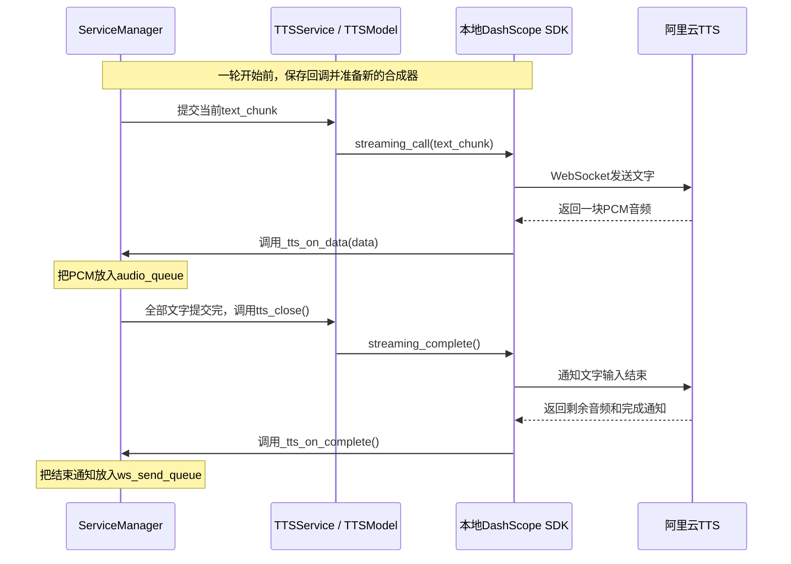

# Echo-Mate：TTS 文字提交到云端合成与音频回调

整理日期：2026-10-06。

本文整理 **聊天回复文字 → TTSService → TTSModel → DashScope SDK → 云端 CosyVoice 合成 → SDK 接收 PCM → 服务端音频回调** 的实际调用流程，并补充本轮合成结束时的回调。前一阶段可对照 [服务端接收音频到 ASR 转文字流程与问答](2026-10-04_服务端接收音频到ASR转文字流程与问答.md)。

内容以整理时的项目源码和本地 DashScope SDK **1.26.7** 为准。必要代码采用节选，省略无关日志、文档字符串和外围处理；每行实际代码都有中文注释。不同代码块中的 `self` 可能代表不同类的对象，阅读时要结合所在文件和方法。代码块用于对照阅读，不能把所有节选直接拼成一个可运行程序。文件行号以后可能变化。

## 1. 先分清：谁提交文字，谁生成音频？

| 名称 | 在哪里运行 | 负责什么 |
| --- | --- | --- |
| 本项目服务端 | 运行 `Server` Python 程序的机器 | 取得聊天回复，调用 TTS，处理返回的音频 |
| `TTSService` | 本项目服务端 | 提供设置回调、提交文字、结束合成的方法 |
| `TTSModel` | 本项目服务端 | 封装 SDK，创建合成器、配置回调、转交文字 |
| `SpeechSynthesizer` | 本项目服务端，来自 DashScope SDK | 管理云端合成任务和网络收发，调用回调 |
| CosyVoice | 阿里云云端 | 实际将文字合成为语音 |

**TTSModel 是项目中的 Python 类；当前配置的 cosyvoice-v1 才是云端语音合成模型。** 项目没有在 `TTSModel` 中加载 CosyVoice 权重来本地生成声音。

`self.synthesizer` 可以理解为本项目服务端与云端 TTS 服务之间的桥梁。SDK 是安装在服务端里的代码，不是另外一台服务器。

本文中的云端 TTS WebSocket 连接，与机器人客户端连接本项目服务器的 WebSocket，是两条不同的连接。



图中的箭头表示主要数据流。多段文字与多块音频可以交错传输，文字片段和音频块没有固定的一一对应关系。

## 2. 对照哪些文件？

项目路径：`/home/mango/ai/Echo-Mate/Demo/AIChat_demo/Server`。

| 阅读顺序 | 文件与入口 | 作用 |
| --- | --- | --- |
| 1 | [service_manager.py：创建 TTSService](/home/mango/ai/Echo-Mate/Demo/AIChat_demo/Server/service_manager.py:22) | 创建并持有 TTS 服务对象 |
| 2 | [tts_service.py：TTSService](/home/mango/ai/Echo-Mate/Demo/AIChat_demo/Server/services/tts_service.py:5) | 服务接口，向 TTSModel 转交调用 |
| 3 | [tts_model.py：TTSModel](/home/mango/ai/Echo-Mate/Demo/AIChat_demo/Server/models/tts_model.py:8) | 配置并调用 SDK |
| 4 | [text_handler.py：Listening 分支](/home/mango/ai/Echo-Mate/Demo/AIChat_demo/Server/handle/text_handler.py:54) | 登记业务回调，准备本轮合成器 |
| 5 | [service_manager.py：聊天文字循环](/home/mango/ai/Echo-Mate/Demo/AIChat_demo/Server/service_manager.py:115) | 逐段把回复文字交给 TTS |
| 6 | [SDK：streaming_call](/home/mango/miniconda3/envs/AIChatServer/lib/python3.10/site-packages/dashscope/audio/tts_v2/speech_synthesizer.py:625) | 启动任务并发送文字 |
| 7 | [SDK：on_message](/home/mango/miniconda3/envs/AIChatServer/lib/python3.10/site-packages/dashscope/audio/tts_v2/speech_synthesizer.py:785) | 接收云端数据并分发回调 |
| 8 | [service_manager.py：音频与完成回调](/home/mango/ai/Echo-Mate/Demo/AIChat_demo/Server/service_manager.py:56) | 接收 PCM、加入队列，处理完成通知 |

SDK 文件位于 `AIChatServer` 环境的 `site-packages` 中，不是本项目自己实现的云端模型代码。

## 3. 程序启动时：先创建服务对象

### 3.1 ServiceManager 创建 TTSService

在 [main.py：第 13 行](/home/mango/ai/Echo-Mate/Demo/AIChat_demo/Server/main.py:13)：

```python
service_manager = ServiceManager()  # 创建服务管理器，Python自动执行它的初始化方法
```

接着在 [service_manager.py：第 22 行](/home/mango/ai/Echo-Mate/Demo/AIChat_demo/Server/service_manager.py:22)：

```python
self.tts_service = TTSService()  # 在ServiceManager中创建TTSService对象，保存其引用
```

这里的 `self` 是当前 `ServiceManager` 对象。`self.tts_service` 是它的实例属性，类似 C++ 中通过 `this` 访问的成员变量。

### 3.2 TTSService 创建 TTSModel

在 [tts_service.py：第 5～7 行](/home/mango/ai/Echo-Mate/Demo/AIChat_demo/Server/services/tts_service.py:5)：

```python
class TTSService:  # 定义本项目的TTS服务类
    def __init__(self):  # 创建TTSService对象时，Python自动执行此方法
        self.tts_model = TTSModel()  # 创建TTSModel对象，保存到当前服务对象的属性中
```

这段代码中的 `self` 是 `TTSService` 对象。它保存的 `self.tts_model` 指向另一个对象：`TTSModel`。

### 3.3 TTSModel 创建初始 SDK 合成器

在 [tts_model.py：第 19～26 行](/home/mango/ai/Echo-Mate/Demo/AIChat_demo/Server/models/tts_model.py:19)，初始化方法中的必要代码为：

```python
self.callback = None  # 初始时尚未配置业务回调对象
self.synthesizer = SpeechSynthesizer(  # 创建SDK语音合成器对象，并保存到TTSModel的属性中
    model="cosyvoice-v1",  # 指定云端使用的语音合成模型
    voice="longxiaochun",  # 指定声音的音色
    format=AudioFormat.PCM_16000HZ_MONO_16BIT,  # 指定返回16kHz、单声道、16位PCM音频
    callback=self.callback  # 此时传入的回调是None
)  # 完成初始合成器对象的创建
```

这里的 `self` 是 `TTSModel` 对象。创建 `SpeechSynthesizer` 对象时，还没有提交文字，也没有建立本轮云端连接。

这一步的对象关系是：

```text
ServiceManager对象
  └─ tts_service → TTSService对象
                       └─ tts_model → TTSModel对象
                                          └─ synthesizer → SDK合成器对象
```

创建 `TTSService()` 时只执行它的 `__init__()`，不会自动执行 `tts_set()`、`tts_speech_stream()` 等其他方法。

## 4. 一轮开始前：登记回调并准备合成器

### 4.1 TextHandler 保存的是同一个 ServiceManager

[ws_server.py：第 20～22 行](/home/mango/ai/Echo-Mate/Demo/AIChat_demo/Server/ws_server.py:20) 将已有的服务管理器交给文本处理器：

```python
self.service_manager = service_manager  # WebSocketServer保存外部传入的服务管理器引用
self.text_handler = TextHandler(self.service_manager)  # 创建文本处理器，把同一个管理器传进去
```

在 [text_handler.py：第 6～8 行](/home/mango/ai/Echo-Mate/Demo/AIChat_demo/Server/handle/text_handler.py:6)：

```python
class TextHandler:  # 定义处理JSON文本消息的类
    def __init__(self, service_manager: ServiceManager):  # 接收已有管理器，冒号后面是类型标注
        self.service_manager = service_manager  # 给当前TextHandler对象添加属性，保存管理器引用
```

这段初始化没有创建新的 `ServiceManager`。`service_manager: ServiceManager` 是参数及类型标注，`ServiceManager()` 才是创建对象。

因此，TextHandler 可以通过 `self.service_manager.tts_service` 找到启动时创建好的 TTS 服务。

### 4.2 收到 Listening 通知后，TextHandler 调用 tts_set

客户端进入 Listening 后发送状态消息。本项目服务器将该 JSON 文本消息交给 TextHandler。

在 [text_handler.py：第 60 行](/home/mango/ai/Echo-Mate/Demo/AIChat_demo/Server/handle/text_handler.py:60)，Listening 分支中的 TTS 操作为：

```python
self.service_manager.tts_service.tts_set(  # 调用已有TTS服务，为这一轮准备回调和合成器
    on_data=self.service_manager._tts_on_data,  # 传入收到音频时执行的绑定方法
    on_complete=self.service_manager._tts_on_complete  # 传入整轮合成完成时执行的绑定方法
)  # 其余三个回调未传入，使用默认值None
```

`_tts_on_data`、`_tts_on_complete` 已经定义在 `ServiceManager` 类中。**方法存在、创建服务对象、把方法登记为回调，是不同的事情。**

这里传递函数本身，没有在方法名后面写 `()`，所以此时不执行回调函数体。

### 4.3 TTSService 将参数继续传给 TTSModel

在 [tts_service.py：第 9～18 行](/home/mango/ai/Echo-Mate/Demo/AIChat_demo/Server/services/tts_service.py:9)，省略文档字符串后：

```python
def tts_set(self, on_open=None, on_complete=None, on_error=None, on_close=None, on_data=None):  # 定义五个回调参数，缺省时使用None
    self.tts_model.tts_stream_set(on_open, on_complete, on_error, on_close, on_data)  # 把这次收到的五个值按顺序传给TTSModel
```

这次调用的参数值是：

| 参数 | 这次收到的值 |
| --- | --- |
| `on_open` | `None` |
| `on_complete` | `ServiceManager._tts_on_complete` 绑定方法 |
| `on_error` | `None` |
| `on_close` | `None` |
| `on_data` | `ServiceManager._tts_on_data` 绑定方法 |

**默认值只在这次调用没有传入对应参数时使用。** 创建 `TTSService` 时没有调用 `tts_set`，不能把它的方法参数默认值理解为所有后续调用都会固定使用 `None`。

### 4.4 TTSModel 创建回调对象，再创建本轮合成器

在 [tts_model.py：第 53～76 行](/home/mango/ai/Echo-Mate/Demo/AIChat_demo/Server/models/tts_model.py:53)，省略日志、文档字符串和已注释的预连接代码后：

```python
def tts_stream_set(self, on_open=None, on_complete=None, on_error=None, on_close=None, on_data=None):  # 接收TTSService传来的五个回调值
    self.callback = self.__tts_callback(  # 创建回调对象，保存到当前TTSModel对象的callback属性
        on_open=on_open, on_complete=on_complete,  # 把当前收到的启动和完成回调继续传进去
        on_error=on_error, on_close=on_close, on_data=on_data  # 把其余回调继续传进去
    )  # 完成回调对象创建
    self.synthesizer = SpeechSynthesizer(  # 创建本轮新的SDK合成器，替换此前保存的合成器
        model="cosyvoice-v1",  # 指定云端语音合成模型
        voice="longxiaochun",  # 指定音色
        format=AudioFormat.PCM_16000HZ_MONO_16BIT,  # 指定云端返回的PCM格式
        callback=self.callback  # 将已有回调对象交给SDK合成器
    )  # 完成本轮合成器配置
    return True  # 返回配置成功标志
```

`on_open=on_open` 两边的名字虽然相同，属于不同方法：

| 部分 | 所属位置 |
| --- | --- |
| 等号左边的 `on_open` | `__tts_callback.__init__` 接收的参数名 |
| 等号右边的 `on_open` | 当前 `tts_stream_set` 方法的局部参数值 |

它是关键字传参，意思是“把当前值交给接收方的这个参数”。

`callback=self.callback` 同样是传参：左边是 SDK 的参数名，右边是 TTSModel 保存的回调对象。SDK 与 TTSModel 使用同一个回调对象的引用。

源码中的主动预连接代码目前被注释。因此，此步骤配置对象和回调，实际网络连接在第一次 `streaming_call()` 时建立，不能仅依据“提前打开 ws”的注释判断已经连接。

### 4.5 回调对象怎样保存函数和默认处理？

在 [tts_model.py：第 28～35 行](/home/mango/ai/Echo-Mate/Demo/AIChat_demo/Server/models/tts_model.py:28)：

```python
class __tts_callback(ResultCallback):  # 定义SDK回调对象的类，继承SDK提供的回调基类
    def __init__(self, on_open=None, on_complete=None, on_error=None, on_close=None, on_data=None):  # 接收可选回调函数
        self.on_open = on_open or (lambda: logger.info("tts server-WS is open."))  # 保存启动回调，未提供时使用日志函数
        self.on_complete = on_complete or (lambda: logger.info("Speech synthesis task completed successfully."))  # 保存完成回调或默认日志函数
        self.on_error = on_error or (lambda message: logger.info(f"Speech synthesis task failed, {message}"))  # 保存错误回调或默认错误日志函数
        self.on_close = on_close or (lambda: logger.info("tts server-WS is closed."))  # 保存关闭回调或默认日志函数
        self.on_data = on_data or (lambda data: logger.info(f"Audio result length: {len(data)}"))  # 保存音频回调，未提供时仅打印长度
```

这里的 `self` 是回调对象自身，不是 TTSModel，也不是 ServiceManager。

`lambda` 创建一个匿名函数。此处调用方没有提供 `on_open`、`on_error`、`on_close`，因此这三个使用默认日志函数；音频和完成回调使用传入的业务方法。

当前类下面还定义了同名的 `def on_data(...)`、`def on_complete(...)` 等包装方法。**初始化时保存的实例属性会遮蔽这些同名类方法。** 正常的 `callback.on_data(data)` 实际直接调用实例中保存的业务方法，不必先经过下面那个同名包装方法。对照源码时，不要把回调路径画成重复转发或递归调用。

## 5. 开始有回复文字：逐段调用 TTS

### 5.1 当前有效入口在 chat_start_task

在 [service_manager.py：第 104～121 行](/home/mango/ai/Echo-Mate/Demo/AIChat_demo/Server/service_manager.py:104)，正常路径的必要代码为：

```python
answers = self.chat_service.generate_chat_response(text, history=history_list, is_stream=True)  # 获得流式回复生成器，后面的循环取得实际文字
for text_chunk in answers:  # 推动生成器运行，每次取得一段回复文字
    print(text_chunk, end="", flush=True)  # 将当前片段打印到终端
    self.tts_service.tts_speech_stream(text_chunk)  # 把当前片段交给TTS服务
```

`text_chunk` 是当前文字片段，长度不固定，可能只有几个字，也可能是句子的一部分。外层循环取得下一段时，继续调用相同的 TTS 服务和本轮合成器。

生成器由这个循环驱动，不会因为创建了 `answers` 就自行启动后台执行。聊天任务由 [TaskManager 的线程池](/home/mango/ai/Echo-Mate/Demo/AIChat_demo/Server/threads/task_manager.py:14) 执行；这里的文字循环运行在该任务的工作线程中。

当前主程序没有启动 `TTSGenerateThread`：[main.py：第 17 行](/home/mango/ai/Echo-Mate/Demo/AIChat_demo/Server/main.py:17) 的启动语句被注释，聊天任务中的 `tts_text_queue.put(...)` 也被注释。实际链路直接从文字循环调用 TTS。

### 5.2 TTSService 转交给 TTSModel

在 [tts_service.py：第 24～25 行](/home/mango/ai/Echo-Mate/Demo/AIChat_demo/Server/services/tts_service.py:24)：

```python
def tts_speech_stream(self, text_chunk):  # TTSService接收当前回复片段
    self.tts_model.tts_stream_speech_synthesis(text_chunk)  # 通过保存的TTSModel对象继续处理
```

在 [tts_model.py：第 85～95 行](/home/mango/ai/Echo-Mate/Demo/AIChat_demo/Server/models/tts_model.py:85)，省略文档字符串后：

```python
def tts_stream_speech_synthesis(self, text_chunk):  # TTSModel接收当前文字片段
    if text_chunk:  # 当前值非空时才进行提交
        try:  # 尝试通过SDK提交文字
            self.synthesizer.streaming_call(text_chunk)  # 调用本轮SDK合成器，把文字发给云端
        except Exception as e:  # 捕获提交过程中发生的异常
            return False  # 当前实现以False表示这次提交失败
```

文字提交链是：

```text
ServiceManager.chat_start_task()
    → TTSService.tts_speech_stream(text_chunk)
    → TTSModel.tts_stream_speech_synthesis(text_chunk)
    → SpeechSynthesizer.streaming_call(text_chunk)
    → 云端TTS服务
```

这一层的 `streaming_call` 正常返回 `None`。它不通过返回值把音频交出来；音频在后续网络接收中通过回调返回。[阿里云 SDK 文档](https://help.aliyun.com/zh/model-studio/cosyvoice-python-sdk)

## 6. SDK 内部怎样把文字发送到云端？

### 6.1 第一次提交：建立连接并启动任务

在 [SDK：第 625～640 行](/home/mango/miniconda3/envs/AIChatServer/lib/python3.10/site-packages/dashscope/audio/tts_v2/speech_synthesizer.py:625)，省略文档字符串后：

```python
def streaming_call(self, text: str):  # SDK接收待合成文字，这里的self是SDK合成器对象
    if self._is_first:  # 判断是否是本轮第一次提交
        self._is_first = False  # 标记已执行首次启动
        self.__start_stream()  # 建立必要的连接并启动云端合成任务
    self.__submit_text(text)  # 向已启动的任务提交当前文字
    return None  # 此方法正常返回None，音频通过回调另行交付
```

在 [SDK：第 565～570 行](/home/mango/miniconda3/envs/AIChatServer/lib/python3.10/site-packages/dashscope/audio/tts_v2/speech_synthesizer.py:565)，启动流程中的连接和发送操作为：

```python
if self.ws is None:  # 尚无WebSocket对象时建立云端连接
    self.__connect(5)  # 调用SDK连接方法，并设置连接等待时限
request = self.request.get_start_request(self.additional_params)  # 构造启动合成任务的run-task请求
self.__send_str(request)  # 将启动请求发送给云端
```

后面的 SDK 代码等待云端的任务启动确认，再继续提交文字。启动成功时调用 `on_open`；这个回调在调用 `streaming_call` 的线程中执行。

### 6.2 每次提交：构造文字请求并发送

在 [SDK：第 583～590 行](/home/mango/miniconda3/envs/AIChatServer/lib/python3.10/site-packages/dashscope/audio/tts_v2/speech_synthesizer.py:583)，提交方法通过 `get_continue_request(text)` 构造请求，再调用 `__send_str(request)`。前面的状态检查省略后，关键操作为：

```python
request = self.request.get_continue_request(text)  # 按云端要求构造包含当前文字的continue-task请求
self.__send_str(request)  # 在现有WebSocket连接上发送这条请求
```

请求如何包含文字，可以对照 [SDK：第 234～251 行](/home/mango/miniconda3/envs/AIChatServer/lib/python3.10/site-packages/dashscope/audio/tts_v2/speech_synthesizer.py:234)：

```python
def get_continue_request(self, text):  # 构造向当前任务追加文字的请求
    cmd = {  # 创建请求字典
        HEADER: {  # 创建请求头部分，HEADER对应header字段
            ACTION_KEY: ActionType.CONTINUE,  # 指定continue-task动作
            TASK_ID: self.task_id,  # 指定文字属于哪个合成任务
            "streaming": WebsocketStreamingMode.DUPLEX,  # 声明双向流式通信
        },  # 完成请求头
        "payload": {  # 创建请求的业务数据部分
            "model": self.model,  # 指定使用的模型
            "task_group": "audio",  # 指定音频任务组
            "task": "tts",  # 指定文字转语音任务
            "function": "SpeechSynthesizer",  # 指定合成器功能
            "input": {  # 创建输入数据部分
                "text": text,  # 当前文字片段放在这个字段中
            },  # 完成输入数据部分
        },  # 完成业务数据部分
    }  # 完成请求字典
    return json.dumps(cmd)  # 把字典序列化为JSON字符串，供网络发送
```

请求中的 `payload.input.text` 就是本次传入的文字。TTS 云端使用自己的请求格式；这里还没有对 PCM 音频进行 Opus 编码，也不使用本项目客户端音频的 BinProtocol 包头。

在 [SDK：第 400 行](/home/mango/miniconda3/envs/AIChatServer/lib/python3.10/site-packages/dashscope/audio/tts_v2/speech_synthesizer.py:400)，`__send_str` 检查连接后最终执行：

```python
self.ws.send(data)  # 将已经构造好的请求字符串通过网络发送给云端TTS
```

云端接收到文字后执行语音合成，音频通过同一条云端 WebSocket 连接返回。

### 6.3 一个文字片段对应一次提交，不对应一个新对象

同一轮中，示意调用可以是：

```python
self.synthesizer.streaming_call("你好，")  # 用本轮合成器提交第一段文字
self.synthesizer.streaming_call("我是Echo。")  # 用同一个合成器继续提交第二段文字
self.synthesizer.streaming_complete()  # 全部文字提交完后通知本轮输入结束
```

两次文字提交共用同一个合成器、同一个当前合成任务。云端可以积累文字再输出音频，提交次数与音频回调次数不保证相等。

## 7. SDK 怎样接收云端返回的音频？

### 7.1 建立连接时，就启动接收线程

在 [SDK：第 413～425 行](/home/mango/miniconda3/envs/AIChatServer/lib/python3.10/site-packages/dashscope/audio/tts_v2/speech_synthesizer.py:413)：

```python
self.ws = websocket.WebSocketApp(  # 创建与云端通信的WebSocket对象
    self.url,  # 指定SDK使用的云端接口地址
    header=self.request.get_websocket_headers(  # 构造连接请求头，其中包含SDK准备的鉴权信息
        headers=self.headers,  # 传入额外请求头
        workspace=self.workspace,  # 传入工作空间参数
    ),  # 完成连接请求头的构造
    on_message=self.on_message,  # 注册SDK接收到消息时执行的方法
    on_error=self.on_error,  # 注册WebSocket错误处理方法
    on_close=self.on_close,  # 注册WebSocket关闭处理方法
)  # 完成WebSocket对象创建
self.thread = threading.Thread(target=self.ws.run_forever)  # 创建运行WebSocket接收循环的线程
self.thread.daemon = True  # 将接收线程设为守护线程
self.thread.start()  # 启动线程，持续处理连接和收到的数据
```

`on_message=self.on_message` 是 SDK 内部的网络消息回调；`callback=self.callback` 是业务音频与合成事件的回调对象。两者属于不同层次。

因此，业务文件中不需要再写一个循环来反复等待云端音频：SDK 的接收线程承担这部分工作。

### 7.2 发送文字与接收音频由不同线程推进

| 执行位置 | 当前工作 |
| --- | --- |
| 聊天任务的线程池工作线程 | 遍历 `answers`，逐段调用 `streaming_call` |
| SDK 自己创建的接收线程 | 接收云端 WebSocket 数据，调用 `on_data` 和 `on_complete` |

两条流程可以同时进行。`yield` 暂停的是本地聊天生成器的执行位置，不是在指挥云端模型暂停，也不负责驱动 SDK 接收线程。

### 7.3 音频数据到达，SDK 调用 on_data

SDK 的 `on_message` 区分文本控制消息与二进制音频。当前配置返回 PCM，因此收到的二进制数据是 PCM 音频字节。

在 [SDK：第 828～857 行](/home/mango/miniconda3/envs/AIChatServer/lib/python3.10/site-packages/dashscope/audio/tts_v2/speech_synthesizer.py:828)，二进制分支中的回调操作为：

```python
if self.callback:  # SDK合成器配置了回调对象时
    self.callback.on_data(message)  # 把刚收到的音频字节传给回调对象中保存的on_data函数
```

这里的 `message` 已经是从网络收到的音频字节。云端不会直接执行本地的 Python 函数；**本地 SDK 收到数据后，调用本地回调函数。**

## 8. 音频进入业务回调：_tts_on_data

### 8.1 SDK 调用的实际对象关系

前面登记了：

```text
回调对象.on_data
    → ServiceManager对象的_tts_on_data绑定方法
```

所以 `callback.on_data(message)` 会实际进入 `ServiceManager._tts_on_data`。

绑定方法已经带着对应的 ServiceManager 对象。SDK 只需要传入音频参数，Python 会自动将对应的管理器对象用于方法的 `self`。

### 8.2 把 PCM 放入队列

在 [service_manager.py：第 56～62 行](/home/mango/ai/Echo-Mate/Demo/AIChat_demo/Server/service_manager.py:56)，省略文档字符串后：

```python
def _tts_on_data(self, data):  # SDK调用此方法，这里的self是ServiceManager对象
    self.audio_queue.put(data)  # 把收到的PCM音频放入音频队列
```

SDK 中的参数名 `message` 与这个方法中的参数名 `data` 不同，但这次调用传递的是同一块音频数据。

到这里，**“文字发给云端，云端生成音频，再由服务端接收”已经完成**：

```text
本项目服务端的文字
    → SDK发送
    → 云端TTS合成
    → SDK接收PCM字节
    → 调用_tts_on_data(data)
    → PCM放入audio_queue
```

回调入队后即可返回。已经启动的 [AudioSendThread](/home/mango/ai/Echo-Mate/Demo/AIChat_demo/Server/threads/audio_send_thread.py:18) 另行取出 PCM，切帧、编码成 Opus、打包，并加入 WebSocket 发送队列。客户端播放属于后续阶段。

## 9. 文字全部提交完：等待完成回调

### 9.1 外层文字循环结束后，调用 tts_close

在 [service_manager.py：第 121 行](/home/mango/ai/Echo-Mate/Demo/AIChat_demo/Server/service_manager.py:121)：

```python
self.tts_service.tts_close()  # 外层文字循环结束后，结束本轮文字输入
```

在 [tts_service.py：第 20～22 行](/home/mango/ai/Echo-Mate/Demo/AIChat_demo/Server/services/tts_service.py:20)，省略文档字符串后：

```python
def tts_close(self):  # TTSService提供结束合成的接口
    self.tts_model.tts_stream_close()  # 继续调用TTSModel的结束方法
```

在 [tts_model.py：第 81～82 行](/home/mango/ai/Echo-Mate/Demo/AIChat_demo/Server/models/tts_model.py:81)，省略日志后：

```python
def tts_stream_close(self):  # TTSModel处理本轮输入结束
    self.synthesizer.streaming_complete()  # 告知云端所有文字已提交，等待剩余合成结果
```

`streaming_complete()` 向云端发送结束文字输入的 `finish-task` 请求，并等待剩余合成音频返回和任务完成。在正常成功路径中，它不是立即取消任务，也不是每次文字片段提交后都调用。[阿里云 SDK 文档](https://help.aliyun.com/zh/model-studio/cosyvoice-python-sdk)

### 9.2 云端发来完成通知，SDK 调用 on_complete

在 [SDK：第 800～804 行](/home/mango/miniconda3/envs/AIChatServer/lib/python3.10/site-packages/dashscope/audio/tts_v2/speech_synthesizer.py:800)，完成事件分支中的操作为：

```python
self.complete_event.set()  # 标记已收到任务完成事件，唤醒等待完成的线程
if self.callback:  # 已配置回调对象时
    self.callback.on_complete()  # 调用整轮合成完成的回调
    self.callback.on_close()  # 调用SDK此处安排的关闭通知回调
```

这里的 `on_complete` 与 `on_data` 在 SDK 接收线程中执行。`on_close` 在这个完成事件分支中也会被调用，不应仅凭名称把它等同于底层网络套接字已经物理关闭。

### 9.3 业务完成回调生成 TTS 结束通知

在 [service_manager.py：第 65～70 行](/home/mango/ai/Echo-Mate/Demo/AIChat_demo/Server/service_manager.py:65)：

```python
def _tts_on_complete(self):  # SDK在收到整轮合成完成事件后调用此方法
    msg = {  # 创建发给客户端的业务通知
        "type": "tts",  # 表示这是TTS消息
        "state": "end",  # 表示本轮云端语音合成结束
    }  # 完成通知字典
    self.ws_send_queue.put(json.dumps(msg))  # 将通知序列化为JSON，放入WebSocket发送队列
```

这一步只把通知放入队列，实际发送由 [ws_server.py：发送任务](/home/mango/ai/Echo-Mate/Demo/AIChat_demo/Server/ws_server.py:36) 完成。

| 队列 | 这部分放入的内容 |
| --- | --- |
| `audio_queue` | `_tts_on_data` 收到的 PCM 音频 |
| `ws_send_queue` | `_tts_on_complete` 生成的 TTS 结束通知，以及发送线程生成的音频包 |

**云端合成完成、服务端全部音频发送完成、客户端播放完成，是不同的时刻。** 当前 `_tts_on_complete` 没有等待 `audio_queue` 清空或编码发送完成，结束通知可能先于尚未编码入发送队列的尾部音频。不能把这个回调解释成客户端已经说完话。

## 10. 为什么在 Listening 时设置？能不能创建时设置？

**可以在创建 TTSService 时传入并保存业务回调，但需要让它的初始化接口支持这些参数。** 取得和保存绑定方法不会立即执行函数体，也不要求 WebSocket 服务器已经启动。

当前 `tts_set` 将两件事合在一起：

1. 登记业务回调。
2. 新建本轮 `SpeechSynthesizer`。

本地 SDK 第一次提交时会把 `_is_first` 设为 `False`；完成任务时清理启动状态，但不自动恢复这个首次标志。对当前直接使用合成器的方式，完成后不能原样再次调用 `streaming_call` 来开始下一轮。因此每轮重建合成器有实际作用。

对应 SDK 源码：[首次提交](/home/mango/miniconda3/envs/AIChatServer/lib/python3.10/site-packages/dashscope/audio/tts_v2/speech_synthesizer.py:636)、[任务清理](/home/mango/miniconda3/envs/AIChatServer/lib/python3.10/site-packages/dashscope/audio/tts_v2/speech_synthesizer.py:592)。SDK 另有对象池使用的内部重置机制，当前项目没有走那条路径。

从对象生命周期看：

| 对象或配置 | 当前实际行为 |
| --- | --- |
| `ServiceManager` | 启动时创建，后续处理共用它 |
| `TTSService`、`TTSModel` | 启动时创建，后续继续使用 |
| 业务回调函数 | 一直是同一个管理器的两个方法，每轮重新登记 |
| 回调对象、`SpeechSynthesizer` | 每次 Listening 配置时重新创建 |

当前启动时还创建了一个没有业务回调的合成器，随后在 Listening 时被替换；这部分存在重复创建。可选的另一种设计是“启动时保存回调，每轮准备时再创建合成器”。这属于实现组织方式，Python 和 SDK 没有要求回调只能在 Listening 时传入。

## 11. SDK 导入与 API Key 从哪里来？

在 [tts_model.py：第 1～3 行](/home/mango/ai/Echo-Mate/Demo/AIChat_demo/Server/models/tts_model.py:1)：

```python
import dashscope  # 导入阿里云DashScope SDK模块
from dashscope.api_entities.dashscope_response import SpeechSynthesisResponse  # 导入语音合成响应类，当前文件未实际使用
from dashscope.audio.tts_v2 import *  # 导入tts_v2模块公开提供的名称
```

第三行使当前文件可以使用 `SpeechSynthesizer`、`AudioFormat`、`ResultCallback` 等名字。导入语句本身不会提交文字或发起 TTS 合成。

API Key 的初始赋值在 [config/settings.py：第 9 行](/home/mango/ai/Echo-Mate/Demo/AIChat_demo/Server/config/settings.py:9)，该赋值位于 `Settings` 类体中，首次加载配置模块时执行。`tts_service.py` 会导入该配置模块。同一 Python 进程使用已加载的同一个 `dashscope` 模块，因此 SDK 能读取它的 `dashscope.api_key`。

本地 SDK 在 [合成器初始化代码](/home/mango/miniconda3/envs/AIChatServer/lib/python3.10/site-packages/dashscope/audio/tts_v2/speech_synthesizer.py:494) 中读取此值，连接时用于鉴权。SDK 也能从 `DASHSCOPE_API_KEY` 环境变量初始化全局配置，但本项目存在明确的配置赋值。本文不包含实际密钥或其片段。

查询安装信息，可以使用项目的 Python 环境：

```bash
conda activate AIChatServer  # 切换到项目使用的Python环境
python -m pip show dashscope  # 查看包的版本和安装目录
python -m pip show -f dashscope  # 查看该包安装的文件列表
```

## 12. 本部分问题与回答，重复问题已合并

**1. TTS 是本地生成语音，还是云端生成？**

本项目调用阿里云 CosyVoice 在云端生成语音。本项目服务端提交文字、接收 PCM，后续处理音频。

**2. SDK 是什么？合成器对象是不是网络桥梁？**

SDK 是软件开发工具包。这里的 DashScope SDK 提供连接、请求构造、流式收发和回调等代码。合成器对象可以理解为业务代码与云端 TTS 服务之间的桥梁。

**3. TTSService、TTSModel、synthesizer 各做什么？**

TTSService 提供服务方法；TTSModel 配置并调用 SDK；`self.synthesizer` 保存 SDK 的 SpeechSynthesizer 实例。云端实际模型是 `cosyvoice-v1`。

**4. TTSModel 有创建对象吗？为什么可以调用方法？**

有。`TTSService.__init__` 执行 `self.tts_model = TTSModel()`，后面通过这个已保存的对象调用方法。

**5. __init__ 什么时候调用，类似 C++ 构造函数吗？**

通常执行 `类名(...)` 创建对象时，Python 自动调用它进行初始化。用途可以类比构造函数；Python 的实际对象创建由 `__new__` 完成，初始化由 `__init__` 完成。

**6. self.tts_service、self.tts_model、self.service_manager 是变量吗？**

它们是当前对象的实例属性。第一次赋值可以直接添加属性，用来保存另一个对象的引用。不同类里的 `self` 分别指向各自的当前对象。

**7. TextHandler 为什么也保存 service_manager？**

为了处理消息时访问同一套服务和队列。它保存外部传入的管理器引用，没有重新创建一个管理器。

**8. 创建 TTSService 比启动 WebSocket 早，回调不是应该一直为空吗？**

创建时只执行初始化，当时业务回调确实尚未配置。服务器后来收到 Listening 消息，才调用已存在对象的 `tts_set`，传入回调并创建本轮合成器。

**9. 为什么没有直接在创建 TTSService 时传入回调？**

可以这样设计。当前代码把登记回调与创建本轮合成器合在 Listening 时执行；其中每轮合成器准备是有实际作用的。详见第 10 节。

**10. on_open、on_complete 等变量从哪里来？**

它们在 `tts_set` 和 `tts_stream_set` 的方法参数列表里定义。调用方传入相应值；没有传入时使用参数默认值 `None`。

**11. on_open=on_open 怎么理解？**

左边是接收方参数名，右边是当前方法中的变量值。名字可以一样，属于不同方法。当前这项传入的是 `None`，随后选择默认日志函数。

**12. 为什么有默认回调？不是已经定义了方法吗？**

提供处理方法与这次把它传进去是两件事。当前只传了音频和完成方法，其他事件采用默认日志函数。回调对象中的同名实例属性还会遮蔽下面定义的类方法，正常调用直接使用保存的函数。

**13. self.callback 和 callback=self.callback 是同一回事吗？**

`self.callback` 是 TTSModel 保存回调对象的属性。`callback=self.callback` 把这个属性当前指向的对象传给 SDK 构造参数；两边最终引用同一个回调对象。

**14. self.__tts_callback 后面有没有括号，会有什么区别？**

`self.__tts_callback(...)` 创建回调类的对象。不带括号只取得这个类本身，不会创建实例。

**15. 为什么传 _tts_on_data，不写 _tts_on_data()？**

传方法本身，让 SDK 在音频到达时调用它。加括号表示立即执行，而当前方法还需要 SDK 提供的音频参数。

**16. streaming_call(text_chunk) 是往云端传文字吗？**

是。它启动必要的合成任务，并通过 SDK 构造和发送包含当前文字的请求。它正常返回 None，音频通过回调交付。

**17. 每个文字片段都会创建一个 SDK 合成器对象吗？**

不会。本轮多个片段使用同一个合成器，多次调用 `streaming_call`。下一轮 Listening 配置时才重新创建合成器。

**18. 每传一段文字，云端就立刻返回一块对应音频吗？**

云端接收追加的文字并逐步合成，可能积累文字后输出。文字片段和音频块的数量、长度没有固定对应关系。

**19. 业务代码没有接收循环，服务器怎么收到音频？**

接收循环在 SDK 自己创建的线程中。它持续接收 WebSocket 消息，收到音频后调用业务回调。

**20. callback 是做什么的？是云端直接调用 Python 函数吗？**

callback 保存收到音频、合成完成等事件对应的处理函数。本地 SDK 接收云端数据，再调用本地函数；云端只通过网络返回数据和事件。

**21. message、data 怎么会有值？它们是同一块音频吗？**

SDK 从网络取得音频，保存在接收方法的 `message` 参数中，然后调用 `on_data(message)`。进入 `_tts_on_data` 时，这个实参交给名为 `data` 的参数，是同一块传入音频。

**22. _tts_on_data 执行完以后，服务器怎么办？**

PCM 已经进入 `audio_queue`。AudioSendThread 另行取出，编码、打包并加入 `ws_send_queue`；WebSocket 发送任务再发给客户端。

**23. 文字提交完为什么还要 streaming_complete？**

通知云端本轮文字输入结束，使剩余文字合成完成并返回剩余音频。它与 `on_data`、`on_complete` 分别代表输入结束、音频到达和任务完成。

**24. on_complete 是一个片段完成，还是整个任务完成？**

它表示当前整轮云端合成完成，不是每个片段完成，也不能表示服务端所有音频都已发出或客户端都已播放。

**25. TTS 有几个文件？tts_thread.py 是必经步骤吗？**

直接封装服务与 SDK 的核心文件是 `services/tts_service.py` 和 `models/tts_model.py`；实际入口与回调在 `service_manager.py`，设置入口在 `handle/text_handler.py`。Server 下文件名含 tts 的 Python 文件共 6 个，另有生成线程和 3 个测试脚本。当前生成线程未启动，文字循环直接调用 TTS。

## 13. 阅读时优先抓住这四个入口

| 想查什么 | 直接看哪里 |
| --- | --- |
| 谁把回复文字交给 TTS | [service_manager.py：第 115 行](/home/mango/ai/Echo-Mate/Demo/AIChat_demo/Server/service_manager.py:115) |
| 最终哪里提交给云端 | [tts_model.py：第 93 行](/home/mango/ai/Echo-Mate/Demo/AIChat_demo/Server/models/tts_model.py:93) |
| 返回的音频交给谁 | [service_manager.py：第 56 行](/home/mango/ai/Echo-Mate/Demo/AIChat_demo/Server/service_manager.py:56) |
| 整轮合成结束后做什么 | [service_manager.py：第 65 行](/home/mango/ai/Echo-Mate/Demo/AIChat_demo/Server/service_manager.py:65) |

当前错误处理还有一个阅读边界：TTSModel 提交异常时返回 `False`，但 TTSService 的提交方法没有继续返回该值，外层文字循环也没有检查该失败。因此本文的主流程描述正常成功路径，不代表现有代码已经完整处理所有网络或合成失败。
