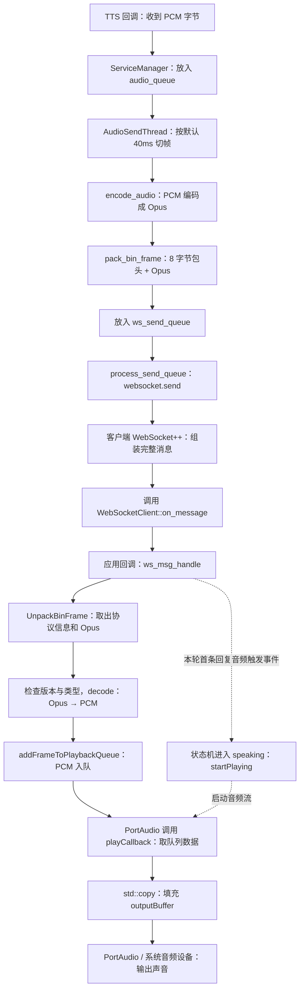
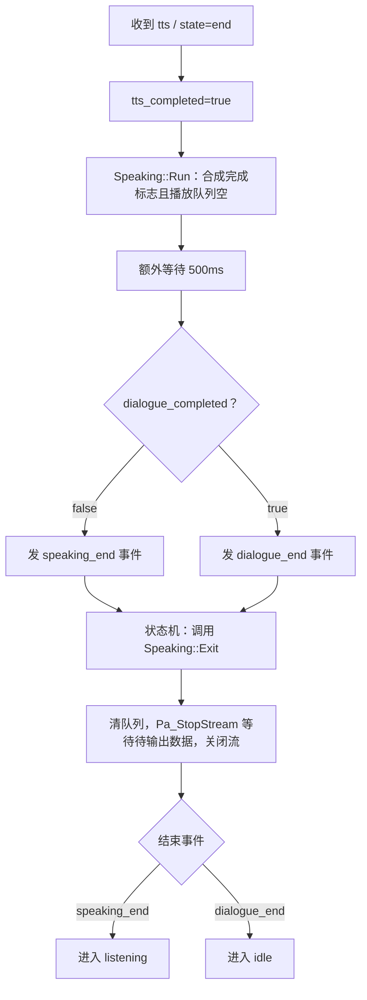

# Echo-Mate：从服务端发送音频到客户端播放结束

整理日期：2026-10-08。

本文接续 [TTS 文字提交到云端合成与音频回调流程与问答](2026-10-06_TTS文字提交到云端合成与音频回调流程与问答.md)，整理 **服务端收到 PCM → 切帧 → Opus 编码 → 打包 → WebSocket 发送 → 客户端回调 → 解包 → Opus 解码 → PCM 入队 → 音频设备输出 → 停止播放与状态切换**，并合并本轮有关回调、智能指针、解包和播放的学习问答。

内容以整理时的工作区源码为准。代码采用必要节选，省略部分日志与外围处理，补充中文注释；标有“等价示意”的代码用于解释调用关系，不代表原文件逐字如此。文件行号以后可能变化。本文描述正常音频数据的主流程，实际实现的边界在相关位置说明。

## 1. 完整数据流与阅读顺序



这张图表示调用关系和数据去向。接收、状态切换、播放分别在不同执行环境中进行，首帧入队与启动播放没有固定的先后完成顺序。播放回调遇到空队列时输出静音，之后继续获取数据。

| 阅读顺序 | 文件与入口 | 负责什么 |
| --- | --- | --- |
| 1 | [service_manager.py：_tts_on_data](/home/mango/ai/Echo-Mate/Demo/AIChat_demo/Server/service_manager.py:56) | 把 TTS 返回的 PCM 放进音频队列 |
| 2 | [audio_send_thread.py：run](/home/mango/ai/Echo-Mate/Demo/AIChat_demo/Server/threads/audio_send_thread.py:13) | 从队列取 PCM，切帧、编码、打包 |
| 3 | [audio_processor.py：encode_audio / pack_bin_frame](/home/mango/ai/Echo-Mate/Demo/AIChat_demo/Server/tools/audio_processor.py:36) | 将 PCM 编码为 Opus，生成应用协议包 |
| 4 | [ws_server.py：process_send_queue](/home/mango/ai/Echo-Mate/Demo/AIChat_demo/Server/ws_server.py:27) | 通过 WebSocket 发出排队的消息 |
| 5 | [WebsocketClient.cc：构造函数](/home/mango/ai/Echo-Mate/Demo/AIChat_demo/Client/WebSocket/WebsocketClient.cc:6) | 注册 WebSocket 消息回调 |
| 6 | [connection_impl.hpp：消息分发](/home/mango/ai/Echo-Mate/websocketpp/websocketpp/impl/connection_impl.hpp:1088) | 库取得完整消息，调用保存的回调 |
| 7 | [WebsocketClient.cc：on_message](/home/mango/ai/Echo-Mate/Demo/AIChat_demo/Client/WebSocket/WebsocketClient.cc:150) | 区分文本与二进制，转交消息内容 |
| 8 | [Application.cc：应用回调](/home/mango/ai/Echo-Mate/Demo/AIChat_demo/Client/Application/Application.cc:16) | 把消息交给 WSHandler |
| 9 | [WS_Handler.cc：ws_msg_handle](/home/mango/ai/Echo-Mate/Demo/AIChat_demo/Client/Application/WS_Handler.cc:44) | 调用解包、解码，再将 PCM 入队 |
| 10 | [AudioProcess.cc：decode / UnpackBinFrame](/home/mango/ai/Echo-Mate/Demo/AIChat_demo/Client/Audio/AudioProcess.cc:447) | 实际完成 Opus 解码与应用协议解包 |
| 11 | [Speaking.cc：Enter](/home/mango/ai/Echo-Mate/Demo/AIChat_demo/Client/Application/UserStates/Speaking.cc:9) | 启动播放和结束检查线程 |
| 12 | [AudioProcess.cc：startPlaying / playCallback](/home/mango/ai/Echo-Mate/Demo/AIChat_demo/Client/Audio/AudioProcess.cc:202) | 启动输出流，向音频缓冲区填 PCM |
| 13 | [Speaking.cc：Run / Exit](/home/mango/ai/Echo-Mate/Demo/AIChat_demo/Client/Application/UserStates/Speaking.cc:21) | 判断本轮结束，停止播放 |
| 14 | [StateConfig.cc：状态转换](/home/mango/ai/Echo-Mate/Demo/AIChat_demo/Client/Application/StateConfig.cc:46) | 播放结束后进入 listening 或 idle |

## 2. 服务端：PCM 怎样变成一条发送消息？

### 2.1 TTS 数据回调把 PCM 放入 audio_queue

在 `ServiceManager._tts_on_data()` 中，必要代码为：

```python
def _tts_on_data(self, data):  # SDK 收到一块 TTS 音频后，转交到这个业务回调
    self.audio_queue.put(data)  # 将 PCM 字节加入音频队列，等待发送线程处理
```

这里的 `data` 是 PCM 字节。一块 TTS 回调数据可能包含多帧或不足一帧，回调块的大小不必等于后面发送的一帧大小。

当前主链路由 `chat_start_task()` 逐段提交文字给 TTS。`main.py` 中创建的 `TTSGenerateThread` 没有调用 `start()`，因此不要把它误当成当前运行的合成线程。实际启动的音频发送线程见 [main.py](/home/mango/ai/Echo-Mate/Demo/AIChat_demo/Server/main.py:19)。

### 2.2 AudioSendThread 按一帧的字节数切片

`AudioSendThread.run()` 从 `audio_queue` 取数据。以下是处理 PCM 的必要节选：

```python
audio_data = self.sevice_manager.audio_queue.get(timeout=1)  # 取一块 PCM；队列暂空时最多等待 1 秒
samples_per_frame = int(self.sevice_manager.audio_processor.frame_duration_ms * self.sevice_manager.audio_processor.sample_rate / 1000) * 2  # 当前单声道 16 位 PCM 的一帧字节数
audio_data = remain_data + audio_data  # 将上次不足一帧的残余与这次数据拼接
for i in range(0, len(audio_data), samples_per_frame):  # 按一帧字节数逐段切片
    frame_slice = audio_data[i:i + samples_per_frame]  # 取当前这一段 PCM
    if len(frame_slice) == samples_per_frame:  # 只有完整一帧才进入编码与发送流程
        opus_data = self.sevice_manager.audio_processor.encode_audio(frame_slice)  # PCM 编码为 Opus
        bin_data = self.sevice_manager.audio_processor.pack_bin_frame(type=0, version=global_settings.protocol_version, payload=opus_data)  # 添加应用协议包头
        self.sevice_manager.ws_send_queue.put(bin_data)  # 将二进制包交给 WebSocket 发送队列
    else:  # 当前块的最后一段不足一帧
        remain_data = frame_slice  # 留到下一次取得 PCM 时继续拼接
```

`sevice_manager` 是源代码中的实际拼写。变量 `samples_per_frame` 在这里保存的是**字节数**，因为计算后乘了 `2`，不是单纯的采样点数量。

服务端默认配置来自 [audio_processor.py](/home/mango/ai/Echo-Mate/Demo/AIChat_demo/Server/tools/audio_processor.py:8)：

```text
采样率：16000 Hz
声道数：1
采样宽度：16 bit = 2 字节
一帧时长：40 ms

一帧采样值数量 = 16000 × 40 / 1000 = 640
一帧 PCM 大小 = 640 × 1 × 2 = 1280 字节
```

以上计算按当前默认单声道配置成立。当前服务器处理客户端 hello 时，修改音频参数的代码被注释；不能理解为客户端填写任何参数，服务端都会自动采用。

不足一帧的数据当前只被保留，没有在 TTS 完成时补齐并发送的处理。`remain_data` 拼接使用后也没有统一清空，若恰好切完所有完整帧，旧残余可能继续保留。这是现有实现的情况，不应把它描述成“最后一帧一定完整发送”。

### 2.3 encode_audio 调用 Opus 编码器

在 [encode_audio()](/home/mango/ai/Echo-Mate/Demo/AIChat_demo/Server/tools/audio_processor.py:69) 中：

```python
full_frames = len(pcm_data) // (self.frame_size * 2)  # 计算输入中有多少完整 PCM 帧
total_bytes_to_process = full_frames * self.frame_size * 2  # 计算这些完整帧的总字节数
opus_data = b''  # 准备保存编码后的字节串
for i in range(0, total_bytes_to_process, self.frame_size * 2):  # 遍历完整 PCM 帧
    frame = pcm_data[i:i + self.frame_size * 2]  # 取一帧 PCM 字节
    encoded_frame = self.encoder.encode(frame)  # 调用 Opus 编码器压缩这一帧
    opus_data += encoded_frame  # 累加编码结果
return opus_data  # 返回 Opus 字节串
```

当前发送线程每次传入一帧，因此这里通常只循环一次。1280 字节是编码前的 PCM 大小，编码后的 Opus 大小由实际编码结果决定，可能变化。

### 2.4 pack_bin_frame 添加 8 字节包头

在 [pack_bin_frame()](/home/mango/ai/Echo-Mate/Demo/AIChat_demo/Server/tools/audio_processor.py:36) 中：

```python
HEADER_FORMAT = "!HHI"  # 格式定义：网络字节序，依次为 2、2、4 字节无符号整数
header = struct.pack(self.HEADER_FORMAT, version, type, len(payload))  # 写入版本、类型及 Opus 字节数
return header + payload  # 拼成“8 字节包头 + Opus 数据”
```

第一行是类中的格式定义，后两行来自 `pack_bin_frame()`。`!` 指定网络大端字节序，本身不占数据字节；两个 `H` 各占 2 字节，`I` 占 4 字节。当前发送音频时 `type=0`。

**Opus 编码负责压缩音频，打包负责添加协议信息。** 这是两个不同的处理步骤。

### 2.5 真正发送的位置是 websocket.send

`ws_send_queue` 是发送队列，其中既可以有音频二进制包，也可以有 JSON 文本。`process_send_queue()` 的发送语句为：

```python
data = self.service_manager.ws_send_queue.get_nowait()  # 从已经入队的消息中取出下一条
await websocket.send(data)  # 通过当前客户端连接发送：bytes 为二进制，str 为文本
```

`ws_send_queue.put(...)` 只负责入队，网络发送发生在 `websocket.send(...)`。连接处理函数通过 `asyncio.create_task()` 启动这个发送协程；同一个连接可以持续发送多条消息。

## 3. 客户端收到的二进制包是什么样？

| 字节位置，从 0 开始 | 字段 | 大小 | 用途 |
| --- | --- | --- | --- |
| 0～1 | `version` | 2 字节 | 自定义应用协议版本 |
| 2～3 | `type` | 2 字节 | 自定义消息类型，当前音频要求为 0 |
| 4～7 | `payload_size` | 4 字节 | 后面的 Opus 数据有多少字节 |
| 从 8 开始 | `payload` | `payload_size` 字节 | Opus 音频数据 |

```text
[version：2][type：2][payload_size：4][Opus：N]
                  包头 8 字节            数据 N 字节

正常应用协议包大小 = 8 + N 字节
```

例如，假设某帧 Opus 为 100 字节，应用协议包就是 108 字节。这只是数值示例。WebSocket 帧头以及 TCP/IP 等网络开销不包含在这里的 108 字节内。

客户端从 `msg->get_payload()` 取得的是 WebSocket 消息的内容。WebSocket 帧头已经由库处理，这个内容中仍包含本项目的 8 字节应用协议包头，需要继续调用 `UnpackBinFrame()`。

### 3.1 BinProtocol 与 BinProtocolInfo

在 [WebsocketClient.h](/home/mango/ai/Echo-Mate/Demo/AIChat_demo/Client/WebSocket/WebsocketClient.h:14) 中：

```cpp
struct BinProtocol {  // 描述用于传输的应用协议布局
    uint16_t version;  // 2 字节版本
    uint16_t type;  // 2 字节类型
    uint32_t payload_size;  // 4 字节负载长度
    uint8_t payload[];  // 后面的可变长度数据区域，当前实现使用柔性数组扩展
} __attribute__((packed));  // 指定紧凑布局，避免字段之间加入填充

struct BinProtocolInfo {  // 保存解包后业务需要的协议字段
    uint16_t version;  // 已转换为本机字节序的版本
    uint16_t type;  // 已转换为本机字节序的类型
};  // 结构体定义结束
```

`BinProtocol` 用来描述和构造传输布局；`BinProtocolInfo` 是解包后的普通信息对象。音频负载另外保存在 `std::vector<uint8_t> opus_data` 中，`payload_size` 用于长度检查和提取，不存入 `BinProtocolInfo`。

## 4. 客户端：收到消息后怎样自动进入 on_message？

### 4.1 构造函数中先注册回调

客户端类型别名来自 [WebsocketClient.h](/home/mango/ai/Echo-Mate/Demo/AIChat_demo/Client/WebSocket/WebsocketClient.h:90)：

```cpp
using client_t = websocketpp::client<websocketpp::config::asio_client>;  // 给采用 Asio 配置的客户端类型起别名
```

创建 `WebSocketClient` 对象时，构造函数执行这句：

```cpp
ws_client_.set_message_handler(bind(&WebSocketClient::on_message, this, std::placeholders::_1, std::placeholders::_2));  // 注册收到消息时执行的回调
```

| 语法部分 | 含义 |
| --- | --- |
| `ws_client_.` | 访问当前 WebSocket++ 客户端对象的成员 |
| `set_message_handler(...)` | 将传入的可调用对象保存为消息回调 |
| `bind(...)` | 调用绑定函数，生成一个可以稍后调用的对象 |
| `&WebSocketClient::on_message` | 取得该类成员函数的指针；`::` 指定所属类 |
| `this` | 绑定当前 `WebSocketClient` 对象，供成员函数调用 |
| `std::placeholders::_1` | 将来调用回调时传入的第一个实参 |
| `std::placeholders::_2` | 将来调用回调时传入的第二个实参 |

构造函数阶段保存“调用哪个函数、通过哪个对象、参数如何对应”。这时还没有收到消息，也没有执行 `on_message()`。

下面是把原表达式拆开的**等价示意**：

```cpp
auto handler = std::bind(  // 生成一个可调用对象，并保存到局部变量 handler
    &WebSocketClient::on_message,  // 保存目标成员函数
    this,  // 保存当前对象指针
    std::placeholders::_1,  // 留出第一个调用参数的位置
    std::placeholders::_2  // 留出第二个调用参数的位置
);  // bind 调用结束
ws_client_.set_message_handler(handler);  // 将生成的对象注册为消息回调
```

`bind` 是函数，它的返回值是可调用对象。回调被保存后可以使用 `handler(hdl, msg)` 这样的形式调用。

### 4.2 set_message_handler 怎样保存回调？

[endpoint.hpp](/home/mango/ai/Echo-Mate/websocketpp/websocketpp/endpoint.hpp:322) 的关键代码如下，省略日志与锁：

```cpp
void set_message_handler(message_handler h) {  // 接收调用者提供的回调
    m_message_handler = h;  // 保存到客户端内部成员中
}  // 注册函数结束
```

创建连接时，在 [endpoint_impl.hpp](/home/mango/ai/Echo-Mate/websocketpp/websocketpp/impl/endpoint_impl.hpp:68) 又执行：

```cpp
con->set_message_handler(m_message_handler);  // 把客户端保存的回调复制给新连接
```

连接也有自己的 `m_message_handler`。客户端与连接里的成员名字相同，属于不同对象；调用消息回调时使用的是当前连接保存的回调。

在库的 [connection.hpp](/home/mango/ai/Echo-Mate/websocketpp/websocketpp/connection.hpp:281) 中，回调类型定义为：

```cpp
typedef lib::function<void(connection_hdl, message_ptr)> message_handler;  // 保存“接收连接句柄和消息指针、无返回值”的可调用对象
```

### 4.3 启动网络循环，建立连接

[Startup.cc](/home/mango/ai/Echo-Mate/Demo/AIChat_demo/Client/Application/UserStates/Startup.cc:19) 中先执行：

```cpp
app->ws_client_.Run();  // 启动独立线程，运行 Asio 网络事件循环
app->ws_client_.Connect();  // 创建连接、添加请求头并发起异步连接
```

`Connect()` 内部调用 `ws_client_.connect(con)` 发起连接。底层建立 TCP 连接后进行 WebSocket 握手，成功后才可以正常交换 WebSocket 消息。应用代码通过库提供的回调处理消息。

### 4.4 库在哪里取得 msg，又怎样传入参数？

WebSocket++ 接收网络字节并组装完整的 WebSocket 消息。库判断消息准备好后，在 `connection_impl.hpp` 中执行以下关键语句；两句之间的状态判断已省略：

```cpp
message_ptr msg = m_processor->get_message();  // 获取指向完整消息对象的智能指针
m_message_handler(m_connection_hdl, msg);  // 调用当前连接保存的回调，传入两个实际参数
```

因为内部保存的是之前 `bind` 生成的回调，参数按位置对应：

```text
m_message_handler(m_connection_hdl, msg)
                          ↓          ↓
                         _1         _2
                          ↓          ↓
this->on_message(m_connection_hdl, msg)
```

`_1` 和 `_2` 按调用参数的位置取值，不依赖变量名字，也不是两个指针。库把连接句柄放在第一个位置、消息智能指针放在第二个位置，因此形成这个对应关系。

`on_message()` 的声明是：

```cpp
void on_message(websocketpp::connection_hdl hdl, client_t::message_ptr msg);  // 接收连接句柄和消息智能指针
```

`msg` 在函数被调用时由第二个实参初始化。头文件声明只告诉编译器函数接口；接收到的消息指针由调用者传入。库的局部变量 `msg` 与函数形参 `msg` 是两个变量，复制智能指针后共享同一个消息对象。

### 4.5 on_message 转交内容，再进入 ws_msg_handle

`WebSocketClient::on_message()` 中的必要节选为：

```cpp
if (msg->get_opcode() == websocketpp::frame::opcode::text) {  // WebSocket 文本消息
    if (on_message_) {  // 已经设置应用层回调
        on_message_(msg->get_payload(), false);  // 转交消息内容，标记为文本
    }  // 应用回调判断结束
} else if (msg->get_opcode() == websocketpp::frame::opcode::binary) {  // WebSocket 二进制消息
    if (on_message_) {  // 已经设置应用层回调
        on_message_(msg->get_payload(), true);  // 转交消息内容，标记为二进制
    }  // 应用回调判断结束
}  // 消息类型分支结束
```

`get_opcode()` 判断 WebSocket 消息类型；本项目包头中的 `type=0` 是负载内部的应用协议类型，两者处于不同层。

应用回调是在 `Application` 构造函数中登记的：

```cpp
ws_client_.SetMessageCallback([this](const std::string& message, bool is_binary) {  // 保存捕获 Application 对象的 lambda
    app_handler.ws_msg_handle(message, is_binary, this);  // 调用业务消息处理函数
});  // 应用回调注册结束
```

`SetMessageCallback()` 把这个 lambda 保存到 `on_message_`。`WebSocketClient::on_message` 是函数名，`on_message_` 是保存应用回调的成员，注意末尾下划线。

这里的 `message` 是 `std::string`，保存消息内容的字节序列。二进制内容可以包含 `0` 字节，使用 `message.data()` 和 `message.size()` 就能按实际长度处理完整内容。

## 5. WS_Handler：解包、解码和 PCM 入队

### 5.1 调用 UnpackBinFrame 的四个参数

在 `ws_msg_handle()` 的二进制分支中：

```cpp
BinProtocolInfo protocol_info;  // 准备接收解包后的版本与类型
std::vector<uint8_t> opus_data;  // 准备接收从包中提取的 Opus 字节
std::vector<int16_t> pcm_data;  // 准备接收后续解码产生的 PCM 采样值
if (app->audio_processor_.UnpackBinFrame(reinterpret_cast<const uint8_t*>(message.data()), message.size(), protocol_info, opus_data)) {  // 解包成功后进入分支
    if (protocol_info.version == app->get_ws_protocolVersion() && protocol_info.type == 0) {  // 检查版本符合配置、类型为音频
        app->audio_processor_.decode(opus_data.data(), opus_data.size(), pcm_data);  // 调用解码，将 Opus 转成 PCM
        app->audio_processor_.addFrameToPlaybackQueue(pcm_data);  // 将得到的 PCM 交给播放队列
    }  // 版本与类型判断结束；失败时原代码记录日志
}  // 解包判断结束；失败时原代码记录日志
```

| 实参 | 方向 | 含义 |
| --- | --- | --- |
| `reinterpret_cast<const uint8_t*>(message.data())` | 输入 | 整个应用协议包的起始地址 |
| `message.size()` | 输入 | 整个包实际收到的字节数 |
| `protocol_info` | 输出 | 通过引用接收版本、类型 |
| `opus_data` | 输出 | 通过引用接收提取出的 Opus 数据 |

四个实参并不是“依次从包里读出四个东西”。前两个提供原始数据的地址和大小，后两个提供保存结果的容器。

`reinterpret_cast` 在这里将 `const char*` 视为 `const uint8_t*`，方便按字节偏移访问。这个转换本身没有解包，也没有解码。

`message.size()` 是本次完整 WebSocket 消息内容的字节数。正常打包时它等于 `8 + payload_size`，没有固定为 1280 字节；1280 是默认一帧编码前 PCM 的大小。

### 5.2 UnpackBinFrame 按约定位置拆包

[UnpackBinFrame()](/home/mango/ai/Echo-Mate/Demo/AIChat_demo/Client/Audio/AudioProcess.cc:489) 首先检查输入至少有 8 字节，然后定位包头字段：

```cpp
const uint16_t* version_ptr = reinterpret_cast<const uint16_t*>(packed_data);  // 版本从字节偏移 0 开始
const uint16_t* type_ptr = reinterpret_cast<const uint16_t*>(packed_data + sizeof(uint16_t));  // 类型从偏移 2 开始
const uint32_t* payload_size_ptr = reinterpret_cast<const uint32_t*>(packed_data + sizeof(uint16_t) * 2);  // 长度从偏移 4 开始
uint16_t version = ntohs(*version_ptr);  // 读取 2 字节版本，将网络字节序转换为本机字节序
uint16_t type = ntohs(*type_ptr);  // 读取 2 字节类型并转换字节序
uint32_t payload_size = ntohl(*payload_size_ptr);  // 读取 4 字节负载长度并转换字节序
```

这里 `packed_data` 指向 `uint8_t`，所以 `packed_data + 2` 就是向后移动 2 字节。解析依赖双方约定好的字段顺序和宽度。

接下来检查实际数据足够容纳包头声明的负载，再保存输出：

```cpp
if (packed_data_size < sizeof(uint16_t) * 2 + sizeof(uint32_t) + payload_size) {  // 检查实际字节数至少为 8 + payload_size
    return false;  // 数据不足时解包失败，省略错误日志
}  // 长度检查结束
protocol_info.version = version;  // 通过引用写回调用者的版本字段
protocol_info.type = type;  // 通过引用写回调用者的类型字段
opus_data.clear();  // 清空输出 vector 中原来的字节
opus_data.insert(opus_data.end(), packed_data + sizeof(uint16_t) * 2 + sizeof(uint32_t),  // 从偏移 8 开始复制
                 packed_data + sizeof(uint16_t) * 2 + sizeof(uint32_t) + payload_size);  // 复制到 8 + payload_size 之前，不含终点
return true;  // 包头与声明长度内的负载已经提取完成
```

返回 `true` 表示解包完成。版本和类型是否符合本客户端要求由调用处另外检查，音频是否成功解码也要看下一步。

实际长度检查使用 `<`，要求“至少有这么多字节”，并不要求严格相等。若尾部还有额外字节，当前实现只复制声明长度内的 Opus 数据。

### 5.3 AudioProcess::decode 将 Opus 转为 PCM

`WS_Handler` 负责调用，实际解码代码位于 [AudioProcess::decode()](/home/mango/ai/Echo-Mate/Demo/AIChat_demo/Client/Audio/AudioProcess.cc:447)。以下节选省略解码器存在性检查和错误日志：

```cpp
int frame_size = 960;  // 当前实现为每个声道预留的输出采样容量
pcm_frame.resize(frame_size * channels);  // 准备 PCM 输出空间
int decoded_samples = opus_decode(decoder, opus_data, static_cast<int>(opus_data_size), pcm_frame.data(), frame_size, 0);  // 将 Opus 解码到 PCM vector 的存储区
if (decoded_samples < 0) {  // Opus 返回负数表示解码失败
    return false;  // 向调用者报告失败
}  // 解码返回值检查结束
pcm_frame.resize(decoded_samples * channels);  // 按实际解码结果调整 vector 大小
return true;  // 解码成功
```

这里的 `960` 是输出空间的容量，不能理解为“每次一定产生 960 个采样点”或“Opus 限制为 960”。`opus_decode` 的实际返回值决定有效采样数量；默认 16 kHz、40 ms、单声道音频对应 640 个采样值。参数含义可对照本地官方 [opus.h](/home/mango/ai/Echo-Mate/SDK/rv1106-sdk/tools/linux/toolchain/arm-rockchip830-linux-uclibcgnueabihf/arm-rockchip830-linux-uclibcgnueabihf/sysroot/usr/include/opus/opus.h:467)。

`pcm_data` 的元素类型为 `int16_t`：默认一帧含 640 个元素，元素总大小为 1280 字节。`pcm_data.size()` 返回元素数量；`opus_data.size()` 返回元素数量，因为其元素为 1 字节的 `uint8_t`，数值也就是 Opus 字节数。

当前 `WS_Handler.cc` 没有检查 `decode()` 的返回值，而是在调用后直接入队。上面的主流程描述正常解码的数据；解包成功不能推导出解码一定成功。

### 5.4 addFrameToPlaybackQueue 保存 PCM

[addFrameToPlaybackQueue()](/home/mango/ai/Echo-Mate/Demo/AIChat_demo/Client/Audio/AudioProcess.cc:339) 加锁后，将 PCM 保存到 `playbackQueue`。默认配置下，短于本地一帧的 PCM 会补 `0` 至一帧大小，表示补静音；足够一帧时直接 `push(pcm_frame)`。

这里保存的是 PCM 数据，还需要播放回调将其提交到音频输出缓冲区。

| 队列 | 所在端 | 保存的数据 | 谁取出 |
| --- | --- | --- | --- |
| `audio_queue` | Python 服务端 | TTS 返回的 PCM 字节块 | `AudioSendThread` |
| `ws_send_queue` | Python 服务端 | 音频二进制包、JSON 文本消息 | `process_send_queue()` |
| `playbackQueue` | C++ 客户端 | 解码后的 PCM 采样值 vector | PortAudio 的 `playCallback()` |

## 6. PCM 如何真正送到音频设备？

### 6.1 本轮首条音频触发 speaking 状态

进入 `listening` 时，客户端设置 `first_audio_msg_received=true`，表示等待本轮首条回复音频。在 `ws_msg_handle()` 的二进制分支中，解包之前执行：

```cpp
if (app->get_first_audio_msg_received() == true) {  // 当前消息是本轮等待的首条回复音频
    app->set_first_audio_msg_received(false);  // 后续音频消息不再重复发这个事件
    app->eventQueue_.Enqueue(static_cast<int>(AppEvent::speaking_msg_received));  // 将开始说话事件交给状态机线程
}  // 首条消息判断结束
```

当前处于 `thinking` 时，这个事件使状态机进入 `speaking`。`Application::Run()` 的状态线程从事件队列取事件，调用 `client_state_.HandleEvent(...)` 完成状态转换。

`SpeakingState::Enter()` 中执行：

```cpp
app->audio_processor_.startPlaying();  // 启动 PortAudio 播放流
state_running_.store(true);  // 允许本状态的结束检查循环运行
state_running_thread_ = std::thread([app]() { Run(app); });  // 单独运行结束检查线程
```

网络处理和状态处理是异步的；首条音频的 PCM 入队与 `startPlaying()` 谁先完成并没有保证。播放启动时队列暂空，回调会先输出静音。

### 6.2 startPlaying 注册播放回调并启动音频流

在 [startPlaying()](/home/mango/ai/Echo-Mate/Demo/AIChat_demo/Client/Audio/AudioProcess.cc:202) 中，初始化与错误处理省略后的关键调用为：

```cpp
outputParameters.device = Pa_GetDefaultOutputDevice();  // 选择默认输出设备
outputParameters.channelCount = channels;  // 设置声道数，默认 1
outputParameters.sampleFormat = paInt16;  // 输出为 16 位有符号 PCM 采样值
err = Pa_OpenStream(&playbackStream,  // 创建并保存播放流
                    nullptr,  // 没有输入流
                    &outputParameters,  // 使用已配置的输出设备参数
                    sample_rate,  // 输出采样率，默认 16000 Hz
                    sample_rate / 1000 * frame_duration_ms,  // 指定每次回调的 sample frames 数，默认 640
                    paClipOff,  // 使用源码配置的流标志
                    playCallback,  // 注册需要音频数据时调用的函数
                    this);  // 将当前 AudioProcess 对象作为 userData 交给回调
err = Pa_StartStream(playbackStream);  // 开始音频处理，之后 PortAudio 会调用播放回调
```

默认单声道时，640 个 sample frames 就是 640 个 `int16_t` 采样值，共 1280 字节。回调应以实际传入的 `framesPerBuffer` 为准。

这里也有“先注册、后调用”的过程：`Pa_OpenStream` 登记 `playCallback` 和 `this`，`Pa_StartStream` 启动后，由 PortAudio 在需要下一段输出数据时调用它。

### 6.3 playCallback 从播放队列取数据

在 [playCallback()](/home/mango/ai/Echo-Mate/Demo/AIChat_demo/Client/Audio/AudioProcess.cc:289) 中，必要节选为：

```cpp
AudioProcess* audioProcess = static_cast<AudioProcess*>(userData);  // 取回注册时传入的 AudioProcess 对象指针
int16_t* output = static_cast<int16_t*>(outputBuffer);  // 将 PortAudio 提供的输出缓冲区按 int16_t 采样值访问
std::lock_guard<std::mutex> lock(audioProcess->playbackMutex);  // 保护播放队列的访问
if (audioProcess->playbackQueue.empty()) {  // 暂时没有待提交的 PCM
    std::fill(output, output + framesPerBuffer * audioProcess->channels, 0);  // 将本次输出缓冲区填为静音
    return paContinue;  // 本次回调结束，保持流运行，等待下次回调
}  // 空队列分支结束
std::vector<int16_t>& currentFrame = audioProcess->playbackQueue.front();  // 引用队列最前面的一帧
size_t samplesToCopy = std::min(static_cast<size_t>(framesPerBuffer * audioProcess->channels), currentFrame.size());  // 本次请求量与当前帧大小取较小值
std::copy(currentFrame.begin(), currentFrame.begin() + samplesToCopy, output);  // 将这些采样值复制到输出缓冲区
if (samplesToCopy < framesPerBuffer * audioProcess->channels) {  // 当前帧不足以填满本次输出
    std::fill(output + samplesToCopy, output + framesPerBuffer * audioProcess->channels, 0);  // 剩余输出位置补静音
}  // 输出缓冲区补齐结束
if (samplesToCopy == currentFrame.size()) {  // 当前帧全部复制完
    audioProcess->playbackQueue.pop();  // 从应用队列移除这一帧
} else {  // 当前帧还有一部分尚未复制
    audioProcess->playbackQueue.front().erase(audioProcess->playbackQueue.front().begin(), audioProcess->playbackQueue.front().begin() + samplesToCopy);  // 删除已复制部分，保留剩余数据
}  // 队列更新结束
return paContinue;  // 保持音频流运行，继续请求下一段数据
```

这次回调实际只处理队列最前面的一个 vector。若它不足以填满输出缓冲区，余下位置补静音，当前实现不会继续取下一个 vector 来拼满。

### 6.4 std::copy 做了什么？声音在哪里产生？

```cpp
std::copy(currentFrame.begin(), currentFrame.begin() + samplesToCopy, output);  // 复制元素到输出缓冲区
```

三个参数分别是：

| 参数 | 含义 |
| --- | --- |
| `currentFrame.begin()` | 源数据的起点 |
| `currentFrame.begin() + samplesToCopy` | 源数据的终点，不包含此位置 |
| `output` | 目标缓冲区的起点 |

它复制的是 `samplesToCopy` 个 `int16_t` 采样值。`std::copy` 完成填充缓冲区的工作，PortAudio 和系统音频设备负责实际输出声音。

```text
队列中的 PCM → std::copy → outputBuffer → PortAudio / 系统音频设备 → 扬声器
```

`outputBuffer` 是音频库提供的输出空间，`output` 是指向这块空间的有类型指针。回调填完数据后，音频库将这些数据用于输出；这也解释了源码中为什么没有另一个 `play(pcm_data)` 调用。

`pop()` 或 `erase()` 表示应用队列里的数据已经复制到输出缓冲区。此刻 PortAudio 或设备还可能有待输出的数据，不能仅据此断定扬声器已经发完声音。

## 7. 怎样判断本轮结束，并停止播放？

### 7.1 服务端发送 TTS 合成完成通知

云端 TTS 完成本轮合成后，SDK 调用业务完成回调，进入 [ServiceManager._tts_on_complete()](/home/mango/ai/Echo-Mate/Demo/AIChat_demo/Server/service_manager.py:65)。它向 `ws_send_queue` 放入下列 JSON 文本：

```json
{"type": "tts", "state": "end"}
```

这条消息仍通过 `process_send_queue()` 的 `websocket.send(...)` 发出。它表示本轮 TTS 合成完成，客户端收到后由文本分支解析，再进入 `handle_tts_message()`。

```cpp
if (stateStr == "end") {  // 识别到 TTS 完成消息中的 state=end
    app->set_tts_completed(true);  // 将本轮 TTS 完成标志设为 true，省略日志
}  // 完成消息判断结束
```

**TTS 完成通知不保证排在最后一个音频包之后。** 原因是 PCM 先进入 `audio_queue`，经过音频发送线程编码后才进入 `ws_send_queue`；完成通知由另一个回调直接进入 `ws_send_queue`。发送队列保证已经入队消息的先后顺序，但无法自动保证两个生产路径的逻辑顺序。

因此，应分别理解这些时刻：云端合成完成、服务端音频编码与发送完成、客户端应用队列被消费、音频设备输出完成。

### 7.2 整个对话结束有另外一个标志

服务端识别到结束对话意图 `exit_chat` 时，在 [service_manager.py](/home/mango/ai/Echo-Mate/Demo/AIChat_demo/Server/service_manager.py:89) 将下列消息加入发送队列：

```json
{"type": "chat", "dialogue": "end"}
```

这个标志可以在告别回复合成和播放之前发出。它告诉客户端，这轮语音结束后应该回到等待唤醒。

客户端在 `handle_chat_message()` 中执行：

```cpp
if (dialogueStr == "end") {  // 收到整个对话结束的标记
    app->set_dialogue_completed(true);  // 保存结束对话标志，省略日志
}  // 标志判断结束
```

两个标志的用途不同：

| 客户端内部标志 | 来自哪条消息 | 用途 |
| --- | --- | --- |
| `tts_completed` | `{"type":"tts","state":"end"}` | 与播放队列状态一起判断当前语音是否可以结束 |
| `dialogue_completed` | `{"type":"chat","dialogue":"end"}` | 决定语音结束后继续监听还是回到等待唤醒 |

JSON 中没有名为 `tts_completed` 或 `dialogue_completed` 的字段；它们是客户端接收消息后设置的内部状态。

### 7.3 SpeakingState::Run 检查标志和队列

`SpeakingState::Enter()` 启动的工作线程执行 [Run()](/home/mango/ai/Echo-Mate/Demo/AIChat_demo/Client/Application/UserStates/Speaking.cc:21)。以下是正常结束分支，省略日志：

```cpp
while (state_running_.load() == true) {  // 持续检查当前 speaking 状态是否应结束
    std::this_thread::sleep_for(std::chrono::milliseconds(500));  // 每轮检查前等待 500ms
    if (app->get_tts_completed() && app->audio_processor_.playbackQueueIsEmpty()) {  // 合成完成标志已收到，并且应用播放队列暂空
        std::this_thread::sleep_for(std::chrono::milliseconds(500));  // 条件成立后额外等待 500ms
        if (app->get_dialogue_completed() == false) {  // 整个对话还没有结束
            app->eventQueue_.Enqueue(static_cast<int>(AppEvent::speaking_end));  // 发事件，准备回到 listening
        } else {  // 整个对话已结束
            app->eventQueue_.Enqueue(static_cast<int>(AppEvent::dialogue_end));  // 发事件，准备回到 idle
        }  // 结束去向判断结束
        app->set_tts_completed(false);  // 重置本轮合成完成标志
        app->set_dialogue_completed(false);  // 重置结束对话标志
        break;  // 结束这个检查循环
    }  // 本轮结束条件判断结束
}  // 检查循环结束
```

这里是程序采用的结束判断。额外的 500ms 是延迟等待，当前代码在等待后没有再次检查队列；它不代表收到设备精确的播放完成通知。结合服务端完成消息的入队时序，不能把这一条件解释为“协议已经严格确认所有音频都发送并播放完”。

### 7.4 状态机先退出 speaking，再进入下一状态

状态转换配置是：

| 当前状态 | 事件 | 下一状态 |
| --- | --- | --- |
| `thinking` | `speaking_msg_received` | `speaking` |
| `speaking` | `speaking_end` | `listening`：继续接收用户语音 |
| `speaking` | `dialogue_end` | `idle`：回到唤醒检测 |

事件处理线程消费结束事件后，[StateMachine::ChangeState()](/home/mango/ai/Echo-Mate/Demo/AIChat_demo/Client/StateMachine/StateMachine.cc:53) 先调用旧状态的 `Exit()`，再调用新状态的 `Enter()`。

因此，退出 `speaking` 时先执行：

```cpp
app->audio_processor_.clearPlaybackAudioQueue();  // 清空应用播放队列
app->audio_processor_.stopPlaying();  // 停止音频输出流并清理资源
state_running_.store(false);  // 关闭本状态工作循环的运行标志
state_running_thread_.join();  // 等待结束检查线程退出
```

随后进入 `listening` 或 `idle`。正常的一轮语音结束后，程序和 WebSocket 连接继续运行，等待下一轮。

### 7.5 stopPlaying 停止流并等待待输出缓冲区

在 [stopPlaying()](/home/mango/ai/Echo-Mate/Demo/AIChat_demo/Client/Audio/AudioProcess.cc:259) 中，正常停止路径的必要调用为：

```cpp
err = Pa_StopStream(playbackStream);  // 停止音频处理，等待已经交给流的待输出缓冲区播放完成
err = Pa_CloseStream(playbackStream);  // 关闭音频流，省略错误判断
Pa_Terminate();  // 释放 PortAudio 初始化资源
isPlaying = false;  // 更新客户端内部播放状态
```

`Pa_StopStream` 的等待语义来自本地官方 [portaudio.h](/home/mango/ai/Echo-Mate/SDK/rv1106-sdk/tools/linux/toolchain/arm-rockchip830-linux-uclibcgnueabihf/arm-rockchip830-linux-uclibcgnueabihf/sysroot/usr/include/portaudio.h:994)。它等待已经提交给音频流的缓冲区完成；未收到、未解码或已从应用队列清除的数据不在这个等待范围内。

从收到完成消息到退出状态的关系可以这样看：



图中的队列为空是应用层检查，不是设备完成信号。图表示当前代码的退出逻辑。

## 8. 本轮学习问答

| 问题 | 回答 |
| --- | --- |
| `set_message_handler(...)` 在构造函数中，还是注册吗？ | 是。构造函数执行初始化，注册回调就是初始化的一部分；收到消息后才执行回调。 |
| `bind()` 是 message handler 对象吗？ | `bind` 是函数；`bind(...)` 返回可调用对象，该对象被保存为消息处理回调。 |
| `_1` 怎么知道对应 hdl，`_2` 对应 msg？ | 按调用实参的位置：库执行 `m_message_handler(m_connection_hdl, msg)`，第一个位置给 `_1`，第二个给 `_2`。 |
| `m_message_handler(...)` 为什么能调用我绑定的函数？ | `set_message_handler` 已把回调赋给内部成员，创建连接时再复制给连接。调用保存的对象就会执行绑定的成员函数。 |
| `client_t` 是对象吗？ | 它是 `using` 定义的类型别名；`ws_client_` 是这个类型的对象。 |
| `client_t::message_ptr msg` 在哪里获得值？ | 库先通过 `get_message()` 取得消息智能指针，再调用回调。函数形参在调用时由实参初始化。 |
| 声明头文件后参数就有消息了吗？ | 声明提供函数接口；消息指针的实际值由调用者传入。 |
| `msg`、`message` 是什么关系？ | `msg` 指向库的消息对象；`get_payload()` 取出内容，应用回调用 `std::string message` 接收这些字节。 |
| `std::string` 可以保存二进制数据吗？ | 可以，包括值为 0 的字节。这里按 `.data()` 和 `.size()` 处理实际长度。 |
| `UnpackBinFrame` 是按顺序读取字节吗？ | 按约定的字段宽度和偏移定位：0 处版本、2 处类型、4 处长度、8 处音频。先读包头，再按长度提取负载。 |
| 包还没拆开，为什么能传四个参数？ | 前两个传输入地址和大小，后两个传接收输出的引用对象；它们不是已经读出的四个包内字段。 |
| 为什么输出用 `BinProtocolInfo`？ | 它保存解包后的版本与类型；音频另外放进 `opus_data`，无需把传输包整体作为输出结构。 |
| 每次解包的数据大小是多少？ | 本次 `message.size()` 字节；正常包为 `8 + payload_size` 字节。包头固定，Opus 负载大小可变。 |
| 解包成功就代表音频解码完成了吗？ | 解包提取 Opus，后面的 `decode()` 才生成 PCM。两者分别有自己的结果。 |
| 是在 `WS_Handler` 中解码吗？ | 它发起调用；实际解码由 `AudioProcess::decode()` 内的 `opus_decode()` 完成。 |
| 放进 `playbackQueue` 就播放了吗？ | 数据只是等待输出。音频流运行后，由 `playCallback()` 取出并填入输出缓冲区。 |
| `std::copy(...)` 实现了播放吗？ | 它复制 PCM 采样值到 PortAudio 提供的缓冲区；PortAudio 与系统音频设备完成实际输出。 |
| 回调返回 `paContinue` 就结束播放了吗？ | 当前这次回调结束，音频流继续运行，之后仍会再次调用回调。 |
| 队列空就等于扬声器播完吗？ | 表示应用队列数据已被取出；音频库和设备还可能有待输出数据。停止流时 `Pa_StopStream` 会等待已提交缓冲区。 |
| 播放结束后程序也结束了吗？ | 一轮语音流程结束。状态机转入 `listening` 或 `idle`，继续下一轮交互。 |

复盘时，可以沿下面的调用与数据传递关系向下查找：

```text
服务端：
_tts_on_data → audio_queue → AudioSendThread.run
→ encode_audio → pack_bin_frame → ws_send_queue
→ process_send_queue → websocket.send

客户端接收：
WebSocket++ 的 m_message_handler(hdl, msg)
→ WebSocketClient::on_message → 应用 lambda → ws_msg_handle
→ UnpackBinFrame → decode → addFrameToPlaybackQueue

客户端输出：
SpeakingState::Enter → startPlaying → Pa_OpenStream / Pa_StartStream
→ PortAudio 调用 playCallback → std::copy 填输出缓冲区 → 音频设备

本轮结束：
tts/end → handle_tts_message 设置 tts_completed
→ SpeakingState::Run 在线程中轮询检测
→ speaking_end 或 dialogue_end 进入 eventQueue
→ 状态线程处理事件，调用 SpeakingState::Exit
→ stopPlaying → 进入 listening 或 idle
```
