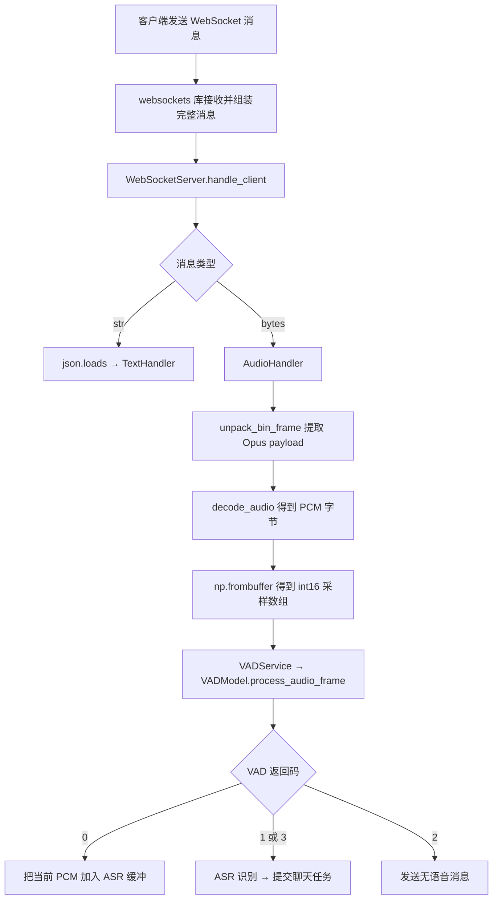
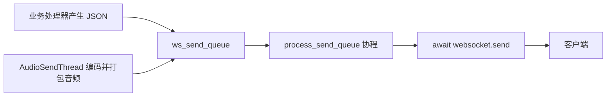

# 服务端 WebSocket 接收与 VAD 检测流程及问答

整理日期：2026-10-12。

整理范围：从“服务端第一时间接收音频数据的在哪里？”开始，到“每 40ms 调用一次，为什么不是每次都执行到 VAD 模型？”为止。保留提问和确认理解的表述，按主题合并重复问题；解释以当前项目代码为准。

项目位置：`Demo/AIChat_demo/Server`。本项目依赖文件指定 `websockets==13.1`，以下回调签名按这个版本使用的 legacy asyncio 接口解释。

## 阅读导航

- [一、服务端入口与握手](#server-entry)
- [二、回调参数、self 和 websocket 对象](#callback)
- [三、协程、await、事件循环与线程](#async)
- [四、发送队列、请求头和鉴权](#send-auth)
- [五、ServiceManager、services、handle 与 tools](#services)
- [六、二进制解包、消息完整性和 TCP 顺序](#protocol)
- [七、AudioHandler、PCM 转换与 ASR 缓冲](#audio-handler)
- [八、VAD 音频缓冲与 40ms / 200ms 的执行过程](#vad-buffer)
- [九、VAD 模型、cache 和起止点解析](#vad-result)
- [十、当前代码中需要准确理解的细节](#details)
- [十一、代码与参考资料](#references)

## 先看完整接收链路



这里有三个不同的概念：客户端默认每块音频是 **40ms**；VAD 模型每次分析的块是 **200ms**；一句话可以持续数秒，跨越很多块音频。

<a id="server-entry"></a>

## 一、服务端入口与握手

### 1. 服务端在哪里最先接收音频？handle_client 是做什么的？

**你的问题：**

> 服务端第一时间接收音频数据的在哪里？
>
> handle_client？

在项目的业务代码中，入口是 `ws_server.py` 的 `WebSocketServer.handle_client()`：

```python
async for message in websocket:
    if isinstance(message, bytes):
        await self.audio_handler.handle_audio_message(message)
    else:
        text = json.loads(message)
        await self.text_handler.handle_text_message(text)
```

底层网络字节先由操作系统和 `websockets` 库处理。库把一条完整 WebSocket 消息交出来后，这里的 `message` 才拿到它。

`handle_client()` 负责这条客户端连接的业务流程：启动发送任务、读取请求头、鉴权、接收消息，再分发给音频或文本处理器。

### 2. TCP 三次握手和 WebSocket 握手在哪里处理？

**你的问题：**

> 服务端中哪里是处理websocket三次握手的？
>
> websocket也是基于tcp协议的吧
>
> async with websockets.serve(self.handle_client, self.host, self.port):这一条代码就包含了整个握手的过程？

本项目的 WebSocket 建立在 TCP 连接上，需要区分两个过程：

| 过程 | 作用 | 主要由谁处理 |
|---|---|---|
| TCP 三次握手 | 建立 TCP 连接 | 操作系统 TCP 协议栈 |
| WebSocket 开启握手 | 通过 HTTP Upgrade 升级为 WebSocket | `websockets` 库 |

项目启动服务的代码是：

```python
async with websockets.serve(self.handle_client, self.host, self.port):
    await asyncio.Future()
```

`serve(...)` 启动监听并登记连接回调。之后每当客户端连接进来，操作系统处理 TCP 连接，库创建连接对象、完成 WebSocket 开启握手，再调用 `handle_client()`。这行代码让库接管相应流程，并不表示所有客户端的握手都在启动时一次性完成。[websockets 13.1 服务端文档](https://websockets.readthedocs.io/en/13.1/reference/legacy/server.html)

`async with` 管理服务的启动和关闭；这里未设置结果的 `Future` 让当前协程持续等待，使服务保持运行。它等待期间，事件循环仍能运行连接处理任务。

<a id="callback"></a>

## 二、回调参数、self 和 websocket 对象

### 3. serve 的形参是什么？ws_handler 和 handle_client 是回调吗？

**你的问题：**

> websockets.serve这个函数的参形参是？
>
> ws_handler是回调函数吗
>
> handle_client是回调函数？

把库接口简化后，可以看成：

```python
serve(ws_handler, host=None, port=None, ...)
```

项目传入的是：

```python
websockets.serve(self.handle_client, self.host, self.port)
```

对应关系如下：

| 库的形参 | 项目传入的实参 |
|---|---|
| `ws_handler` | `self.handle_client`，连接处理回调 |
| `host` | `self.host`，监听地址 |
| `port` | `self.port`，监听端口 |

`ws_handler` 是库给回调参数起的名字，`handle_client` 是项目实现的回调方法名。这里没有写 `self.handle_client()`，因为现在要把方法交给库，留待连接建立后调用。

### 4. websocket 的值是谁传入的？第二个位置固定叫 websocket 吗？

**你的问题：**

> handle_client中的websocket是从哪里传过来的
>
> 相当于websocket=new websocket
>
> `websocket` 是库传过来的？
>
> handle_client中的websocket的值是谁传进来的？
>
> 不理解，第二个参数的位置默认是websocket?

项目定义的是：

```python
async def handle_client(self, websocket, path):
    ...
```

`websocket` 的值由库传入，是代表当前客户端连接的对象。可以把库的调用过程概念性地理解为：

```python
# 示意代码，不是库的完整实现
connection = 库创建的当前连接对象
await registered_handler(connection, request_path)
```

因为登记的是绑定方法 `self.handle_client`，`self` 已绑定到服务端实例。库提供的 `connection` 对应 `websocket`，`request_path` 对应 `path`。

`websocket` 只是你选的形参名，换成下面这样也成立：

```python
async def handle_client(self, connection, request_path):
    async for message in connection:
        ...
```

所以，值按调用约定和参数位置传入，不是因为变量名字叫 `websocket`。可以理解为“库创建对象后传给我”，但不是业务代码在这里执行 `new websocket`；这个对象已经与真实的网络连接关联。

### 5. self 是 main.py 中的 server 吗？

**你的问题：**

> 这个self指的是main.p中的server吗？

在这个调用场景中，是的。`main.py` 创建 `WebSocketServer` 实例并用变量 `server` 保存。调用这个实例的方法时，方法内的 `self` 就指向这个实例。

```python
server = WebSocketServer(...)
await server.start_server()
```

在 `start_server()` 中登记的 `self.handle_client` 也绑定到同一个实例。注意 `self` 的含义跟所属类有关：`AudioHandler` 方法中的 `self` 指向 `AudioHandler` 实例。

### 6. websocket 对象内部有什么？项目到底用了哪个库？

**你的问题：**

> websocket中有什么东西
>
> 我想知道websocket内部是什么样的？
>
> websocket有在ws_server.py中使用吗
>
> 有使用websocket这个库那

当前 `ws_server.py` 中使用的是：

```python
import websockets
```

要区分：

| 名称 | 含义 |
|---|---|
| WebSocket | 通信协议 |
| `websockets` | 本项目使用的 Python 库，复数形式 |
| `websocket` | 回调中的局部形参，保存当前连接对象 |

按项目使用的 13.1 legacy 实现，这个连接对象是 `WebSocketServerProtocol` 实例。概念上包含以下内容：

```text
当前 WebSocket 连接对象
├── 底层 TCP 传输对象
├── 连接状态、请求路径、请求头和响应头
├── 输入缓冲和完整消息队列
├── 接收、保活和关闭等内部任务
└── send()、recv()、close()、异步迭代等接口
```

它封装了网络连接和协议处理能力。`websocket.send(...)` 通过当前连接发送消息；`websocket.request_headers` 读取该连接握手时的请求头。内部属性布局属于库的具体实现，业务代码主要依赖公开接口。[13.1 协议类源码](https://github.com/python-websockets/websockets/blob/13.1/src/websockets/legacy/protocol.py)

### 7. 怎么知道 websocket 中有 message？async for 是官方接收方式吗？

**你的问题：**

> 那么我开发的时候怎么知道websocket中有message这个变量/
>
> 我明白了 async for message in websocket这个就是官方接收消息的代码

`message` 不是这里访问的对象属性，而是循环中自己命名的变量，类似：

```python
for number in [10, 20, 30]:
    print(number)
```

列表不需要有一个叫 `number` 的属性。同样，连接对象支持异步迭代，每次产生一条消息，这条消息被赋给 `message`。

```python
async for message in websocket:
    ...
```

这是库支持的接收写法。也可以通过 `await websocket.recv()` 接收一条消息。开发时应查看对象类型的官方文档、示例和 IDE 补全，确认它支持哪些方法及异步迭代接口。

<a id="async"></a>

## 三、协程、await、事件循环与线程

### 8. 什么是协程？await 是什么？等待时能处理其他任务吗？

**你的问题：**

> await是？
>
> 意思是当前函数卡在这个；里，处理器可以处理其他任务
>
> 什么是协程

在这里，协程是一段可以在等待时暂停、之后从暂停处继续执行的程序。

```python
async def send_message(websocket, data):
    await websocket.send(data)
    print("发送操作完成后执行")
```

准确区分三个概念：

| 写法 | 含义 |
|---|---|
| `async def send_message(...)` | 定义协程函数 |
| `send_message(websocket, data)` | 创建协程对象 |
| `await ...` 或 `asyncio.create_task(...)` | 执行它，或把它调度成任务 |

执行到 `await` 时，如果该操作需要等待，当前协程暂停，事件循环可以执行其他已就绪任务；操作完成后，当前协程继续。若操作立即完成，这次 `await` 也可能直接继续，不一定发生任务切换。

因此，“当前函数等在这里，其他任务可以继续”这个理解是对的；更准确地说，是当前协程在等待，事件循环线程可以运行其他任务。`await websocket.send()` 完成，也不等于已经收到对方业务处理完成的确认。[Python 协程与任务文档](https://docs.python.org/3/library/asyncio-task.html)

### 9. 什么是事件循环？什么叫共用一个事件循环线程？所有线程都共用吗？

**你的问题：**

> 什么叫做共用一事件循环线程
>
> 事件循环是什么
>
> 线程都是共用一个事件循环吗

事件循环负责安排异步任务什么时候继续执行：查看哪些任务就绪，运行它们；任务等待网络或定时器时，再去运行其他就绪任务。

项目中的 `asyncio.run(main())` 创建并运行一个事件循环。`handle_client()` 和通过 `asyncio.create_task(...)` 创建的 `process_send_queue()` 任务在这个循环中交替推进。

```text
同一条事件循环线程
    接收协程：等待下一条消息 ───────→ 收到后处理
    发送协程：读取发送队列 → 发送 ─→ 再读队列
    其他就绪任务：在等待间隙得到执行机会
```

这是任务在同一线程中的并发推进。一次耗时的同步计算如果一直不让出执行权，同一事件循环中的其他任务就要等它。

所有线程并不共用一个事件循环。项目的 `AudioSendThread` 是独立的普通线程，它不因存在于同一进程中就自动加入主线程的事件循环；有需要的其他线程也可以独立管理事件循环。

### 10. 如何判断进程、线程和协程？

**你的问题：**

> ？如何判断进程和线程》

| 类型 | 如何理解 | 项目中的例子 |
|---|---|---|
| 进程 | 操作系统中的程序运行实例，有独立地址空间 | 启动 `python main.py` 通常创建一个服务端进程 |
| 线程 | 进程内部由操作系统调度的执行单位，共享进程内存 | 主线程、`AudioSendThread`、任务线程池的工作线程 |
| 协程任务 | 由事件循环调度，可在等待时暂停和恢复 | `handle_client()`、`process_send_queue()` 对应的任务 |

看代码时：`threading.Thread` 子类及其 `.start()` 表示启动线程；`asyncio.create_task()` 表示创建协程任务；`async def` 只定义协程函数，本身不创建新线程。

Linux 下可查看服务进程及其线程，命令中的 PID 要替换为实际进程号：

```bash
ps -ef
ps -T -p PID
```

### 11. 函数已经是 async，为什么循环还要写 async for？

**你的问题：**

> async for message in websocket:handle_client的这里为什也要加异步，函数不已经是一部分了？

`async def` 允许函数内部使用异步操作，不会把每一行都自动变成异步操作。

普通 `for` 从同步迭代器取值；`async for` 从异步迭代器取值，取下一项时允许等待。

网络上下一条消息可能还没到，因此这里必须使用支持等待的接收方式。概念上可以理解成反复执行：

```python
message = await websocket.recv()
```

没有消息时暂停接收协程，有完整消息时再继续处理；连接正常关闭或异常关闭时的循环结束方式，由库接口定义。

<a id="send-auth"></a>

## 四、发送队列、请求头和鉴权

### 12. handle_client 为什么启动发送队列处理任务？

**你的问题：**

> handle_client中为什要启动发送队列？

队列本身已在 `ServiceManager.__init__()` 中创建。`handle_client()` 启动的是消费队列并发送消息的任务：

```python
process_task = asyncio.create_task(self.process_send_queue(websocket))
```

服务端一边接收客户端音频，一边需要把 ASR 文字、控制消息和回答音频发回客户端。把发送流程作为独立任务后，接收协程等待新消息时，发送协程仍有机会处理队列。



生产者只需将数据放进队列，发送协程负责从同一连接发出。`create_task()` 创建的是异步任务，没有为这个发送函数创建新线程。

### 13. get_nowait 为什么要非阻塞？主要因为这个函数是异步的吗？

**你的问题：**

> process_send_queue这里为什么data = self.service_manager.ws_send_queue.get_nowait() 非阻塞获取数据？
>
> 主要因为是process_send_queue是一个异步函数？

这里的 `ws_send_queue` 是普通的、可在线程间使用的 `queue.Queue`。

| 调用 | 队列为空时的行为 |
|---|---|
| `queue.Queue.get()` | 默认阻塞当前线程，等待数据 |
| `queue.Queue.get_nowait()` | 立即抛出 `queue.Empty` |

这个发送任务和接收任务运行在同一事件循环线程中。若用阻塞式 `get()` 等待队列，整个线程可能被卡住，接收等任务也不能继续。

因此，关键是**不能让同步队列的等待阻塞事件循环线程**。函数写了 `async def`，也不会自动把内部的阻塞调用改成异步等待。[Python queue 文档](https://docs.python.org/3/library/queue.html)

当前代码的空队列分支是：

```python
await asyncio.sleep(0.1)
```

它暂停当前发送协程约 100ms，让其他任务有机会执行，然后再检查队列。这也意味着空队列期间采用轮询，不是数据入队就立即被该任务唤醒。

### 14. headers 来自 Settings 吗？鉴权为什么要 await？

**你的问题：**

> headers这个请求头是Settings中的内容吗
>
> 鉴权时候为什么要await

```python
headers = websocket.request_headers
```

这里读到的是客户端建立 WebSocket 连接时发来的 HTTP 请求头，包括本项目使用的 `Authorization`、`Device-Id`、`Protocol-Version` 等。

它们不是从服务端 Settings 直接读取的。鉴权时，服务端把客户端提供的值与自己配置的预期值进行比较。

当前鉴权函数是普通同步函数：

```python
if not self.auth_handler.authenticate(headers):
    await websocket.send(json.dumps({
        "type": "auth",
        "message": "Authentication failed",
    }))
    await websocket.close(reason="Authentication failed")
    return
```

`authenticate(headers)` 的比较过程没有使用 `await`。需要 `await` 的是发送鉴权响应和关闭连接这些异步操作。

本项目的这次业务鉴权发生在 WebSocket 开启握手完成、进入 `handle_client()` 之后。

### 15. JSON 直接发送，二进制音频需要打包，对吗？

**你的问题：**

> 服务端向客户端发的消息分为json和二进制音频，json就是直接发送，二进制需要打包

按本项目的应用协议，可以这样理解，但 JSON 字典也要先序列化：

```python
# JSON 文本消息
data = json.dumps({"type": "asr", "text": "你好"})
await websocket.send(data)

# 二进制音频消息：payload 是 Opus 字节
header = struct.pack("!HHI", version, 0, len(payload))
await websocket.send(header + payload)
```

两种情况都会由 WebSocket 库添加协议自己的帧头。区别是：JSON 业务信息放在文本中；本项目的音频消息先添加自定义二进制头，再作为一条二进制消息发送。

项目实际使用中，生产者通常把准备好的 `str` 或 `bytes` 放入 `ws_send_queue`，再由 `process_send_queue()` 统一执行发送。

<a id="services"></a>

## 五、ServiceManager、services、handle 与 tools

### 16. ServiceManager 是什么，为什么需要它？

**你的问题：**

> ServiceManager讲一下，并且讲一下为什么需要这个
>
> 也就是说使用一个对象管理这些功能

对。`ServiceManager` 是项目自己定义的类，用一个对象持有多个服务、共享状态、队列和任务管理器：

| 成员 | 作用 |
|---|---|
| `audio_processor` | Opus 编解码、自定义音频协议打包与解包 |
| `vad_service` | 检测语音活动和结束 |
| `asr_service` | 积累音频并识别为文字 |
| `intent_service` | 根据文本判断意图和函数调用 |
| `chat_service` | 生成聊天回复文字 |
| `tts_service` | 把回复文字合成为语音 |
| `is_vad` | 控制本轮输入音频是否继续处理 |
| `audio_queue` | 保存 TTS 回调产生的 PCM 音频 |
| `ws_send_queue` | 保存等待发送的 JSON 字符串或二进制消息 |
| `task_manager` | 把聊天等任务提交到线程池 |
| `stop_event` | 通知相关工作线程停止 |

`main.py` 创建一个 `ServiceManager`，再把同一个对象传给服务端和音频发送线程。处理器也通过服务端拿到同一个对象引用。

这样它们共享服务实例和状态，避免各自创建一套模型、各自维护互不相通的缓冲区。它还提供 `reset_services()`，统一重置 VAD、ASR 等状态。

`tts_text_queue` 也在类中创建，但当前 `main.py` 中 `TTSGenerateThread.start()` 被注释；当前聊天任务主要直接向 TTS 服务提交文本片段。

### 17. services、handle、service_manager、tools 是什么关系？

**你的问题：**

> services与handle是什么关系
>
> 都是handle调用service?
>
> service_manage，services，handle，三者有包含关系吗
>
> handle通过service_manage调用service和tools的文件

目录关系是：

```text
Server/
├── service_manager.py
├── ws_server.py
├── handle/
├── services/
├── models/
├── tools/
└── threads/
```

这些目录在文件系统中是同级的。运行时的对象关系则是：

```text
WebSocketServer
├── 持有 TextHandler 和 AudioHandler
└── 持有 ServiceManager 的引用

AudioHandler / TextHandler
└── 持有同一个 ServiceManager 的引用
    ├── VADService → VADModel
    ├── ASRService → ASRModel
    ├── ChatService、TTSService、IntentService
    └── AudioProcessor 等工具对象
```

`handle` 主要处理“收到的消息要做什么”，`services` 提供语音检测、识别、聊天和合成等能力，`models` 封装模型调用，`tools` 提供协议处理等工具。

例如：

```python
self.service_manager.vad_service.process_audio_frame(audio_data_np_array)
self.service_manager.audio_processor.unpack_bin_frame(msg)
```

更准确的说法是“通过 manager 持有的对象调用方法”，不是调用某个文件。也并非所有服务调用都必须来自 handler；`ServiceManager.chat_start_task()` 自己也会调用意图、聊天、TTS 服务，一些工具则直接通过 import 使用。

### 18. samples_per_frame 是 40ms 音频数据吗？

**你的问题：**

> samples_per_frame是40ms的音频数据吗

在 `AudioSendThread.run()` 这段代码中：

```python
samples_per_frame = int(frame_duration_ms * sample_rate / 1000) * 2
frame_slice = audio_data[i:i + samples_per_frame]
```

`samples_per_frame` 保存的是**每块 PCM 的字节数**，实际数据在 `frame_slice` 中。

按当前默认配置：

```text
40ms × 16000 采样点/秒 ÷ 1000 = 640 个采样点
640 × 2 字节/采样点 = 1280 字节
```

所以它是整数 `1280`，不是音频数组或音频字节本身。这个变量名容易让人误认为它是采样点数；这里计算成立的前提是当前采用单声道、16 位 PCM。

<a id="protocol"></a>

## 六、二进制解包、消息完整性和 TCP 顺序

### 19. unpack_bin_frame 是按数据流依次读取吗？payload 就是音频吗？

**你的问题：**

> unpack_bin_frame中时按照数据流依次读取吗，payload就是音频数据吗

它按协议布局解析一条已经收到的完整 `bytes` 消息，不是在这里继续从网络流中读取。

本项目自定义头格式是 `!HHI`：`!` 表示网络字节序，两个 `H` 各占 2 字节，`I` 占 4 字节，总共 8 字节。

```text
传给 unpack_bin_frame 的 data
┌──────────────┬────────────┬────────────────┬──────────────┐
│ version 2字节│ type 2字节 │ payload_size 4字节│ payload ... │
└──────────────┴────────────┴────────────────┴──────────────┘
```

代码先读取前 8 字节：

```python
version, type, payload_size = struct.unpack(
    self.HEADER_FORMAT, data[:self.HEADER_SIZE]
)
```

再根据长度切出负载：

```python
payload = data[self.HEADER_SIZE:self.HEADER_SIZE + payload_size]
```

在本项目 `type == 0` 的音频消息中，`payload` 是 **Opus 编码后的音频字节**，经过 `decode_audio(payload)` 才得到 PCM 字节。

### 20. 数据前后到达会读错吗？WebSocket 怎么知道收齐了？

**你的问题：**

> payload有没有可能因为发送的时候，数据前后到达而发生读取错误呢
>
> **WebSocket 库负责拼出完整消息。** 数据没有收齐时会继续等待， await websocket.send(header + payload)使用这个的话，websocket怎么会知道数据有没有收齐？

这里有两层长度信息，不能混在一起：

| 层次 | 谁处理 | 如何判断边界 |
|---|---|---|
| WebSocket 协议 | `websockets` 库 | 帧头中的负载长度、分片消息的 FIN 等标记 |
| 本项目音频协议 | `unpack_bin_frame()` | 自定义头中的 `payload_size` |

执行下面这行时，`header + payload` 先拼成一个 `bytes` 对象，再作为一条 WebSocket 消息提交：

```python
await websocket.send(header + payload)
```

库添加 WebSocket 帧头。接收方按帧头的长度读取帧数据；一条消息若由多个 WebSocket 分片组成，则继续组装，直到最后一个分片。业务层 `recv()` 或 `async for` 得到的是完整消息。[WebSocket 帧格式](https://www.rfc-editor.org/rfc/rfc6455.html#section-5.2)、[分片规则](https://www.rfc-editor.org/rfc/rfc6455.html#section-5.4)

例如不启用压缩、使用单个数据帧时：自定义头 8 字节，Opus 数据 100 字节，那么自定义 `payload_size` 为 100，WebSocket 帧的负载长度为 108。

网络暂时只到了一部分，库会继续等；连接中断则按连接关闭或错误处理，不会把“半条正常消息”交给这个解包函数。

注意：下面两次调用产生两条消息，不能指望接收方自动把它们合成一条：

```python
await websocket.send(header)
await websocket.send(payload)
```

### 21. 如何保证不乱序？顺序标记在哪个帧头？

**你的问题：**

> 如何保证数据包不会乱序呢？
>
> 这个数据标记是放在帧头中吗

TCP 网络报文实际可能乱序到达。TCP 使用序列号、确认和重传等机制，把数据恢复为同一连接内按顺序交付的字节流。

TCP 序列号位于 **TCP 报文头** 中，标记的是字节流位置，不是项目的“第几块音频”。如果后面的数据先到，操作系统可以暂存，等待缺少的前面部分，必要时通过重传补齐。[TCP 可靠有序传输](https://www.rfc-editor.org/rfc/rfc9293.html#section-2.2)、[TCP 头字段](https://www.rfc-editor.org/rfc/rfc9293.html#section-3.1)

三种头各司其职：

```text
TCP 报文头：序列号等，负责可靠、有序的字节传输
WebSocket 帧头：类型、长度、FIN 等，负责协议帧和消息边界
项目自定义头：版本、类型、payload_size，负责音频业务格式
```

当前项目自定义音频头没有单独的音频包序号。这里依赖的是同一 TCP 连接的有序传输能力，不保证不同连接之间有共同的顺序。

### 22. 每次发送都是 TCP 头 + WebSocket 头 + 音频包吗？

**你的问题：**

> 所以每次发送的都是tcp报文头+websocket帧头加音频包？

从逻辑封装关系看，可以这样理解，还需要把项目的自定义头包含进去：

```text
TCP 承载的字节流
    WebSocket 帧头
        项目自定义头 + Opus 音频负载
```

但一次 `send()` 不一定对应一个 TCP 报文段。TCP 可以把一条 WebSocket 消息拆到多个报文段里，也可以把多条较小消息的字节放进一个报文段。

例如一帧被拆成两段时，示意如下，省略 IP 和链路层头：

```text
TCP 段 1：[TCP头][WebSocket头][项目头][音频前半部分]
TCP 段 2：[TCP头][音频后半部分]
```

因此不能认为每个 TCP 段都带有一份 WebSocket 头和项目头。TCP 的分段边界与 WebSocket 消息边界是不同的概念。

<a id="audio-handler"></a>

## 七、AudioHandler、PCM 转换与 ASR 缓冲

### 23. is_vad = False 为什么存在？结束后必须重新唤醒吗？

**你的问题：**

> AudioHandler中为什么要设置这个self.service_manager.is_vad = False # 防止VAD发生后还语音加入
>
> 就是表示一轮对话的结束，想要传语音必须重新唤醒
>
> 什么叫本轮音频是否继续处理？

`is_vad` 这个名字容易造成误解。按当前代码使用方式：

| 值 | 实际作用 |
|---|---|
| `False` | 允许本轮输入音频继续进入解码、VAD 和 ASR 流程 |
| `True` | 本轮已经结束，后续音频消息暂时不再进入这些处理步骤 |

入口条件包括：

```python
if (type == 0
        and protocol_version == global_settings.protocol_version
        and self.service_manager.is_vad == False):
    ...
```

初始化时设为 `False`，让音频能够开始处理；VAD 返回语音结束、无语音超时或缓冲超限后，设置为 `True`，避免继续往这一轮加入新的音频。

这里的“本轮”主要指一次输入语句的处理过程：一句话被分成很多 40ms 块传来，在这一轮内持续积累。`True` 也不意味着 WebSocket 停止收消息，只是这段业务条件不再允许处理输入音频。

一句话结束不等于整个聊天结束，也不要求每句话重新唤醒。正常状态流转是：

```text
listening → thinking → speaking → listening
```

客户端再次进入 `listening` 后，服务端 `TextHandler` 执行：

```python
self.service_manager.is_vad = False
self.service_manager.vad_service.reset()
self.service_manager.asr_service.reset()
```

这就开始下一轮。无语音等事件可能让客户端返回 `idle`，整个对话结束也有对应状态转换，此时才涉及重新唤醒。`AudioHandler.__init__()` 的初始化只在创建处理器时执行，不是每收到一块音频都执行一次。

### 24. 为什么要 np.frombuffer？传来的本来就是 int16 吗？

**你的问题：**

> audio_data_np_array = np.frombuffer(pcm_data, dtype=np.int16)为什么要有这句
>
> 传过来的时候也是16位有符号整数？

要分清网络传输格式与解码后的表示：

```text
网络中的 payload：Opus 编码字节
    ↓ decode_audio(payload)
pcm_data：PCM 字节串 bytes
    ↓ np.frombuffer(pcm_data, dtype=np.int16)
audio_data_np_array：按 int16 解释的采样数组
```

`np.frombuffer()` 按指定类型解释已有缓冲区。这里每两个字节对应一个有符号 16 位采样值，让 VAD 可以把它们作为采样点数组进行拼接、切片和计算；它没有再次执行音频解码。[NumPy frombuffer 文档](https://numpy.org/doc/stable/reference/generated/numpy.frombuffer.html)

例如 40ms 单声道 PCM 是 1280 字节，转换后数组长度为 640。数组里的每个元素是一个采样幅值。`frombuffer` 通常创建引用原缓冲区的视图，不是先复制全部音频；后续 `concatenate` 才创建拼接结果。

### 25. asr_add_audio_buffer 这一步是什么？它是异步操作吗？

**你的问题：**

```python
if vad_result == 0:  # 继续处理音频数据
    # 存入音频到 ASR 服务的缓冲区
    self.service_manager.asr_service.asr_add_audio_buffer(pcm_data)
```

> 异步是什么
>
> 这一步是什么

这一步把当前 PCM 块追加到 ASR 的音频缓冲区，暂时不识别文字。调用链是：

```text
AudioHandler.handle_audio_message
    → ASRService.asr_add_audio_buffer(pcm_data)
        → ASRModel.add_audio_buffer(pcm_data)
            → np.frombuffer(..., dtype=np.int16)
            → np.append(self.audio_buffer, audio_data_array)
```

等 VAD 返回语音结束后，再调用 `asr_generate_text()`，用积累的音频识别文字，完成后清空 ASR 缓冲。

`asr_add_audio_buffer()` 是普通同步方法，没有 `async def`，调用处也没有 `await`。外层处理器是异步函数，不代表这一步自动异步运行。

另一个关键点：`vad_result == 0` 只是“本轮继续”。它也包括“还没攒够 200ms，尚未调用 VAD 模型”，不能理解成“已经确认这块一定是人声”。

<a id="vad-buffer"></a>

## 八、VAD 音频缓冲与 40ms / 200ms 的执行过程

### 26. process_audio_frame 如何处理音频？

**你的问题：**

> process_audio_frame如何处理音频数据的

首先区分两层同名方法：

```text
VADService.process_audio_frame()
    → 转交给 VADModel.process_audio_frame()
```

真正的缓冲、切片和模型检测逻辑在 `models/vad_model.py` 中。每收到一块音频，正常流程是：

1. 检查已有缓冲区是否超过配置的最大时长。
2. 将当前块追加到 VAD 的 `audio_buffer`。
3. 计算尚未处理的采样点数；不足 200ms，立即返回 `0`。
4. 数据足够时，切出下一块 200ms 音频。
5. 调用 `self.vad_model.generate(...)`。
6. 将已处理时长增加 200ms。
7. 解析模型输出，更新正在说话与最后语音位置等状态。
8. 根据无语音超时、语音结束后的等待等条件返回结果。

| 返回码 | 业务含义 | AudioHandler 的后续行为 |
|---|---|---|
| `0` | 本轮继续，包括等待凑够检测块 | 将当前 PCM 加入 ASR 缓冲 |
| `1` | 包装层判断本轮语音结束 | 停止继续加入，执行 ASR，提交聊天任务 |
| `2` | 无语音活动超时 | 停止本轮处理，发送 `vad/no_speech` |
| `3` | VAD 缓冲时长超过限制 | 停止继续加入，执行 ASR，提交聊天任务 |

模型 `generate()` 的 `res` 是起止点检测结果；包装方法 `process_audio_frame()` 返回的 `0/1/2/3` 是项目定义的业务返回码，两者不是同一种结果。

### 27. audio_buffer 是多大？

**你的问题：**

> audio_buffer是多大

VAD 的初始化是：

```python
self.audio_buffer = np.array([], dtype=np.int16)
```

它从空数组开始，每次通过 `np.concatenate` 拼接新音频，长度逐渐增加，并非一开始就分配固定 15 秒的数组。

按默认 16kHz、单声道计算：

| 音频时长 | 数组元素数，也就是采样点数 | int16 数据大小 |
|---|---:|---:|
| 40ms | 640 | 1280 字节 |
| 200ms | 3200 | 6400 字节 |
| 1 秒 | 16000 | 32000 字节 |
| 15 秒 | 240000 | 480000 字节，约 469KiB |

配置的 `max_buffer_length_ms` 默认为 `15000`。这是时长限制，不是数组固定容量；具体检查位置还允许短暂超过这个值，见第十部分。

VAD 已处理的采样点仍保留在这个数组中，靠 `processed_audio_length` 跳过；调用 `reset()` 才把数组置空。ASR 也有一个同名 `audio_buffer`，但它属于 `ASRModel`，是另一个独立缓冲区。

### 28. chunk_stride 设置为多少？它是定值吗？

**你的问题：**

> chunk_stride = self.sample_rate * self.frame_duration_ms // 1000这个是设置的多少
>
> chunk_stride是定值？

VAD 模型包装类默认参数是：

```python
sample_rate = 16000
frame_duration_ms = 200
```

因此：

```python
chunk_stride = 16000 * 200 // 1000
# 结果为 3200 个采样点
```

`//` 是整除运算。采样率单位是“采样点/秒”，乘毫秒再除 1000，结果就是采样点数量。

在这个 VAD 实例的参数不变时，`chunk_stride` 每次都算出 `3200`，可以视为定值。它表示每次检测所需的数据长度，本身不包含音频。

客户端和 `AudioProcessor` 的 40ms 配置，与 `VADModel` 的 200ms 配置是两个位置的参数；收到一块 40ms，不代表 VAD 的 `frame_duration_ms` 也会变成 40。

### 29. processed_audio_length 为什么存在？是不是标记已经检测到哪里？

**你的问题：**

> processed_audio_length起到什么作用？
>
> 为什么要这样处理
>
> audio_buffer的长度会逐渐累积，由processed_audio_length标记已经处理过的长度，下次从这个位置进行vad声音检测，是这样吗？

是的。它相当于书签，记录 VAD 模型已经处理了多少毫秒的音频。

```python
self.processed_audio_length = 0

# 一次模型调用完成后
self.processed_audio_length += self.frame_duration_ms
```

例如缓冲区已有 600ms，而 `processed_audio_length == 400`，表示前 400ms 已经检测，下一块应从 400ms 开始，处理到 600ms。

```text
audio_buffer：[已处理 0～200ms][已处理 200～400ms][待处理 400～600ms]
processed_audio_length：400ms ───────────────────────↑
```

因为缓冲区保留了旧数据，不记录这个位置就容易每次重复取最前面的音频。未攒够一块、提前返回时，这个书签不增加；重置时归零。

### 30. 为什么切片用采样点，不直接用毫秒？

**你的问题：**

```python
beg_frame = self.processed_audio_length * self.sample_rate // 1000
end_frame = beg_frame + chunk_stride
speech_chunk = self.audio_buffer[beg_frame:end_frame]
```

> 这里的长度为什么使用采样点计算而不是使用ms为单位计算？

`audio_buffer` 是采样数组，每个元素存一个采样值。数组下标表示“第几个元素”，数组本身不知道毫秒是什么。

因此，已处理时长必须先换成采样下标：

```text
采样下标 = 毫秒数 × 采样率 ÷ 1000
```

在 16kHz 下，200ms 对应 3200 个采样点。连续三次模型调用的切片是：

| 调用模型前已处理时长 | beg_frame | end_frame | 对应音频区间 |
|---|---:|---:|---|
| 0ms | 0 | 3200 | 0～200ms |
| 200ms | 3200 | 6400 | 200～400ms |
| 400ms | 6400 | 9600 | 400～600ms |

Python 切片包含开始下标、不包含结束下标，因此每次取出恰好 3200 个元素。

### 31. 每 40ms 调用一次，为什么不会每次执行到 res 和模型？

**你的问题：**

> 每收到一块 40ms 音频就会被调用，但只有未处理数据攒够 200ms，才会调用 VAD 模型。我不太理解，每40ms掉用一次，肯定会调用到res则会行代码也肯定会调用到vad模型

**函数被调用，不代表函数中的每一行都会执行。** 关键是 `res = ...` 前有提前返回：

```python
# 当前音频先加入缓冲区
self.audio_buffer = np.concatenate((self.audio_buffer, audio_frame))

chunk_stride = self.sample_rate * self.frame_duration_ms // 1000

# 未处理的采样点不足一块，立即结束本次调用
if len(self.audio_buffer) - self.processed_audio_length * self.sample_rate // 1000 < chunk_stride:
    return 0

# 只有没有提前返回，才会执行到这里
beg_frame = self.processed_audio_length * self.sample_rate // 1000
end_frame = beg_frame + chunk_stride
speech_chunk = self.audio_buffer[beg_frame:end_frame]

res = self.vad_model.generate(
    input=speech_chunk,
    cache=self.vad_cache,
    is_final=False,
    chunk_size=self.frame_duration_ms,
)
self.processed_audio_length += self.frame_duration_ms
```

从空缓冲区开始，每次收到 40ms，也就是 640 个采样点：

| process_audio_frame 调用次数 | 追加后总时长 | 调用开始时已处理时长 | 未处理时长 | 本次结果 |
|---|---:|---:|---:|---|
| 1 | 40ms | 0ms | 40ms | 提前 `return 0` |
| 2 | 80ms | 0ms | 80ms | 提前 `return 0` |
| 3 | 120ms | 0ms | 120ms | 提前 `return 0` |
| 4 | 160ms | 0ms | 160ms | 提前 `return 0` |
| 5 | 200ms | 0ms | 200ms | 调用模型，已处理时长更新为 200ms |
| 6 | 240ms | 200ms | 40ms | 提前 `return 0` |
| 7 | 280ms | 200ms | 80ms | 提前 `return 0` |
| 8 | 320ms | 200ms | 120ms | 提前 `return 0` |
| 9 | 360ms | 200ms | 160ms | 提前 `return 0` |
| 10 | 400ms | 200ms | 200ms | 调用模型，已处理时长更新为 400ms |

第五次时未处理点数是 3200，判断 `3200 < 3200` 为假，所以向下执行；第六次缓冲区虽然共有 3840 个点，但已经处理 3200 个点，剩下只有 640 个点，因此再次提前返回。

`return` 只结束**这一次调用**，不会清空对象的 `self.audio_buffer`。下一块到来时，从函数开头重新执行，上一次存入的数据仍在，所以可以逐步攒够 200ms。

上表假设本轮继续、未触发结束或重置，并且每块都恰好 40ms。这里说的是音频块代表的时长，网络到达间隔不一定严格等于 40ms。

<a id="vad-result"></a>

## 九、VAD 模型、cache 和起止点解析

### 32. VAD 是哪个模型？

**你的问题：**

> vad是哪个模型？

项目通过 FunASR 的 `AutoModel` 加载 **FSMN-Monophone VAD**，本地模型目录是：

```text
models/FunAudioLLM/iic/speech_fsmn_vad_zh-cn-16k-common-pytorch
```

它负责检测有效语音的起止位置。VAD 回答“什么时候有人说话、什么时候结束”；ASR 回答“说了什么”，本项目 ASR 使用的是另外的 SenseVoiceSmall 模型。

### 33. generate 如何检测？cache=self.vad_cache 是什么？

**你的问题：**

> res = self.vad_model.generate(input=speech_chunk, cache=self.vad_cache, is_final=False, chunk_size=self.frame_duration_ms)这块如何进行检测的？
>
> `cache=self.vad_cache` 这个是什么

这行把下一块 200ms 采样数组交给已经加载的 VAD 模型：

| 参数 | 本项目中的含义 |
|---|---|
| `input=speech_chunk` | 本次要分析的 3200 个采样点 |
| `cache=self.vad_cache` | 连续多次调用共享的模型内部状态 |
| `is_final=False` | 后面还可能有输入，按流式输入继续处理 |
| `chunk_size=self.frame_duration_ms` | 当前检测块时长，默认 200ms |

可以把检测过程理解为：音频采样 → 提取声学特征 → FSMN 网络计算声学状态分数 → 结合上下文、阈值和端点状态判断语音边界。

本地配置使用约 25ms 的特征窗、10ms 的帧移，因此模型可以在 200ms 输入块内部进行更细粒度的分析，不是把整块简单判断一次“有声/无声”。模型内部还考虑跨块上下文，不会只看单个采样值大小。

`cache=self.vad_cache` 是关键字传参：左边 `cache` 是模型接口的参数名，右边 `self.vad_cache` 是传入的字典对象。

```python
# 开始一轮时
self.vad_cache = {}

# 后续多次调用复用同一个字典
res = self.vad_model.generate(..., cache=self.vad_cache, ...)
```

模型在缓存中维护特征提取、网络和端点检测等连续处理状态，也可能保存尚未处理完的输入片段，使相邻块能接起来。

| 对象或变量 | 负责保存什么 |
|---|---|
| `audio_buffer` | 包装层收到的原始采样数组 |
| `processed_audio_length` | 包装层已交给模型处理的音频时长 |
| `vad_cache` | 模型内部的流式处理上下文和状态 |

重置时重新设为 `{}`，表示下一轮从新的检测状态开始。

`is_final=False` 不表示“用户还在说话”，也不会禁止检测语音结束。即使输入流继续传静音，模型仍可报告一个语音结束点。[FunASR 流式 VAD 源码](https://github.com/modelscope/FunASR/blob/main/funasr/models/fsmn_vad_streaming/model.py)

### 34. res 返回几个值？start 和 end 是什么？

**你的问题：**

> res返回的值有几个？

本项目每次输入一个音频块，返回结果通常形如：

```python
res = [
    {
        "key": "音频标识",
        "value": [[start_ms, end_ms], ...],
    }
]
```

要分三层看：外层 `res` 是结果列表；`res[0]` 是这次输入的结果字典；`res[0]["value"]` 是本次报告的边界列表。

`value` 可以是空列表，也可以包含一组或多组边界；每组边界有两个数，分别是 `start` 和 `end`。

| 示例 value | 含义 |
|---|---|
| `[]` | 这次没有新的边界事件，可能仍在持续说话 |
| `[[120, -1]]` | 报告开始点 120ms，本次没有提供结束点 |
| `[[-1, 1380]]` | 报告结束点 1380ms，开始点通常已在前面报告 |
| `[[120, 1380]]` | 同时报告完整区间 |

时间单位为毫秒，表示本轮连续输入时间轴上的位置，不是每个 200ms 块内部都从零开始。`-1` 表示这次没有提供对应边界，不能简单理解成“没有声音”。

### 35. 为什么要解析 start、end 并更新状态？只是为了算起点吗？

**你的问题：**

> 下面这段代码是什么意思？

```python
if len(res[0]["value"]):
    for start, end in res[0]["value"]:
        if end != -1:
            self.last_speech_pos = end
            self.is_speaking = False
        elif start != -1:
            self.is_speaking = True
            self.last_speech_pos = start
```

> 为什么要有这段代码
>
> 因为process_audio_frame是不断被循环调用的，每次处理200ms的语音块，所以要这样得到语音的起始位置

核心作用是：**把模型返回的边界事件，转换成业务代码需要的持续状态，跟踪一句话的开始、持续和结束。**

逐句来看：

```python
if len(res[0]["value"]):
```

列表非空时才进入解析。空列表不会修改这里的说话状态，所以前一次的状态可以保留。

```python
for start, end in res[0]["value"]:
```

依次取出每个二元组，并把两个数分别赋给 `start` 和 `end`。

```python
if end != -1:
    self.last_speech_pos = end
    self.is_speaking = False
```

如果这次报告结束点，就记录结束位置，并标记当前已不在说话。

```python
elif start != -1:
    self.is_speaking = True
    self.last_speech_pos = start
```

如果只报告开始点，就标记进入说话状态。若同一组同时有有效开始点和结束点，前面的 `if end != -1` 优先执行，最终状态是已结束。

例如，以下只是说明状态变化的示意，并非固定的模型输出：

| 某次调用的 value | 解析后的状态 |
|---|---|
| `[[120, -1]]` | `is_speaking = True` |
| `[]` | 保留 `True`，表示仍在说话 |
| `[]` | 继续保留 `True` |
| `[[-1, 1380]]` | `is_speaking = False`，记录结束点 1380ms |

模型输出并不会自动修改包装类的 `self.is_speaking` 和 `self.last_speech_pos`，所以需要这段解析代码连接多次检测结果，供后面的无语音超时、结束等待等判断使用。

还要区分两个“开始位置”：

| 位置 | 来源 | 表示什么 |
|---|---|---|
| `beg_frame` | 根据 `processed_audio_length` 换算 | 下一块待检测音频在数组中的开始下标 |
| `start` | VAD 模型输出 | 用户语音的开始时间，单位 ms |

因此，不是用这段代码计算每个 200ms 块的开始位置；语音起点由模型检测出来，这里负责读取结果并更新状态。

此外，后面还有：

```python
if self.is_speaking:
    self.last_speech_pos = audio_length
```

所以 `last_speech_pos` 并不始终保存最初的语音起点；说话期间它不断更新，结束时再记录模型给出的结束位置。

<a id="details"></a>

## 十、当前代码中需要准确理解的细节

以下是整理问答时按实现确认的细节，便于避免把简化解释当成严格行为。

1. **每次函数调用最多提交一个 200ms 块。** 当前代码没有用循环一次性处理全部积压块；默认每次送入 40ms 时，每五块积累出一次模型调用。

2. **`audio_length` 在追加本次输入前计算。** 后面用于超时判断的这个变量，在默认输入下通常比追加后的缓冲时长少 40ms。因此不要把语音结束响应时间简单当成恰好 200ms。

3. **15 秒限制不是精确的固定容量。** 最大时长检查在追加之前，而且使用 `>` 而非 `>=`。每次增加 40ms 时，缓冲可能先达到 15040ms，到下一次调用才返回 `3`。

4. **`last_speech_pos > 800` 比较的是时间轴位置。** 它没有计算 `end - start`，因此仅按当前实现，不能严格说成“实际说话时长超过 800ms”；注释中的说话时长表述需要结合代码理解。

5. **模型参数与包装层的结束等待是两层设置。** 构造模型时传入 `max_end_silence_time=self.frame_duration_ms`，默认值为 200；包装层还配置 `post_speech_buffer_ms=200`。二者含义不同，实际触发还受模型状态、检测块节奏和判断条件影响。

6. **异步处理器里仍有同步工作。** 当前 VAD 和 ASR 方法调用在进入后同步执行。`async def handle_audio_message()` 本身不会把模型计算自动移到后台线程；显式通过 `TaskManager` 提交的聊天任务才走相应线程池。

<a id="references"></a>

## 十一、代码与参考资料

以下相对路径从本学习文档所在的 `snowboy` 目录出发。

| 代码 | 本次讨论的内容 |
|---|---|
| [main.py](../Demo/AIChat_demo/Server/main.py) | 创建 ServiceManager、启动音频发送线程和服务端事件循环 |
| [ws_server.py](../Demo/AIChat_demo/Server/ws_server.py) | 登记连接回调、鉴权、消息接收分发和发送队列处理 |
| [service_manager.py](../Demo/AIChat_demo/Server/service_manager.py) | 服务实例、共享状态、队列、聊天任务和重置 |
| [auth_handler.py](../Demo/AIChat_demo/Server/handle/auth_handler.py) | 请求头中的 token、设备和协议版本校验 |
| [text_handler.py](../Demo/AIChat_demo/Server/handle/text_handler.py) | 收到 listening 状态后重置 VAD 与 ASR |
| [audio_handler.py](../Demo/AIChat_demo/Server/handle/audio_handler.py) | 解包、解码、PCM 转数组和按 VAD 返回码处理 |
| [audio_processor.py](../Demo/AIChat_demo/Server/tools/audio_processor.py) | `!HHI` 头、Opus 编解码和默认 40ms 参数 |
| [audio_send_thread.py](../Demo/AIChat_demo/Server/threads/audio_send_thread.py) | TTS PCM 切块、编码并放入发送队列 |
| [vad_service.py](../Demo/AIChat_demo/Server/services/vad_service.py) | VAD 服务接口与模型包装层之间的转发 |
| [vad_model.py](../Demo/AIChat_demo/Server/models/vad_model.py) | 200ms 缓冲、已处理位置、模型调用和边界状态 |
| [asr_service.py](../Demo/AIChat_demo/Server/services/asr_service.py) | ASR 缓冲入口、生成文字后清空 |
| [asr_model.py](../Demo/AIChat_demo/Server/models/asr_model.py) | 独立的 ASR 音频数组和 SenseVoiceSmall 调用 |
| [VAD 模型 README](../Demo/AIChat_demo/Server/models/FunAudioLLM/iic/speech_fsmn_vad_zh-cn-16k-common-pytorch/README.md) | FSMN-Monophone 模型介绍、实时 VAD 调用示例 |
| [VAD 模型配置](../Demo/AIChat_demo/Server/models/FunAudioLLM/iic/speech_fsmn_vad_zh-cn-16k-common-pytorch/config.yaml) | 采样率、特征窗、端点检测和 FSMN 参数 |
| [StateConfig.cc](../Demo/AIChat_demo/Client/Application/StateConfig.cc) | listening、thinking、speaking、idle 的转换 |

外部接口和协议的依据已在相应解释处链接到官方文档或源码。FunASR 依赖只规定最低版本，模型内部缓存的具体字段可能随安装版本变化；本文以本地包装代码和稳定的流式调用语义解释。
