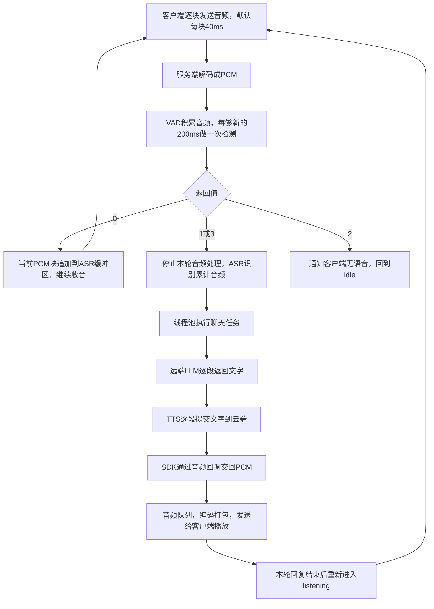

# Echo-Mate：VAD 返回值、ASR 缓冲、流式对话与 TTS 回调

整理日期：2026-10-13。

整理范围：本次对话中，从 `vad_model.py` 的静音判断和返回值开始，到 `SpeakingState::Run()` 为什么重置 `tts_completed` 为止。重复问题按主题合并，保留实际场景、调用关系和代码位置；前面讨论中逐步澄清的内容，以本文的准确表述为准。

本文解释当前代码，不修改业务实现。文件链接从本文件所在的 `snowboy/` 目录出发；定位代码时，可以结合文件名和函数名查找。

## 阅读导航

- [一、先看整条处理链](#overview)
- [二、VAD 的时间参数与返回值](#vad)
- [三、VAD 与 ASR 的两个缓冲区](#buffers)
- [四、为什么设置 is_vad](#round-control)
- [五、线程池怎样启动聊天任务](#task)
- [六、LLM、history 与 messages](#history)
- [七、流式回复、for、next 与 yield](#stream)
- [八、TTS 文字提交与音频回调](#tts)
- [九、TTS 完成通知与客户端状态](#complete)
- [十、容易混淆的结论与代码索引](#references)

<a id="overview"></a>

## 一、先看整条处理链

| 名称 | 作用 | 本项目中的实现位置 |
|---|---|---|
| VAD | 检测语音活动、判断本轮发言是否结束 | 服务端本地调用 VAD 模型 |
| ASR | 把音频识别成文字 | 服务端本地调用 SenseVoiceSmall |
| LLM | 理解文字、生成回复 | 本地 `LLMModel` 封装调用远端模型 |
| TTS | 把回复文字合成为语音 | 本地 `TTSModel` 封装调用云端 CosyVoice |



这里必须分清三个长度：**每次收到的一块音频通常是 40ms；VAD 每次检测的新音频是 200ms；ASR 识别的是整句累计音频，可能持续数秒。**

“本轮发言结束”表示这一句话收完了。整个对话还可以继续，下一轮再接收用户的话。

<a id="vad"></a>

## 二、VAD 的时间参数与返回值

代码位置：[models/vad_model.py](../Demo/AIChat_demo/Server/models/vad_model.py)，`VADModel.__init__()`、`process_audio_frame()`；调用方是 [handle/audio_handler.py](../Demo/AIChat_demo/Server/handle/audio_handler.py) 的 `handle_audio_message()`。

### 1. 每 40ms 调用一次，为什么又说每 200ms 检测一次？

每收到一块音频，都会调用 `process_audio_frame()`。进入函数后先保存音频；未处理的数据不足 200ms 时，直接返回 `0`。

只有攒够新的 200ms，才执行模型调用：

```python
res = self.vad_model.generate(
    input=speech_chunk,
    cache=self.vad_cache,
    is_final=False,
    chunk_size=self.frame_duration_ms
)
```

在默认 40ms 输入下，典型过程是：

| 累计新收到的音频 | 是否调用 VAD 模型 |
|---|---|
| 40ms | 否，先返回 0 |
| 80ms | 否，先返回 0 |
| 120ms | 否，先返回 0 |
| 160ms | 否，先返回 0 |
| 200ms | 是，分析这一批音频 |
| 再收到 40ms | 继续等待下一批积累够 200ms |

检测完 200ms，并不会把整轮 VAD 缓冲区清空。`processed_audio_length` 标记已经检测到哪里，下一次从后面的未处理部分继续取数据。

### 2. 200ms、3000ms、800ms 分别控制什么？

| 参数或条件 | 默认值 | 含义 |
|---|---|---|
| 客户端音频块长度 | 40ms | 一次发送多少音频 |
| `frame_duration_ms` | 200ms | 每次调用 VAD 模型分析多少新音频 |
| `post_speech_buffer_ms` | 200ms | 最后语音位置之后等待多久，再判断发言结束 |
| `no_speech_timeout_ms` | 3000ms | 无语音间隔超过多久，结束本轮等待 |
| `last_speech_pos > 800` | 800ms | 比较最后语音位置；作者想借此过滤短声音 |
| `max_buffer_length_ms` | 15000ms | 本轮 VAD 音频缓冲时长的上限判断 |

两个 200ms 数值相同，但用途不同：一个决定每次分析的长度，一个决定语音之后的静音等待时间。

“每次检测 200ms”不意味着只允许等待 200ms。比如一直没人说话，程序可以检测很多批 200ms 音频，直到累计无语音时间超过约 3 秒。

当前条件使用 `>`，实际检查还受模型端点输出、200ms 检测节奏等影响，不能理解为静音刚到 200ms 就一定立即结束。

### 3. return 0、1、2、3 分别是什么意思？

这些数字是项目约定的状态码，含义由调用方决定。

| 返回值 | VAD 的含义 | 调用方操作 | 是否执行 ASR |
|---|---|---|---|
| `0` | 当前尚未满足本轮结束条件 | 当前 PCM 块加入 ASR 缓冲，继续收音 | 暂不识别 |
| `1` | 判断用户本轮发言结束 | `is_vad=True`，识别已累计音频，提交聊天任务 | 是 |
| `2` | 无语音超时 | `is_vad=True`，发送 `vad/no_speech` 消息 | 否 |
| `3` | VAD 缓冲时长超过上限 | `is_vad=True`，识别已累计音频，提交聊天任务 | 是 |

`return` 结束的是当前这一次函数调用。下一块音频到达，处理函数还可能再次被调用；是否继续处理，由外层的 `is_vad` 控制。

`return 0` 不等于“这一块没有声音”：用户正在说话、暂时静音、数据不足 200ms，都可能返回 `0`。

### 4. 为什么 return 1 和 return 2 不合并？

它们都涉及静音，但后续动作不同。

```text
开始收音 → 用户一直没开口 → 无语音超时 → 返回2，不识别

开始收音 → 用户说了一句话 → 末尾静音够久 → 返回1，识别这句话
```

如果用 200ms 作为无语音超时，用户稍微迟一点开口，本轮就可能结束。如果每次说完都等 3 秒再识别，又会增加回复等待时间。

可以合并公共的静音时间计算，但仍需区分这两种业务结果。

严格按当前代码，返回 `2` 的条件是“当前没有在说话，且距离最后语音位置超过 3 秒”，没有显式检查“本轮从来没说过话”。通常有语音的情况会先触发较短的尾部静音结束条件；若一次检查时两个条件都满足，前面的 `return 2` 优先。

### 5. last_speech_pos > 800 真的是说话时长超过 800ms 吗？

`last_speech_pos` 是本轮音频时间轴上的位置。模型输出结束点时，它保存结束点；正在说话时，代码持续更新它。

作者的注释体现了“过滤短声音”的意图，但当前条件没有计算实际语音时长。例如：

```text
先静音1000ms → 说话300ms → 语音结束位置为1300ms

1300 > 800 成立，但实际说话只有300ms
```

如果真正按语音持续时长过滤，应保存开始位置并比较：

```python
speech_end_ms - speech_start_ms > 800
```

800ms 也只是过滤阈值；“嗯”“好”“对”等正常回应可能很短，不能认定短于 800ms 就一定是噪声。

### 6. 外层语音结束条件成立，为什么最后还可能 return 0？

当前代码的结构是：

```python
if self.last_speech_pos > 0 and \
   (audio_length - self.last_speech_pos) > self.post_speech_buffer_ms:
    if self.last_speech_pos > 800:
        return 1
    else:
        self.reset()
return 0
```

例如最后语音位置为 300ms，当前 `audio_length` 为 600ms：尾部间隔 300ms，满足外层条件；但 `300 > 800` 不成立，于是清空 VAD 状态，再返回 `0`，继续等待。

还有一个时间细节：`audio_length` 在追加当前音频块之前计算，后面没有重算。默认每次输入 40ms 时，它通常比追加后的实际缓冲时长少 40ms。因此，上面的时间示例用于解释判断关系，不代表精确触发时刻。

<a id="buffers"></a>

## 三、VAD 与 ASR 的两个缓冲区

### 7. pcm_data、audio_frame、audio_buffer 是什么关系？

代码位置：[handle/audio_handler.py](../Demo/AIChat_demo/Server/handle/audio_handler.py)，`handle_audio_message()`；[models/vad_model.py](../Demo/AIChat_demo/Server/models/vad_model.py)，`process_audio_frame()`。

| 变量 | 保存的数据 |
|---|---|
| `pcm_data` | 本次解码得到的 PCM 字节，通常对应 40ms |
| `audio_data_np_array` / `audio_frame` | 当前 PCM 块按 `int16` 读取后的采样数组 |
| `vad_model.audio_buffer` | VAD 自己累计保存的多块音频 |
| `asr_model.audio_buffer` | ASR 自己累计保存的多块音频 |

```python
audio_data_np_array = np.frombuffer(pcm_data, dtype=np.int16)
```

这一步把 PCM 字节按 16 位整数采样点解释，表示的声音没有改变。

```text
第1次：pcm_data = A，累计缓冲 = A
第2次：pcm_data = B，累计缓冲 = A + B
第3次：pcm_data = C，累计缓冲 = A + B + C
```

### 8. 返回 0 时，当前音频也加入 VAD 了吗？

通常已经加入了。VAD 在检查是否攒够 200ms 前，先执行：

```python
self.audio_buffer = np.concatenate((self.audio_buffer, audio_frame))
```

随后才决定继续积累、调用模型或返回状态。短声音过滤分支中的 `self.reset()` 是例外，它会把已经积累的 VAD 状态清空，然后返回 `0`。

### 9. VAD 缓冲区在哪里被放进 ASR 缓冲区？

没有把整个 VAD 缓冲区转存给 ASR。两个缓冲区使用同一来源的当前 PCM 块，分别追加。

调用链如下：

1. [handle/audio_handler.py](../Demo/AIChat_demo/Server/handle/audio_handler.py)：VAD 返回 `0` 时，把本次 `pcm_data` 交给 ASR。

   ```python
   if vad_result == 0:
       self.service_manager.asr_service.asr_add_audio_buffer(pcm_data)
   ```

2. [services/asr_service.py](../Demo/AIChat_demo/Server/services/asr_service.py)，`asr_add_audio_buffer()`：转交模型包装层。

   ```python
   self.asr_model.add_audio_buffer(audio_data)
   ```

3. [models/asr_model.py](../Demo/AIChat_demo/Server/models/asr_model.py)，`add_audio_buffer()`：真正追加到 ASR 数组。

   ```python
   audio_data_array = np.frombuffer(pcm_data, dtype=np.int16)
   self.audio_buffer = np.append(self.audio_buffer, audio_data_array)
   ```

### 10. VAD 和 ASR 缓冲区的数据始终一致吗？

两个数组独立管理。连续正常返回 `0`、未单独重置时，它们的采样内容通常相同；以下情况会不同：

| 情况 | VAD 缓冲区 | ASR 缓冲区 |
|---|---|---|
| 正常返回 `0` | 已追加当前块 | 调用方随后追加当前块 |
| 返回 `1` | 已追加当前块 | 当前块不追加，直接识别之前累计内容 |
| 返回 `2` | 已追加当前块 | 当前块不追加，不执行识别 |
| 返回 `3` | 超长检查发生在追加前，当前块未追加 | 当前块不追加，识别之前累计内容 |
| VAD 把短声音重置后返回 `0` | 被清空 | 之前累计内容仍在，并继续追加当前块 |
| ASR 正常识别完成后 | 通常等待后续状态切换重置 | 已清空 |

`return 1` 对应的当前块通常属于尾部静音，因为结束判断要求语音之后已有一段静音；此前说话期间返回 `0` 的块已经进入 ASR。当前实现跳过结束块，是分支安排的结果，不是 ASR 必须丢弃这一块。

### 11. 静音块会被丢弃、不加入 ASR 吗？

当前代码按返回值判断是否追加，不是按“当前块有没有声音”过滤。

- 静音尚未达到结束或超时条件，返回 `0`：仍然加入 ASR。
- 达到结束条件，返回 `1`：当前块不加入，识别之前累计的音频。
- 无语音超时，返回 `2`：当前块不加入，也不识别。

因此 ASR 缓冲区通常包含说话内容，以及开头、句间、结尾的一部分静音。

### 12. ASR 是识别每个 200ms，还是识别整句话？

ASR 在本轮持续积累音频；返回 `1` 或 `3` 时，识别已累计的整段音频。

```text
音频：[200ms][200ms][200ms]……[末尾静音]
VAD：  检测    检测    检测 …… 判断说完
ASR： ←────持续积累音频────→  统一识别
```

### 13. 为什么保存的是 int16，识别时传 float32？

代码位置：[models/asr_model.py](../Demo/AIChat_demo/Server/models/asr_model.py)，初始化与 `ASR_generate_text()`；[services/asr_service.py](../Demo/AIChat_demo/Server/services/asr_service.py)，`asr_generate_text()`。

```python
audio_for_asr = self.asr_model.audio_buffer.astype(np.float32)
res = self.asr_model.ASR_generate_text(audio_for_asr)
self.asr_model.clear_audio_buffer()
```

这里为了以浮点数组形式交给 ASR 后续计算，创建一份 `float32` 数组。原来的对象属性 `self.audio_buffer` 仍然是 `int16`；函数形参 `audio_buffer` 接收的是转换后的数组，它们是不同变量。

```text
int16：   [1000,   -2000,   300]
float32： [1000.0, -2000.0, 300.0]
```

采样值和采样点数量不变，音量、时长、采样率不变，也不会提高录音质量。每个采样点占用的空间从 2 字节变为 4 字节。

`astype(np.float32)` 只转换类型，本身不会归一化到 `[-1, 1]`。模型内部如何处理幅值，还要看对应推理实现，不能仅凭这次类型转换下结论。

### 14. 一轮结束后，什么时候清空缓冲区？

正常流程中：

- 返回 `1/3`：`asr_generate_text()` 识别完成后清空 ASR；VAD 不在该返回处自动清空。
- 返回 `2`：不识别；客户端收到 `no_speech` 后回到 `idle`，服务器收到状态后执行 `reset_services()`。
- 开始新一轮 `listening`：重置 VAD、ASR，并把 `is_vad` 设回 `False`。

相关代码在 [handle/text_handler.py](../Demo/AIChat_demo/Server/handle/text_handler.py) 的 `listening` 分支，以及 [service_manager.py](../Demo/AIChat_demo/Server/service_manager.py) 的 `reset_services()`。

进入 `listening` 只重置本轮音频相关状态，不清除普通聊天历史；`idle` 调用的 `reset_services()` 还会清空聊天历史。

<a id="round-control"></a>

## 四、为什么设置 is_vad

代码位置：[handle/audio_handler.py](../Demo/AIChat_demo/Server/handle/audio_handler.py)，`handle_audio_message()`；[handle/text_handler.py](../Demo/AIChat_demo/Server/handle/text_handler.py)，`listening` 分支。

### 15. is_vad 表示正在检测声音吗？

在这个项目里，它实际表示“本轮音频是否已经结束处理”。

| 状态 | 行为 |
|---|---|
| `is_vad=False` | 允许音频进入本轮 VAD/ASR 流程 |
| `is_vad=True` | 本轮已经结束，跳过后续音频处理 |

`is_speaking` 判断用户当前是否正在说话；`is_vad` 控制本轮是否继续处理音频。

### 16. 已经 return 1，为什么还要设置 is_vad？

`return 1` 是本次检测的结果，不能阻止下一块音频再次进入处理函数。外层需要一个跨调用保存的记号，记录“本轮已经处理过”。

如果没有拦截，典型情况是：

```text
用户说“你好” → VAD返回1 → ASR识别“你好”，清空ASR缓冲
                              ↓
后续静音继续进入 → 原来的VAD结束位置仍保留
                              ↓
再次积累够检测数据 → 结束条件可能仍成立 → 再次返回1
                              ↓
再次触发ASR和聊天任务
```

重复的是识别和对话处理流程。ASR 已经清空过，第二次可能处理的是空数组或后来积累的静音，不一定把原来的“你好”再识别一遍。

设置 `is_vad=True` 后，入口条件会挡住这些后续音频。返回 `2/3` 也会设置该标志，防止本轮结束事件继续重复处理。

### 17. 为什么不立即清空 VAD，再进行 ASR？

这个方案可以成立。两个缓冲区独立，只清空 VAD 不会清空 ASR：

```python
# 另一种处理策略的示意，不是当前代码已实施的改动。
self.service_manager.vad_service.reset()
asr_res = self.service_manager.asr_service.asr_generate_text()
```

但它与暂停本轮的策略不同：

- 重置 VAD 后继续收音：后续音频立即成为新一轮检测的输入，静音超时也重新计时。
- `is_vad=True`：保持本轮关闭，等客户端明确重新进入 `listening` 后才开始下一轮。

所以，仅为清除旧的结束状态，重置 VAD 也能解决；`is_vad` 同时承担了当前项目“用户说一句、AI 回复、再听下一句”的轮次控制。

如果要一边识别上一句、一边接收下一句，需要进一步分开管理两轮 ASR 音频，避免新数据被上一轮的清空操作影响。

### 18. 禁止处理后续音频，之后的话怎么接收？

当前项目按照状态机轮流说话：

```text
listening：接收用户音频，is_vad=False
    ↓
VAD返回1/3：is_vad=True，ASR识别
    ↓
客户端收到ASR消息：进入thinking，退出listening并停止录音
    ↓
speaking：播放AI回复
    ↓
回复播放结束且对话未退出：重新进入listening
    ↓
客户端发送listening状态，服务器重置VAD、ASR和is_vad
```

代码位置：

- [Client/Application/StateConfig.cc](../Demo/AIChat_demo/Client/Application/StateConfig.cc)：状态转换关系。
- [Client/Application/UserStates/Listening.cc](../Demo/AIChat_demo/Client/Application/UserStates/Listening.cc)：进入时通知服务器并启动录音，退出时停止录音与发送循环。
- [Server/handle/text_handler.py](../Demo/AIChat_demo/Server/handle/text_handler.py)：收到 `listening` 后恢复本轮处理。

`is_vad=True` 不是断开 WebSocket；服务器仍可收到消息，只是音频不再进入本轮处理。关闭期间被忽略的音频不会补回来。当前实现不能保证保存用户在 AI 思考、回复期间的插话。

`ListeningState::Enter()` 还会在启动录音后等待 500ms，再清空录音队列。因此当前代码不是连续无缝保留所有录音的设计。

<a id="task"></a>

## 五、线程池怎样启动聊天任务

代码位置：[handle/audio_handler.py](../Demo/AIChat_demo/Server/handle/audio_handler.py)，返回 `1/3` 的分支；[threads/task_manager.py](../Demo/AIChat_demo/Server/threads/task_manager.py)，`submit_task()`；[service_manager.py](../Demo/AIChat_demo/Server/service_manager.py)，`chat_start_task()`。

### 19. submit_task(chat_start_task, asr_res) 是什么意思？

```python
self.service_manager.task_manager.submit_task(
    self.service_manager.chat_start_task,
    asr_res
)
```

第一个参数是要执行的函数，第二个参数是传给该函数的文字。比如 `asr_res="今天天气怎么样"`，线程池中的线程会执行：

```python
self.service_manager.chat_start_task("今天天气怎么样")
```

`chat_start_task` 后面没有括号，因为这里是交出函数对象，让线程池负责调用。

`TaskManager` 内部使用：

```python
self.executor = ThreadPoolExecutor(max_workers=5)
self.executor.submit(func, *args, **kwargs)
```

任务由线程池运行；有空闲线程时可开始执行，否则排队。提交任务后，当前音频处理函数不必等完整回复生成完，就可以继续构造、发送 ASR 结果。

`executor.submit()` 返回 `Future`，但项目的 `submit_task()` 没有把它 `return` 给调用方。

### 20. 后台任务负责哪些工作？

`chat_start_task()` 负责意图识别、准备函数调用信息、调用聊天模型、逐段把回复交给 TTS，最后结束本轮 TTS 输入。

需要区分：之前的 ASR 调用发生在提交聊天任务之前。当前 `handle_audio_message()` 虽然声明为 `async def`，其中同步执行的 VAD/ASR 并不会因此自动转移到线程池。

<a id="history"></a>

## 六、LLM、history 与 messages

代码位置：[services/chat_service.py](../Demo/AIChat_demo/Server/services/chat_service.py)，`generate_chat_response()`；[models/llm_model.py](../Demo/AIChat_demo/Server/models/llm_model.py)，`add_message()`、`get_LLM_response()`、`get_LLM_response_stream()`。

### 21. LLM 是模型本身，还是远端调用接口？

LLM 是 Large Language Model，即大语言模型，本身指模型。

项目的 `LLMModel` 类则是本地调用封装，负责维护历史消息、创建请求和接收云端回复。真正的模型推理在远端进行。理解代码时，可以把这个类看成 `LLMClient` 一类的角色。

### 22. generate_chat_response() 的三个参数是什么意思？

```python
generate_chat_response(user_input, history=None, is_stream=False)
```

| 参数 | 含义 |
|---|---|
| `user_input` | 当前用户输入，主流程中来自 ASR 识别结果 |
| `history` | 额外补充的消息，预期为包含 `role/content` 字典的列表 |
| `is_stream` | `True` 时逐段获取回复；`False` 时等待完整字符串 |

函数先把符合字段要求的 `history` 加入本地消息列表，然后选择流式或非流式调用。

当前类型注解 `history: Optional[Dict]` 不准确，循环实际预期的是字典列表；返回注解 `-> str` 也没有涵盖流式生成器。

### 23. for his in history 这一步是在做什么？

```python
for his in history:
    if "role" in his and "content" in his:
        self.chat_llm_model.add_message(his["role"], his["content"])
```

每次取出一条额外消息，检查是否包含 `role` 和 `content` 两个字段，然后调用 `add_message()`。

```python
# 某次循环取到的消息
his = {"role": "user", "content": "你好"}

# 相当于调用
self.chat_llm_model.add_message("user", "你好")
```

`add_message()` 的实际操作是追加到本地列表：

```python
self.messages.append({"role": role, "content": content})
```

这里尚未发送云端请求，只是在准备之后请求使用的上下文。

### 24. history 记录函数调用，messages 记录普通聊天吗？

当前主流程中，`history_list` 是每轮临时创建的补充消息，主要用于函数调用相关说明；`messages` 是最终完整上下文，包含系统提示、用户输入、AI 回复和成功合并进来的补充消息。

```text
history里的补充信息 → add_message() ─┐
普通聊天的输入/回复 → add_message() ─┼→ messages → 云端模型
系统提示 ──────────────────────────┘
```

`history` 这个参数并不限定只能记录函数调用，只是当前调用方主要这样使用它。普通聊天通常不通过这个参数传入，`LLMModel` 会自己追加用户问题和助手回复。

意图识别也不是把所有意图原样加入聊天历史：`continue_chat` 分支不添加补充消息；`exit_chat` 分支发送结束对话消息；其他函数调用分支构造“函数调用”和“函数调用完成”的补充文字。

### 25. 当前函数调用历史真的成功添加了吗？

代码位置：[service_manager.py](../Demo/AIChat_demo/Server/service_manager.py)，`chat_start_task()` 的 `history_list.append(...)`。

当前写法是：

```python
history_list.append([
    {"role": "user", "content": f"函数调用: {function_call}"},
    {"role": "assistant", "content": "函数调用完成"}
])
```

它产生嵌套列表，`for his in history` 取到的 `his` 是列表，检查 `"role" in his` 不成立，所以这些补充消息会被跳过。普通聊天的 `messages` 仍然照常维护。

要实现平铺的消息列表，可以使用 `extend([...])` 或逐条 `append()`。这是对当前实现问题的说明，本文没有修改代码。

此外，当前“函数调用完成”文字是在服务器把命令放入发送队列后构造的，这段代码本身没有等待客户端实际执行结果，不能把这句话理解为已经核验执行成功。

### 26. 历史记录保存在本地还是云端？每次都会发送吗？

这里说的本地，是运行 Python 服务端的机器。历史由 `LLMModel.self.messages` 保存，每次请求带过去：

```python
response = client.chat.completions.create(
    model=self.model_name,
    messages=self.messages
)
```

流式调用也传入同一份消息列表，只是增加 `stream=True`。

```text
第1次请求：系统提示 + 用户问题1
得到回复后：本地追加AI回复1

第2次请求：系统提示 + 用户问题1 + AI回复1 + 用户问题2
```

在这份实现里，云端根据每次收到的上下文作答；本地代码负责保存和再次发送历史。`clear_messages()` 重置为系统提示消息，后续不再携带之前的普通聊天记录。

### 27. 会话越长，会不会越慢？

未清空历史时，消息越积越多，每次发送的请求也更大，模型需要处理的输入上下文更长，等待首段回复的时间可能增加。

实际延迟还受输出长度、网络、服务端负载和缓存影响，不能理解为每一轮都固定慢多少。当前包装代码没有主动裁剪或摘要历史；如果实现长会话管理，可以考虑保留近期消息、摘要较早内容，但本文没有实施这些改动。

<a id="stream"></a>

## 七、流式回复、for、next 与 yield

代码位置：[models/llm_model.py](../Demo/AIChat_demo/Server/models/llm_model.py)，`get_LLM_response_stream()`；[service_manager.py](../Demo/AIChat_demo/Server/service_manager.py)，`chat_start_task()` 中的 `for text_chunk in answers`。

### 28. answers 是完整回复，还是一个个片段？

```python
answers = self.chat_service.generate_chat_response(
    text, history=history_list, is_stream=True
)
```

这句返回生成器对象，保存在 `answers` 中。随后迭代它，才会逐段拿到文字：

```python
for text_chunk in answers:
    self.tts_service.tts_speech_stream(text_chunk)
```

文字片段来自内部的 `yield delta`。片段长度不固定，不一定是一句话、一个词或一个字。

含有 `yield` 的函数在调用时创建生成器，函数体从第一次取值时开始执行。`generate_chat_response()` 自己先处理额外 `history`，然后返回内部生成器；真正的流式网络请求在开始迭代这个生成器时执行。

### 29. 内层 for chunk in stream 在做什么？

```python
full_text = ""
for chunk in stream:
    if not chunk.choices:
        continue

    delta = chunk.choices[0].delta.content
    if delta:
        full_text += delta
        yield delta
```

| 对象或语句 | 含义 |
|---|---|
| `stream` | SDK 返回的响应流迭代对象 |
| `chunk` | 本次从响应流取得的数据块 |
| `chunk.choices` | 本块包含的候选回复信息 |
| `delta.content` | 当前块新增的文字内容 |
| `full_text += delta` | 把片段拼入完整回复 |
| `yield delta` | 把当前片段交给外层调用方，并暂停生成器 |

`continue` 只跳过当前块，继续取下一块；`delta` 为空时不输出文字，也不会因此结束整个回复。

### 30. yield 由谁“唤醒”？

外层 `for text_chunk in answers` 每次获取下一项，会自动调用 `next(answers)`，恢复生成器执行。

```text
外层for调用next(answers)
    ↓
生成器执行到yield delta，交出一段文字并暂停
    ↓
外层循环把这段文字交给TTS
    ↓
循环体执行完，再调用next(answers)
    ↓
生成器从上次yield后继续，取后续chunk并产出下一段文字
```

准确说，是恢复生成器，不是另外启动一个线程或发送唤醒通知。这里由同一个聊天任务中的外层循环推进生成器。

### 31. 没有新 chunk，for 为什么不立即结束？

`for` 的统一规则是不断获取下一项，直到迭代器明确结束。可以用下面的示意代码理解：

```python
iterator = iter(stream)
while True:
    try:
        chunk = next(iterator)
    except StopIteration:
        break
    # 处理chunk
```

普通空列表的迭代器立即产生 `StopIteration`，所以循环一次也不执行。网络流的取值过程可以等待网络数据，暂时没收到数据时，`next(iterator)` 还没有返回，程序停在取值操作中。

| 情况 | 行为 |
|---|---|
| 尚未收到下一块网络数据 | 取下一项的操作等待，不进入本轮循环体 |
| 收到块，但 `choices` 为空 | 执行 `continue`，继续取下一块 |
| 收到有文字的块 | 累加文字并 `yield` |
| 响应流正常结束 | 内层迭代结束，退出循环 |
| 网络超时或异常 | 进入异常处理路径 |

等待逻辑取决于迭代对象的实现，不取决于变量名是否叫 `stream`。暂时没有文字，与整个响应流已经结束，是不同状态。

### 32. 内层和外层 for 分别什么时候停止？

正常情况下：

```text
云端响应流结束
    ↓
内层for chunk in stream结束
    ↓
保存完整回复到聊天历史
    ↓
生成器函数执行到末尾
    ↓
外层再次next(answers)时得到StopIteration
    ↓
外层for text_chunk in answers结束
    ↓
调用tts_close()，通知TTS文字全部发送完
```

`yield` 表示“这一段交给你，下次继续”；生成器执行结束表示“后续没有内容了”。

这条保存完整回复的路径要求调用方正常消费完整个生成器；如果提前停止迭代，不能假定后面的保存逻辑已经执行。

### 33. full_text 是把全部回复加进历史吗？

是。每段先执行 `full_text += delta`，正常完成后再执行：

```python
if full_text:
    self.add_message("assistant", full_text)
```

最终保存一条完整的助手回复。空内容不添加。

当前异常分支是 `yield -1`。这表示调用方会在迭代时收到一个错误标记，不是 `answers` 这个生成器对象直接等于 `-1`；因此 `if answers == -1` 不能提前捕获这种流式错误。本文保留这个实现细节，正常流程的片段示例均指文字内容。

<a id="tts"></a>

## 八、TTS 文字提交与音频回调

代码位置：[services/tts_service.py](../Demo/AIChat_demo/Server/services/tts_service.py)，`tts_speech_stream()`；[models/tts_model.py](../Demo/AIChat_demo/Server/models/tts_model.py)，`tts_stream_set()`、`tts_stream_speech_synthesis()`。

### 34. tts_stream_speech_synthesis() 怎么合成语音？

核心代码是：

```python
if text_chunk:
    try:
        self.synthesizer.streaming_call(text_chunk)
    except Exception as e:
        return False
```

它通过 SDK 提交文字。真正的语音模型在云端运行，项目创建合成器时配置：

```python
SpeechSynthesizer(
    model="cosyvoice-v1",
    voice="longxiaochun",
    format=AudioFormat.PCM_16000HZ_MONO_16BIT,
    callback=self.callback
)
```

模型负责把文字变成声音，`voice` 选择音色，输出格式是 16kHz、单声道、16 位 PCM。

流式文字片段会持续提交给同一轮合成器；不能假定一个文字片段就一定对应一个音频块，接收侧按实际返回的音频数据处理。

### 35. TTS 使用我们设置的 dashscope.api_key 吗？

是。当前创建 `SpeechSynthesizer` 时没有单独传入凭证，SDK 使用配置好的 `dashscope.api_key`。API Key 用于身份验证，模型和音色由 `model`、`voice` 参数指定。[阿里云 CosyVoice Python SDK 文档](https://help.aliyun.com/zh/model-studio/cosyvoice-python-sdk)

项目配置入口在 [config/settings.py](../Demo/AIChat_demo/Server/config/settings.py) 的 `Set_API_Key()`；[handle/text_handler.py](../Demo/AIChat_demo/Server/handle/text_handler.py) 的 `hello` 分支会读取客户端提供的 API Key，并调用这个设置方法。

本文只说明配置变量和调用关系，不记录具体凭证值。

### 36. 函数没有 return 音频，音频从哪里回来？

音频通过 `on_data` 回调交给项目。发送文字和接收音频走两条调用路径：

```text
chat_start_task逐段取得LLM文字
    ↓
tts_service.tts_speech_stream(text_chunk)
    ↓
tts_model.tts_stream_speech_synthesis(text_chunk)
    ↓
SDK.streaming_call(text_chunk) → 云端合成
                                      ↓
SDK收到音频，调用已注册的on_data回调
    ↓
ServiceManager._tts_on_data(data)
    ↓
audio_queue
    ↓
AudioSendThread切帧、Opus编码、打包
    ↓
ws_send_queue → WebSocket发送 → 客户端播放
```

按文件查找：

| 步骤 | 文件与位置 | 关键操作 |
|---|---|---|
| 注册业务回调 | [handle/text_handler.py](../Demo/AIChat_demo/Server/handle/text_handler.py)，`listening` 分支 | `tts_set(on_data=..._tts_on_data, on_complete=..._tts_on_complete)` |
| 服务层转交参数 | [services/tts_service.py](../Demo/AIChat_demo/Server/services/tts_service.py)，`tts_set()` | 调用 `tts_stream_set()` |
| 回调绑定到 SDK | [models/tts_model.py](../Demo/AIChat_demo/Server/models/tts_model.py)，`tts_stream_set()` | 构造回调对象并传入 `callback=self.callback` |
| 提交文字 | [models/tts_model.py](../Demo/AIChat_demo/Server/models/tts_model.py)，`tts_stream_speech_synthesis()` | `streaming_call(text_chunk)` |
| 接收音频 | [service_manager.py](../Demo/AIChat_demo/Server/service_manager.py)，`_tts_on_data()` | `self.audio_queue.put(data)` |
| 整理待发送音频 | [threads/audio_send_thread.py](../Demo/AIChat_demo/Server/threads/audio_send_thread.py)，`run()` | 取 PCM、切帧、编码、放入 `ws_send_queue` |
| 实际发送 WebSocket 消息 | [ws_server.py](../Demo/AIChat_demo/Server/ws_server.py)，`process_send_queue()` | `await websocket.send(data)` |

`_tts_on_data()` 的 `data` 是 SDK 交回的音频字节：

```python
def _tts_on_data(self, data):
    self.audio_queue.put(data)
```

`tts_stream_speech_synthesis()` 正常执行没有显式 `return`，因此返回 `None`；捕获异常时返回 `False`。这两个返回值都不是合成的音频。

### 37. handle_text_message() 是处理客户端消息的吗？

是。位置：[handle/text_handler.py](../Demo/AIChat_demo/Server/handle/text_handler.py)，`handle_text_message()`。

它处理客户端传来的、已经解析为字典的 JSON 文本消息，例如：

- `hello`：初始化信息，包括客户端传来的 API Key。
- `functions_register`：注册客户端支持的函数。
- `state`：`idle/listening/thinking/speaking` 等状态。

二进制音频消息由 [handle/audio_handler.py](../Demo/AIChat_demo/Server/handle/audio_handler.py) 的 `handle_audio_message()` 处理。入口分发在 [ws_server.py](../Demo/AIChat_demo/Server/ws_server.py) 的 `handle_client()`。

`on_data` 则是 SDK 收到云端音频时触发的回调，与客户端发来的 JSON 消息处理入口分开。

<a id="complete"></a>

## 九、TTS 完成通知与客户端状态

### 38. 文字全部发送完后，如何结束 TTS？

代码位置：[service_manager.py](../Demo/AIChat_demo/Server/service_manager.py)，`chat_start_task()` 的文字循环之后；[models/tts_model.py](../Demo/AIChat_demo/Server/models/tts_model.py)，`tts_stream_close()`。

```python
for text_chunk in answers:
    self.tts_service.tts_speech_stream(text_chunk)

self.tts_service.tts_close()
```

服务层最终调用：

```python
self.synthesizer.streaming_complete()
```

这通知合成器：本轮文字已全部提交，完成剩余的合成。不能把“文字已发完”直接等同于“最后一段语音已在客户端播放完”。

当前 `tts_stream_set()` 虽然有“提前打开连接”的注释，但显式预连接代码已被注释；当前执行的是配置回调和创建合成器，不能仅凭注释认定这里已经提前连上网络。

### 39. 为什么需要 _tts_on_complete()？

代码位置：[service_manager.py](../Demo/AIChat_demo/Server/service_manager.py)，`_tts_on_complete()`。

SDK 合成完成时，通过已注册的完成回调，生成客户端能理解的结束消息：

```python
def _tts_on_complete(self):
    msg = {"type": "tts", "state": "end"}
    self.ws_send_queue.put(json.dumps(msg))
```

这个信号用于告诉客户端“云端本轮合成已完成”。合成完成、服务器发送完成、客户端收到全部音频、扬声器播放完成，是不同阶段，不能混为一谈。

### 40. 客户端收到完成消息后做什么？

位置：[Client/Application/WS_Handler.cc](../Demo/AIChat_demo/Client/Application/WS_Handler.cc)，`handle_tts_message()`。

```cpp
if (stateStr == "end") {
    app->set_tts_completed(true);
}
```

然后 [Client/Application/UserStates/Speaking.cc](../Demo/AIChat_demo/Client/Application/UserStates/Speaking.cc) 的 `SpeakingState::Run()` 检查：

```cpp
if (app->get_tts_completed() &&
    app->audio_processor_.playbackQueueIsEmpty()) {
    // 等待后，发送speaking_end或dialogue_end事件
}
```

不能只看队列是否为空：流式播放过程中可能只是下一块音频尚未到达，队列暂时没有内容。

当前代码每隔 500ms 检查一次；两个条件满足后又等待 500ms，给设备中尚未播放完的数据留缓冲时间。这个等待不是精确的硬件播放完成通知。

正常对话未结束时发送 `speaking_end`，状态机切回 `listening`；若已标记整个对话结束，则发送 `dialogue_end`，切回 `idle`。转换规则在 [Client/Application/StateConfig.cc](../Demo/AIChat_demo/Client/Application/StateConfig.cc)。

### 41. 为什么 SpeakingState::Run() 最后设置 tts_completed=false？

位置：[Client/Application/UserStates/Speaking.cc](../Demo/AIChat_demo/Client/Application/UserStates/Speaking.cc)，完成分支末尾：

```cpp
app->set_tts_completed(false);
app->set_dialogue_completed(false);
break;
```

本轮完成标志用过后清除，为下一轮准备：

```text
本轮合成完成 → tts_completed=true
    ↓
客户端决定结束本轮speaking，发出状态事件
    ↓
tts_completed=false，清除本轮标志
    ↓
下一轮必须等待自己的TTS完成通知
```

如果沿用上一轮的 `true`，下一轮播放队列暂时为空时，就可能误判为新一轮也已经结束。

<a id="references"></a>

## 十、容易混淆的结论与代码索引

### 先核对这几句话

| 容易混淆的说法 | 准确理解 |
|---|---|
| 每收到 40ms 都调用了 VAD 模型 | 每 40ms 调用包装函数，攒够新的 200ms 才调用模型 |
| ASR 负责识别 VAD 刚处理的 200ms | ASR 在结束时识别之前累计的整段音频 |
| 返回 0 就没有保存数据 | 正常先保存到 VAD，返回 0 后调用方再追加到 ASR |
| 静音块不会进入 ASR | 返回 0 的静音块也会进入 ASR |
| 返回 1/2/3 都必须识别 | 只有 1/3 识别，2 不识别 |
| 返回 1 表示整个对话结束 | 它表示本轮用户发言结束 |
| 800ms 是语音之后等待的静音时间 | 末尾静音阈值是 200ms；800ms 比较的是时间轴位置 |
| VAD 与 ASR 共用一个音频数组 | 同源输入，两个独立数组，各自追加和清空 |
| is_vad 是为保护 ASR 正在使用的 VAD 缓冲区 | ASR 不使用 VAD 数组；标志主要控制本轮只处理一次及何时接收下一轮 |
| 被忽略的音频会在下一轮补回 | 当前代码没有这条补回路径 |
| int16 转 float32 是放大音量或提高音质 | 只是数值类型转换，astype 本身也不归一化 |
| LLMModel 会在本机运行大语言模型 | 本项目的这个类封装远端请求 |
| history 和 messages 永远分开保存 | history 按设计被合并到最终 messages；当前嵌套列表导致补充信息被跳过 |
| 暂时没有 chunk，for 就结束 | 取下一项可以等待网络；迭代明确结束才退出 |
| yield 会直接结束函数 | yield 暂停生成器，下一次 next() 时继续 |
| streaming_call 的返回值就是音频 | 音频通过 on_data 回调交回 |
| TTS 合成完成就代表扬声器播完 | 合成、传输、排队、设备播放是不同阶段 |

### 代码阅读索引

| 文件 | 优先看的函数或位置 |
|---|---|
| [Server/models/vad_model.py](../Demo/AIChat_demo/Server/models/vad_model.py) | `__init__`、`reset`、`process_audio_frame` |
| [Server/handle/audio_handler.py](../Demo/AIChat_demo/Server/handle/audio_handler.py) | `handle_audio_message` 中的 0/1/2/3 分支 |
| [Server/services/asr_service.py](../Demo/AIChat_demo/Server/services/asr_service.py) | `asr_add_audio_buffer`、`asr_generate_text` |
| [Server/models/asr_model.py](../Demo/AIChat_demo/Server/models/asr_model.py) | `add_audio_buffer`、`clear_audio_buffer`、`ASR_generate_text` |
| [Server/threads/task_manager.py](../Demo/AIChat_demo/Server/threads/task_manager.py) | `submit_task` |
| [Server/service_manager.py](../Demo/AIChat_demo/Server/service_manager.py) | `chat_start_task`、`_tts_on_data`、`_tts_on_complete`、`reset_services` |
| [Server/services/chat_service.py](../Demo/AIChat_demo/Server/services/chat_service.py) | `generate_chat_response` |
| [Server/models/llm_model.py](../Demo/AIChat_demo/Server/models/llm_model.py) | `add_message`、`clear_messages`、两种回复方法 |
| [Server/services/tts_service.py](../Demo/AIChat_demo/Server/services/tts_service.py) | `tts_set`、`tts_speech_stream`、`tts_close` |
| [Server/models/tts_model.py](../Demo/AIChat_demo/Server/models/tts_model.py) | `__tts_callback`、`tts_stream_set`、`tts_stream_speech_synthesis`、`tts_stream_close` |
| [Server/handle/text_handler.py](../Demo/AIChat_demo/Server/handle/text_handler.py) | `handle_text_message` 的 `hello/listening/idle` 分支 |
| [Server/ws_server.py](../Demo/AIChat_demo/Server/ws_server.py) | `handle_client`、`process_send_queue` |
| [Server/threads/audio_send_thread.py](../Demo/AIChat_demo/Server/threads/audio_send_thread.py) | `run` |
| [Client/Application/WS_Handler.cc](../Demo/AIChat_demo/Client/Application/WS_Handler.cc) | `handle_asr_message`、`handle_tts_message` |
| [Client/Application/UserStates/Listening.cc](../Demo/AIChat_demo/Client/Application/UserStates/Listening.cc) | `Enter`、`Run`、`Exit` |
| [Client/Application/UserStates/Speaking.cc](../Demo/AIChat_demo/Client/Application/UserStates/Speaking.cc) | `Run` 中的完成判断和状态重置 |
| [Client/Application/StateConfig.cc](../Demo/AIChat_demo/Client/Application/StateConfig.cc) | `listening/thinking/speaking/idle` 转换规则 |

### 相关学习文档

- [服务端 WebSocket 接收与 VAD 检测流程及问答](2026-10-12_服务端WebSocket接收与VAD检测流程及问答.md)
- [服务端接收音频到 ASR 转文字流程与问答](2026-10-04_服务端接收音频到ASR转文字流程与问答.md)
- [TTS 文字提交到云端合成与音频回调流程与问答](2026-10-06_TTS文字提交到云端合成与音频回调流程与问答.md)
- [服务端发送音频到客户端播放结束流程与问答](2026-10-08_服务端发送音频到客户端播放结束流程与问答.md)
