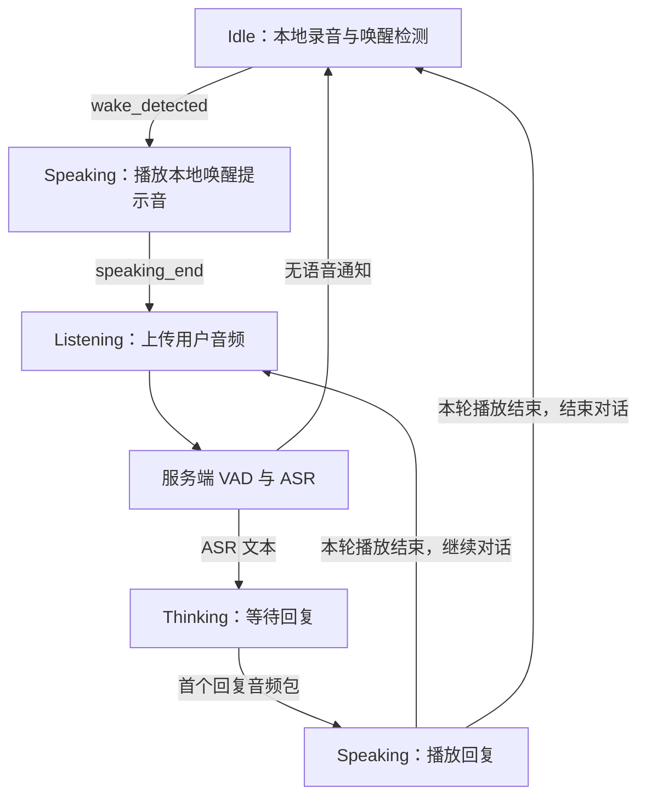
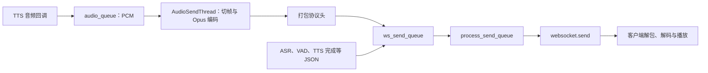

# Echo-Mate：客户端与服务端交互、音频处理和线程协程问答整理

整理日期：2026-10-14。

整理范围：本次对话涉及的状态机注册、客户端与服务端消息、VAD 与 ASR、发送队列、音频余量、进程与线程、`async/await`、WebSocket 回调，以及两种 TTS 调用方式。重复问题按主题合并，保留代码示例和容易混淆的细节。

本文以整理时的本地代码为准。代码在学习过程中有更新：当前 `main.py` 中创建 `TTSGenerateThread` 对象的语句、启动和等待线程结束的语句均已注释。文中的改进示例仅用于解释，没有在整理文档时修改业务代码。

## 阅读导航

- [一、状态编号、事件编号与转换表](#states)
- [二、客户端与服务端交换什么数据](#messages)
- [三、handle_client 的调用与消息接收](#receive)
- [四、async、await 和 Future 如何工作](#async)
- [五、VAD 返回值与 is_vad 开关](#vad)
- [六、提交聊天任务是否意味着语音合成结束](#chat)
- [七、TTSGenerateThread 与直接调用 TTS](#tts)
- [八、发送队列、音频队列与剩余数据](#queues)
- [九、服务端的进程、线程和协程](#execution)
- [十、超时处理与异常处理](#errors)
- [十一、代码与图示索引](#references)

<a id="states"></a>

## 一、状态编号、事件编号与转换表

### 1. transitions_ 的外层键、内层键和值分别是什么？

定义可以理解为：

```cpp
std::unordered_map<int, std::unordered_map<int, int>> transitions_;
//                 当前状态                事件  目标状态
```

核心写入方式：

```cpp
transitions_[from][event] = to;
```

| 位置 | 含义 |
|---|---|
| 外层键 `from` | 从哪个状态出发 |
| 内层键 `event` | 发生哪个事件 |
| 内层值 `to` | 切换到哪个状态 |

`RegisterTransition` 注册的是转换规则，不是在注册时立即切换状态。状态进入和退出的回调由 `RegisterState` 注册到另一张表 `stateActions_`。

### 2. “内层键 event 就是 4”是否正确？

只有事件为 `wake_detected` 时，事件编号才是 `4`。`event` 是参数，可以取不同事件的编号。

客户端状态编号：

| 编号 | 状态 | 含义 |
|---|---|---|
| 0 | `fault` | 故障处理 |
| 1 | `startup` | 启动 |
| 2 | `stopping` | 停止 |
| 3 | `idle` | 等待本地唤醒 |
| 4 | `listening` | 录音并上传 |
| 5 | `thinking` | 等待回复音频 |
| 6 | `speaking` | 播放音频 |

客户端事件编号：

| 编号 | 事件 |
|---|---|
| 0 | `fault_happen` |
| 1 | `fault_solved` |
| 2 | `startup_done` |
| 3 | `to_stop` |
| 4 | `wake_detected` |
| 5 | `vad_no_speech` |
| 6 | `vad_end` |
| 7 | `asr_received` |
| 8 | `speaking_msg_received` |
| 9 | `speaking_end` |
| 10 | `dialogue_end` |

例如：

```cpp
RegisterTransition(3, 4, 6);
// 等价于 transitions_[3][4] = 6;
// idle 状态收到 wake_detected 事件，切换到 speaking。
```

这里的状态编号 `4` 与事件编号 `4` 属于不同的枚举，含义不同。二进制协议的音频类型 `0` 也不等于事件 `fault_happen = 0`。

### 3. 当前注册了哪些规则？

| 当前状态 | 事件 | 下一状态 |
|---|---|---|
| `startup` | `startup_done` | `idle` |
| `idle` | `wake_detected` | `speaking` |
| `listening` | `vad_no_speech` | `idle` |
| `listening` | `asr_received` | `thinking` |
| `thinking` | `speaking_msg_received` | `speaking` |
| `speaking` | `speaking_end` | `listening` |
| `speaking` | `dialogue_end` | `idle` |
| 所有已注册状态 | `fault_happen` | `fault` |
| 所有已注册状态 | `to_stop` | `stopping` |
| `fault` | `fault_solved` | `idle` |

`RegisterTransition(-1, event, to)` 会遍历当时已经注册的状态，逐个写入相同规则。`vad_end` 虽然定义在枚举中，但当前这张转换表没有为它注册规则。

真正处理事件时，先查当前状态下有没有对应规则；有规则才执行“旧状态 Exit → 更新 currentState_ → 新状态 Enter”。

<a id="messages"></a>

## 二、客户端与服务端交换什么数据

### 1. 客户端检测到声音，就立即发送给服务端吗？

需要区分本地唤醒与进入监听后的录音上传。

在 `idle` 状态，客户端录音供本地 Snowboy 检测唤醒词，并不把这段音频持续上传。检测到唤醒词后，客户端产生本地事件 `wake_detected`，进入 `speaking`，播放本地 `waked.pcm` 提示音。提示音结束后进入 `listening`，才开始这一轮语音上传。



### 2. 交换的数据类型

| 方向 | 数据 | 用途 |
|---|---|---|
| 客户端 → 服务端 | `hello` JSON | 提交初始化信息，如 API key、音频参数 |
| 客户端 → 服务端 | `functions_register` JSON | 注册客户端提供的功能说明 |
| 客户端 → 服务端 | `state` JSON | 通知进入 `idle/listening/thinking/speaking` |
| 客户端 → 服务端 | 二进制音频包 | 上传 Opus 编码的录音 |
| 服务端 → 客户端 | `auth` JSON | 返回连接鉴权结果 |
| 服务端 → 客户端 | `asr` JSON | 返回识别出的文字 |
| 服务端 → 客户端 | `vad/no_speech` JSON | 通知本轮没有有效语音 |
| 服务端 → 客户端 | 二进制音频包 | 返回 Opus 编码的合成语音 |
| 服务端 → 客户端 | `tts/end` JSON | 通知云端 TTS 合成完成 |
| 服务端 → 客户端 | `chat/dialogue=end` JSON | 标记整个对话应结束 |
| 服务端 → 客户端 | `function_call` JSON | 请求客户端执行功能 |

当前 `hello` 处理会读取 API key 并调用配置设置函数；音频参数的动态应用代码仍被注释。文档不记录实际密钥值。

音频包结构为：

```text
version：2 字节
type：2 字节，0 表示音频
payload_size：4 字节
payload：Opus 音频数据
```

协议头共 8 字节，多字节字段使用网络字节序；当前默认协议版本为 2。状态机的事件编号不会直接作为上述消息发送，它们主要用于客户端内部事件队列。

### 3. 哪些消息直接影响状态，哪些只是设置标志？

| 收到的数据 | 客户端行为 |
|---|---|
| `vad/no_speech` | 产生事件 5，`listening → idle` |
| `asr` | 产生事件 7，`listening → thinking` |
| 本轮首个二进制音频消息 | 产生事件 8，`thinking → speaking` |
| `tts/end` | 只设置 `tts_completed = true` |
| `chat/dialogue=end` | 只设置 `dialogue_completed = true` |
| `function_call` | 调用客户端功能处理，不直接对应一条状态转换规则 |

当前客户端先触发“首个音频消息”事件，再校验二进制包格式。状态机是否接受事件，还取决于当前状态有没有对应规则。

`SpeakingState::Run()` 检查 `tts_completed` 和播放队列是否为空，再根据 `dialogue_completed` 产生 `speaking_end` 或 `dialogue_end`。因此，“TTS 合成完成”“音频发送完成”“扬声器播放完成”是不同阶段。

<a id="receive"></a>

## 三、handle_client 的调用与消息接收

### 1. handle_client 是第一时间收到客户端数据的地方吗？

从本项目业务代码看，它是拿到完整 WebSocket 消息并进行分发的入口。底层先经过操作系统网络栈、事件循环和 `websockets` 库，完成网络读取与 WebSocket 协议处理，再交给业务代码。

```python
async for message in websocket:
    if isinstance(message, bytes):
        await self.audio_handler.handle_audio_message(message)
    else:
        text = json.loads(message)
        await self.text_handler.handle_text_message(text)
```

### 2. handle_client 执行几次？

正常情况下，每建立一条 WebSocket 连接，库调用一次 `handle_client`。在这次调用内部，`async for` 持续接收和处理该连接的消息。断开重连后，是新的连接和新的一次调用。

并不是每收到一个音频包，就从头再调用一次 `handle_client`。

### 3. 客户端消息到达时，怎样恢复执行？

先区分连接建立与后续消息到达：

```text
客户端建立连接
    → 事件循环处理连接事件
    → websockets 创建连接处理任务
    → 完成 WebSocket 握手
    → 调用已注册的 handle_client

该连接后续发送消息
    → websockets 读取并组装完整消息
    → 放入库内部消息队列
    → 通知等待中的 recv
    → handle_client 继续执行本次循环体
```

项目中通过以下语句注册连接回调：

```python
websockets.serve(self.handle_client, self.host, self.port)
```

接收循环可以近似理解为：

```python
# 示意代码，省略连接关闭等处理。
while True:
    message = await websocket.recv()
    # 处理这一条消息。
```

当前安装的 `websockets` 库在内部消息队列为空时创建等待对象；收到完整消息后，核心通知逻辑是：

```python
self.messages.append(message)
if self._pop_message_waiter is not None:
    self._pop_message_waiter.set_result(None)
```

设置结果会使等待它的任务具备继续运行的条件，事件循环随后调度恢复。若消息早已在队列中，接收操作可能直接返回，不需要挂起。

<a id="async"></a>

## 四、async、await 和 Future 如何工作

### 1. async def 与普通 def 的区别

```python
def normal_work():
    ...

async def async_work():
    ...
```

直接调用普通函数会执行函数体。调用这里的协程函数 `async_work()` 会创建协程对象，仅创建对象不会执行函数体，需要通过 `await`、`asyncio.create_task()` 或 `asyncio.run()` 等方式驱动。

`async def` 不表示“创建线程”，也不表示里面的普通同步函数自动变成异步函数。

### 2. await server.start_server() 是什么意思？

```python
async def main():
    ...
    await server.start_server()
```

含义是：进入 `start_server` 协程执行，并等待它完成，当前 `main` 才能继续后续执行。发生异常或取消时，则按异常和清理流程退出这个等待。

在本项目中，`start_server` 要持续维持服务器运行，所以正常情况下不会很快返回。

### 3. start_server 怎样挂起自己？

```python
async def start_server(self):
    async with websockets.serve(self.handle_client, self.host, self.port):
        await asyncio.Future()
```

可拆成：

```python
future = asyncio.Future()  # 创建尚未完成的等待对象。
await future              # 当前任务挂起等待它完成。
```

事件循环发现这个 Future 尚未完成，就挂起当前任务，保留协程的执行状态，转去处理其他就绪任务。这里没有其他代码给该 Future 设置结果，因此正常情况下会一直等待；任务取消也可以打断等待。

这样代码一直停留在 `async with` 的上下文中，服务器持续监听。如果没有维持等待的代码，执行完上下文里的语句就会退出 `async with`，服务器随即关闭。

这不是忙循环，也不会仅因等待而持续占用 CPU。

### 4. start_server 不恢复，为什么 handle_client 还能执行？

因为库创建的连接任务由同一个事件循环独立调度，不需要等 `start_server` 返回。

```text
主线程中的事件循环
├── main → start_server：等待维持服务的 Future
├── 连接处理任务：执行 handle_client
├── 发送任务：执行 process_send_queue
└── websockets 内部网络、心跳等任务
```

`start_server` 等待的 Future，与接收消息时库内部使用的等待对象，是不同对象。客户端发来消息不会给那个“维持服务器运行”的 Future 设置结果。

### 5. await handle_text_message(text) 是否先卡住，等事件来了才执行？

准确含义是执行 `handle_text_message(text)`，并等待它完成。执行到这里时，客户端这条消息已经收到了，现在是在处理它。

当前 `handle_text_message` 虽然使用 `async def` 定义，但内部没有 `await`，执行的都是同步操作。因此，这一次调用通常会直接运行到返回，不会因为外面写了 `await` 就自动挂起。

```text
async for 获取消息
    → JSON 解析
    → await handle_text_message(text)
    → 进入函数，执行状态更新、服务重置等操作
    → 函数返回
    → 本次循环结束
    → 获取下一条消息；没有消息时再挂起等待
```

如果其中的同步操作耗时很久，事件循环线程也会被占用；外面的 `await` 不会自动把这项工作移到后台线程。

### 6. 一次 await 是不是只执行一次？循环才会反复等待？

`await work()` 这一表达式调用一次 `work`，并等待本次调用完成。但函数内部可能有多个等待点，因此一次调用可能多次挂起和恢复：

```python
async def work():
    await operation_a()
    await operation_b()

await work()  # 一次调用，内部可能多次挂起和恢复。
```

反复接收消息通常由循环实现：

```python
while True:
    message = await websocket.recv()
    await handle_text_message(message)
```

也可以只在外层调用一次，把循环写在被调用的协程内部。重复来自循环或其他重复调度机制，`await` 本身不会自动重复调用。

### 7. await 与 create_task 的区别

| 写法 | 含义 |
|---|---|
| `await work()` | 当前任务进入协程执行，等待完成后继续 |
| `asyncio.create_task(work())` | 创建独立的异步任务，安排给事件循环调度；调用方不在此等待完成 |
| `asyncio.run(main())` | 在当前线程建立并运行事件循环，驱动入口协程 |

这三种写法本身都不是创建新的工作线程。

<a id="vad"></a>

## 五、VAD 返回值与 is_vad 开关

### 1. 收到一块音频与执行一次 VAD 检测不是同一粒度

当前默认配置：

| 项目 | 默认值 |
|---|---|
| 客户端上传音频块 | 40ms |
| VAD 每次分析的新音频 | 200ms |
| 无语音超时阈值 | 3000ms |
| 语音结束后的缓冲阈值 | 200ms |
| 本轮 VAD 缓冲长度上限 | 15000ms |

每收到一个音频块，都会调用 `process_audio_frame()`。但只有未处理数据够 200ms 时，才调用 VAD 模型；不足时先返回 `0`。默认 40ms 一块时，相当于积累 5 块再检测一次。

`processed_audio_length` 记录已经分析到哪个位置，因此不是每次都从头检测整段音频。

### 2. 返回 0、1、2、3 分别代表什么？

| 返回值 | 含义 | AudioHandler 的处理 |
|---|---|---|
| `0` | 本轮继续收集 | 当前 PCM 块加入 ASR 缓冲 |
| `1` | 判断本轮发言结束 | 关闭本轮音频处理入口，执行 ASR、提交聊天任务 |
| `2` | 无语音超时 | 关闭入口，发送 `vad/no_speech` |
| `3` | 超过缓冲长度上限 | 关闭入口，执行 ASR、提交聊天任务 |

`0` 不仅表示暂时静音，也可能表示还不够 200ms、正在讲话、停顿尚未达到结束条件，或者 VAD 重置后继续收集。

`1` 表示这一句话收完了，可以开始识别与回复，不表示整个多轮对话结束。

ASR 使用的是之前累计的音频，不只是最后一块 200ms。当前代码仅在返回 `0` 的分支追加 PCM；返回 `1/3` 的这次调用，没有再次把当前块追加到 ASR 缓冲。

### 3. 无语音超时怎样判断？

```python
if not self.is_speaking and (
    audio_length - self.last_speech_pos
) > self.no_speech_timeout_ms:
    return 2
```

理解为：目前没有处于说话状态，且累计音频时间已经远离最近的语音活动位置，超过阈值后结束本轮。

这里按收到的音频长度计算时间，不是独立的墙上时钟计时器。如果客户端完全停止发送音频，单靠这段代码不会在现实时间 3 秒后自动触发。

当前 `audio_length` 在追加本次音频块之前计算，因此默认输入下通常比追加后的长度少 40ms。判断还受 200ms 检测节奏影响，不应理解为精确到某个毫秒触发。

### 4. “停顿 200ms”和“说话超过 800ms”需要怎样理解？

当前结束判断：

```python
if self.last_speech_pos > 0 and (
    audio_length - self.last_speech_pos
) > self.post_speech_buffer_ms:
    if self.last_speech_pos > 800:
        return 1
    else:
        self.reset()
return 0
```

默认结束缓冲阈值为 200ms，比较符号是严格大于，还要结合模型检测结果与检测周期，所以不是“尾部静音恰好 200ms 就一定返回 1”。

`last_speech_pos > 800` 比较的是语音位置在整轮时间轴上的数值，并不严格等价于有效说话时长超过 800ms。例如先静音 1000ms、再说话约 100ms，结束位置约 1100ms，也可能通过这个比较。

### 5. self.service_manager.is_vad = False 是什么作用？

这个名字容易误解。按当前用途，它更接近“本轮音频是否已经得到结束结果”。

| 值 | 含义 |
|---|---|
| `False` | 本轮仍允许解码、VAD 检测和积累音频 |
| `True` | 本轮已经结束收集，跳过后续音频处理 |

判断入口是：

```python
if type == 0 and protocol_version == global_settings.protocol_version \
        and self.service_manager.is_vad == False:
    # 解码和处理音频。
```

它与 `VADModel.is_speaking` 不同：后者描述模型当前是否认为用户正在讲话。

### 6. 为什么需要这个开关？

第一次检测到发言结束时，客户端可能还在上传音频，网络中也可能有尚未到达的尾部音频包。如果继续处理，可能重复满足结束条件，再次触发 ASR 和聊天任务。

```text
进入 listening：is_vad = False
    → 返回 0：继续收集，保持 False
    → 返回 1/2/3：设为 True，本轮后续音频跳过
    → 下一轮 listening：重新设为 False，并重置 VAD、ASR
```

`True` 不会直接关闭 WebSocket，也不会直接停止客户端录音；它控制的是服务端业务处理入口。进入 `idle` 的服务重置也会将它恢复为 `False`，因此它不是完整的客户端状态判断器。

<a id="chat"></a>

## 六、提交聊天任务是否意味着语音合成结束

```python
self.service_manager.task_manager.submit_task(
    self.service_manager.chat_start_task,
    asr_res,
)
```

执行到下一行时，只能说明任务已经提交，不能说明聊天或语音合成完成。

`TaskManager` 内部使用：

```python
self.executor = ThreadPoolExecutor(max_workers=5)
self.executor.submit(func, *args, **kwargs)
```

任务可能正在线程池执行，也可能排队等待空闲工作线程。提交操作不等待任务执行完成。

```text
主线程：ASR → 提交 chat_start_task → ASR JSON 入发送队列 → 继续处理
                         ↓
线程池：意图识别 → LLM 流式回复 → 逐段提交 TTS → 结束 TTS 流
```

当前封装没有把 `executor.submit()` 返回的 Future 返回给调用方，也没有检查其执行结果。因此工作线程里的异常不会自动在提交任务的下一行抛出。

另外，任务提交发生在 ASR JSON 入队之前。不同线程会并发生产消息，不能仅凭这两行代码就断言所有聊天相关消息一定排在 ASR 消息后面。

<a id="tts"></a>

## 七、TTSGenerateThread 与直接调用 TTS

### 1. 为什么两处代码都调用语音合成？

项目保留了两种组织方式，当前实际使用的是聊天任务直接调用 TTS。

原有队列方式的结构：

```text
chat_start_task 获取文字
    → tts_text_queue.put(text_chunk)
    → TTSGenerateThread.run() 从队列取出文字
    → tts_speech_stream(text_chunk)
```

`run()` 本身只是线程入口，内部最终也是调用：

```python
self.sevice_manager.tts_service.tts_speech_stream(text_chunk)
```

当前启用的结构：

```python
for text_chunk in answers:
    self.tts_service.tts_speech_stream(text_chunk)

self.tts_service.tts_close()
```

文字入 `tts_text_queue` 的循环被注释，聊天任务在线程池工作线程中直接逐段提交文字。

### 2. TTSGenerateThread 会不会同时运行，重复合成？

当前不会。整理时 `main.py` 中如下语句均为注释：

```python
# tts_generate_thread = TTSGenerateThread(service_manager)
# tts_generate_thread.start()
# tts_generate_thread.join()
```

即使只保留第一行，也仅创建线程对象；没有调用 `.start()`，`run()` 不会自动执行。

在当前直接调用 TTS 的结构下，可以注释或移除这条对象创建语句；相应的 `TTSGenerateThread` 导入也可以清理。但 `AudioSendThread` 仍有工作，需要保留。

### 3. tts_speech_stream 返回，是否代表已经拿到全部音频？

不是。它最终调用 SDK 的 `streaming_call(text_chunk)`，把文字交给云端流式合成；返回的音频通过 SDK 回调交给应用，而不是由这个调用直接返回整段 PCM。

```text
线程池工作线程
    → tts_speech_stream(text_chunk)
    → SDK 提交文字到云端

SDK 接收线程
    → 收到合成音频
    → on_data
    → ServiceManager._tts_on_data
    → audio_queue.put(PCM)
```

首次提交文字可能包含建立连接、等待任务启动等过程，因此“提交文字”也不等于保证立即返回。

当前 `tts_set()` 创建合成器并设置回调，提前连接的实现已注释；不能仅凭“提前打开连接”的注释判断连接已经建立。

### 4. tts_close 的作用

它调用 SDK 的 `streaming_complete()`，结束文字输入并等待合成完成。当前使用的是同步等待版本，因此会占用调用它的线程等待结果；在聊天任务中，这个线程是线程池工作线程。

SDK 的合成完成回调会把 `tts/end` 放入 WebSocket 发送队列。合成完成不意味着音频队列已经全部编码和发送，更不意味着客户端扬声器已经播完。

<a id="queues"></a>

## 八、发送队列、音频队列与剩余数据

### 1. 各个队列存放什么？

| 队列 | 数据 | 当前主要消费者 |
|---|---|---|
| `tts_text_queue` | 待合成文字 | 原设计由 `TTSGenerateThread` 消费，当前路径未启用 |
| `audio_queue` | TTS 回调得到的原始 PCM 字节 | `AudioSendThread` |
| `ws_send_queue` | JSON 字符串或打包后的二进制音频 | `process_send_queue` |

`audio_queue` 中的 PCM 还不能直接等同于发给客户端的 WebSocket 音频包，需要切帧、Opus 编码并加协议头。

### 2. process_send_queue 发送什么，何时发送？

它由 `handle_client` 创建为异步任务：

```python
process_task = asyncio.create_task(self.process_send_queue(websocket))
```

核心逻辑：

```python
while True:
    if not self.service_manager.ws_send_queue.empty():
        data = self.service_manager.ws_send_queue.get_nowait()
        await websocket.send(data)
    else:
        await asyncio.sleep(0.1)
```

有数据时取出一个发送；队列为空时异步等待约 100ms 后再检查。这不是每条消息固定间隔 100ms 发送。

队列中的 `str` 会作为文本消息发送，`bytes` 会作为二进制消息发送。主要包括 ASR、无语音、TTS 完成、对话结束、功能调用 JSON，以及回复音频包。连接鉴权响应则在 `handle_client` 里直接发送。

消费者只有被事件循环调度时才能工作，主线程上的耗时同步处理会延迟实际发送。队列保持实际入队顺序，但不同生产者何时入队取决于运行时调度。

### 3. 完整发送链



`AudioSendThread` 负责准备音频包，真正调用网络发送的是主线程事件循环中的 `process_send_queue`。

### 4. get() 会把 audio_queue 清空吗？怎样避免重复取到同一个块？

```python
audio_data = self.sevice_manager.audio_queue.get(timeout=1)
```

`get()` 取出并移除队头的一个元素，不是清空整个队列。下次 `get()` 会取到后面的元素，所以已经取走的数据不会因为队列仍存在就重复读取。

需要区分队列里的音频块、本次局部变量 `audio_data`、跨循环保留的 `remain_data`。

### 5. remain_data + audio_data 是把剩余放在前面吗？

是的：

```python
audio_data = remain_data + audio_data
```

拼接顺序为“上次尾部 → 本次新数据”，保持音频时间顺序。默认 16kHz、单声道、16bit、40ms 对应一帧 PCM：

```text
16000 × 0.040 × 1 × 2 = 1280 字节
```

一次回调的块大小不一定正好是 1280 的倍数，因此不足一帧的尾部需要保留，等后续数据补齐。拼接创建新字节串，不会自动清空原来的 `remain_data` 变量。

### 6. 上次有剩余，是否意味着这次必然也有剩余？

不一定。设一帧为 `F` 字节，上次剩余 `r` 字节，本次新来 `n` 字节，则新的剩余长度是：

```text
(r + n) % F
```

例如 `F = 1280`、`r = 200`、`n = 1080`，拼接后恰好一帧，正确的新剩余应为 0。

如果每次新块都是整帧大小的倍数，非零余量可能持续存在。这体现切帧边界延后，但并不意味着余量不断增长；按正确拼帧逻辑，剩余始终小于一帧。

### 7. 当前 remain_data 实现的边界问题

当前代码只在最后一片不足一帧时覆盖 `remain_data`，拼接后没有先清空旧值。如果恰好凑成整帧，就不会进入保存新尾部的分支，旧值仍会留到下一轮。

| 输入过程 | 当前代码的结果 |
|---|---|
| 收到 `A × 200` | 剩余为 `A × 200` |
| 再收到 `B × 1080` | 发送 `A × 200 + B × 1080`，但旧剩余未清空 |
| 再收到 `C × 1080` | 又拼入 `A × 200`，旧音频被重复使用 |

最小修正思路是拼接后先清空剩余，让后续不足一帧的分支只保存本轮的新尾部：

```python
audio_data = remain_data + audio_data
remain_data = b''
# 随后切片；如果最后一片不足一帧，再保存新的 remain_data。
```

这是对当前代码问题的说明和修正示例，本文整理没有应用该修改。

### 8. tts/end 能否保证排在所有音频之后？

当前不能保证。音频回调先把 PCM 放进 `audio_queue`，再由音频线程编码并放入 `ws_send_queue`；完成回调则直接把 `tts/end` 放进 `ws_send_queue`。两个生产路径之间没有统一的“音频已全部发送”屏障。

因此，发送队列的 FIFO 只能保证已经入队的数据顺序，不能保证完成消息入队时，另一个队列中的音频已经全部转换完毕。

<a id="execution"></a>

## 九、服务端的进程、线程和协程

### 1. 怎样判断一个函数是进程、线程还是协程？

函数不是进程或线程。进程和线程是执行环境，要看函数通过什么方式执行；`async def` 则定义协程函数。

| 写法 | 执行含义 |
|---|---|
| `func()`，其中 func 为普通函数 | 在调用者当前线程执行 |
| `threading.Thread(target=func).start()` | 启动新线程执行 func |
| `ThreadPoolExecutor.submit(func)` | 在线程池工作线程中执行 func |
| `multiprocessing.Process(target=func).start()` | 启动新进程执行 func |
| `ProcessPoolExecutor.submit(func)` | 在进程池中执行 func |
| `await coroutine_func()` | 在当前异步任务中进入协程并等待完成 |
| `asyncio.create_task(coroutine_func())` | 创建异步任务，由当前事件循环调度 |

线程类的 `.start()` 与 `.run()` 不同：前者启动线程，后者若被直接调用，只是当前线程中的普通方法调用。

### 2. 当前服务端有哪些执行单元？

项目业务入口本身没有显式启动子进程。通常运行在一个 Python 进程中，应用显式使用的线程结构如下：

```text
Python 服务端进程
├── 主线程
│   └── asyncio 事件循环
│       ├── main / start_server
│       ├── 每条连接的 handle_client
│       ├── process_send_queue
│       └── websockets 内部网络与心跳任务
├── AudioSendThread：1 个
├── ThreadPoolExecutor 工作线程：按需创建，最多 5 个
│   └── chat_start_task → 意图识别、LLM、TTS 文字提交
└── SDK / 本地模型内部线程
    ├── TTS SDK 的 WebSocket 接收线程
    └── 推理、数学运算等库可能创建的线程
```

应用显式线程通常可按“1 个主线程 + 1 个音频线程 + 0～5 个线程池工作线程”理解，即 2～7 个；这不是整个进程的固定线程总数，还要算 SDK 和模型库内部线程。

`TTSGenerateThread` 当前未启动。`ServiceManager`、各种队列和事件对象本身也不是线程。

### 3. handle_audio_message 和 handle_text_message 会自动进入独立线程吗？

不会。它们由 `handle_client` 直接 `await` 调用，仍在主线程事件循环中执行。同步 VAD、ASR 和同步重置操作会占用这条线程。

TTS 音频回调则由 SDK 接收线程调用。回调函数也不是天然属于某个线程，具体运行位置由调用它的代码决定。

<a id="errors"></a>

## 十、超时处理与异常处理

### 1. 已有超时和长度控制

| 位置 | 条件 | 后续行为 |
|---|---|---|
| VAD 无语音判断 | 音频时间差大于 3000ms | 返回 2，通知客户端无语音 |
| VAD 结束缓冲 | 时间差大于 200ms，并满足其他条件 | 返回 1，开始识别；属于正常端点检测 |
| VAD 缓冲上限 | 累计长度大于 15000ms | 返回 3，结束本轮收集并识别 |
| `audio_queue.get(timeout=1)` | 队列 1 秒没有可取元素 | 抛出 `queue.Empty`，捕获后继续检查停止标志 |
| WebSocket 握手 | 本地安装库的默认值为 10 秒 | 超时结束握手 |
| WebSocket 心跳 | 默认约 20 秒发 Ping、等待 Pong 超时 20 秒 | 按库逻辑处理失效连接 |
| TTS SDK 连接 | 当前 SDK 调用使用 5 秒连接等待 | 失败或超时走 SDK 错误路径 |
| TTS SDK 任务启动 | 当前实现等待最多 10 秒 | 未启动则报错 |
| TTS SDK 合成完成 | `streaming_complete` 默认 600000ms，即 600 秒 | 超时则报错 |

第三方库数值来自当前本地安装源码，不是所有版本的固定保证。`asyncio.sleep(0.1)` 是发送队列轮询间隔，不是发送超时。上述机制也不等于项目已经实现统一的“整轮对话超时”。

### 2. 已有异常处理及实际效果

| 位置 | 处理方式 | 需要理解的范围 |
|---|---|---|
| `handle_client` | 捕获 `ConnectionClosed`；`finally` 取消发送任务、重置服务 | 其他异常仍可能向库传播，但会执行清理 |
| `process_send_queue` | 捕获异常并记录日志，继续循环 | 已出队但发送失败的数据没有自动重新入队 |
| `AudioSendThread.run` | 队列超时继续循环，其他异常记录日志 | 不等于失败音频会被自动重发 |
| LLM 封装 | 捕获异常；非流式返回错误提示，流式可产出 `-1` | 上层还需要正确消费和处理错误结果 |
| TTS 文字提交 | 底层捕获异常返回 `False` | 当前服务封装没有把这个结果继续返回给聊天任务处理 |
| `reset_services` | 关闭 TTS 时捕获异常 | 当前该分支直接忽略异常 |
| 线程池任务 | 异常保存在任务 Future 中 | 当前封装不保存和检查 Future，调用方不能据此恢复状态 |

`json.loads`、VAD、ASR 等异常没有在每个业务调用点都转为客户端可识别的错误消息。`TextHandler` 某些分支返回错误字典，但调用方没有使用这个返回值，所以“return 错误字典”不等于已经发送给客户端。

当前已有局部超时与异常处理，但没有统一覆盖“失败 → 通知客户端 → 清理本轮 → 恢复可对话状态”的完整机制。

<a id="references"></a>

## 十一、代码与图示索引

链接相对于本文所在的 `snowboy/` 目录。代码行号可能随学习注释变化，建议按函数名定位。

| 内容 | 文件 |
|---|---|
| 状态编号、规则注册 | [StateConfig.h](../Demo/AIChat_demo/Client/Application/StateConfig.h)、[StateConfig.cc](../Demo/AIChat_demo/Client/Application/StateConfig.cc) |
| 事件编号 | [AppEvents.h](../Demo/AIChat_demo/Client/Events/AppEvents.h) |
| 状态机查表与状态切换 | [StateMachine.cc](../Demo/AIChat_demo/Client/StateMachine/StateMachine.cc) |
| 客户端消息分发与完成标志 | [WS_Handler.cc](../Demo/AIChat_demo/Client/Application/WS_Handler.cc) |
| 监听、播放状态 | [Listening.cc](../Demo/AIChat_demo/Client/Application/UserStates/Listening.cc)、[Speaking.cc](../Demo/AIChat_demo/Client/Application/UserStates/Speaking.cc) |
| 服务端启动 | [main.py](../Demo/AIChat_demo/Server/main.py) |
| 连接、消息接收、队列发送 | [ws_server.py](../Demo/AIChat_demo/Server/ws_server.py) |
| VAD 返回值处理 | [audio_handler.py](../Demo/AIChat_demo/Server/handle/audio_handler.py) |
| 状态消息与服务重置 | [text_handler.py](../Demo/AIChat_demo/Server/handle/text_handler.py) |
| VAD 模型与时间判断 | [vad_model.py](../Demo/AIChat_demo/Server/models/vad_model.py) |
| 聊天任务、回调与共享队列 | [service_manager.py](../Demo/AIChat_demo/Server/service_manager.py) |
| 线程池任务提交 | [task_manager.py](../Demo/AIChat_demo/Server/threads/task_manager.py) |
| 未启用的文字队列消费线程 | [tts_thread.py](../Demo/AIChat_demo/Server/threads/tts_thread.py) |
| 音频切帧与编码 | [audio_send_thread.py](../Demo/AIChat_demo/Server/threads/audio_send_thread.py) |
| TTS 封装与 SDK 调用 | [tts_service.py](../Demo/AIChat_demo/Server/services/tts_service.py)、[tts_model.py](../Demo/AIChat_demo/Server/models/tts_model.py) |

本次对话已生成的可编辑图示：

- [客户端与服务端数据交互及状态切换.drawio](客户端与服务端数据交互及状态切换.drawio)
- [Server端进程线程与协程.drawio](Server端进程线程与协程.drawio)

相关既有学习记录：

- [状态机与状态转换流程及问答](2026-10-09_状态机与状态转换流程及问答.md)
- [服务端 WebSocket 接收与 VAD 检测流程及问答](2026-10-12_服务端WebSocket接收与VAD检测流程及问答.md)
- [VAD 返回值到 ASR 与流式对话 TTS 流程及问答](2026-10-13_VAD返回值到ASR与流式对话TTS流程及问答.md)

既有图示和笔记记录的是各自生成时的代码；如其中的“提前打开 TTS 连接”等描述与当前实现存在差异，以本文核对说明和实际代码为准。
